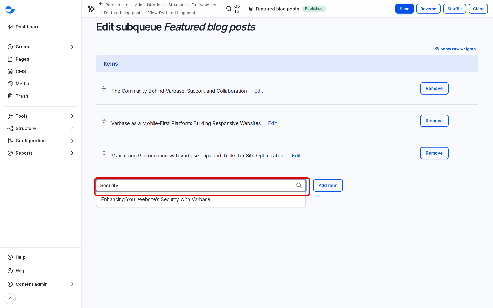

# Add Items to a Queue

This page shows how to add content to an existing EntityQueue and put it in the right place. See [EntityQueues](./) for what queues are.

## Adding Items From the Queue

1. Go to **Structure** \ **Entityqueues** (`/admin/structure/entityqueue`) and click **Edit items** next to the queue.
2. In the empty field at the end of **Items**, start typing the title of the content.
3. Pick it from the suggestions.
4. To add more, click **Add item** and repeat.
5. Drag the new items to their place in the list.
6. Click **Save**.

<!-- <figure><figcaption>
Adding an Item to a Queue
</figcaption></figure> -->

The change shows wherever the queue is displayed on the site.

## Adding an Item From the Content

Content that a queue accepts has an **Entityqueue** tab. Open the item, click the tab, and click **Add to queue** next to the queue.

## Tips

- If an item does not appear in the suggestions, the queue may not accept that kind of content, for example a queue of blog posts does not accept pages.
- A queue can have a maximum number of items. Remove one before adding another if it is full.
- Put the most important item first; the site shows items in queue order.
