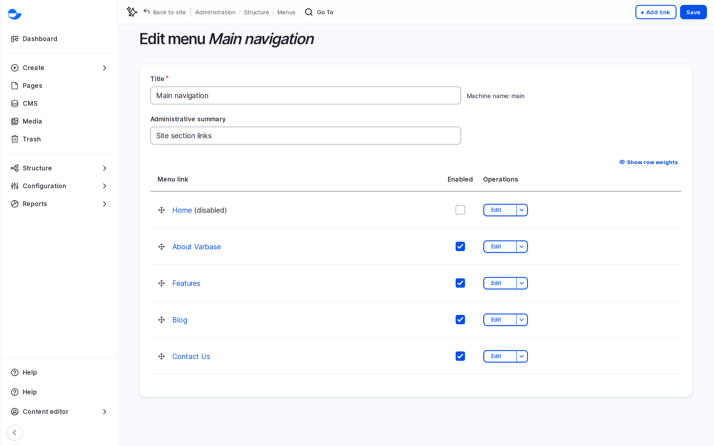

# Menu Management

Menus are the sets of links visitors use to move around your site: the main menu in the header, the footer links and the social media links. This page lists the menus on a Varbase site and the basics of managing them.

## Menus on a Varbase Site

| Menu | Where it shows |
| --- | --- |
| **Main navigation** | The main menu in the site header. |
| **Footer** | Links in the footer, such as **Privacy policy** and **Terms and Conditions**. |
| **Secondary menu** | The footer link groups, such as **Support** and **Quicklinks**. |
| **Social media menu** | The social network links in the footer. |
| **User account menu** | Account links, such as **Log in** and **My account**. |

The **Administration**, **Content**, **Tools**, **Top tasks** and **Navigation user links** menus drive the administration screens. Leave them to your site administrator.

## Opening a Menu

1. Go to **Structure** \ **Menus** (`/admin/structure/menu`).
2. Click **Edit menu** next to the menu.

<figure><figcaption>
The Main Navigation Menu
</figcaption></figure>

The form lists every link in order, with sub-items indented under their parent.

## Key Ideas

- **Menu link**: one link, with a title and a destination.
- **Parent link**: a link can sit under another to make a drop-down.
- **Weight**: the order among links at the same level. Dragging sets it for you.
- **Enabled**: an unticked link stays in the menu but is hidden from visitors.

## Who Can Manage Menus

The **Content editor**, **Content Admin**, **SEO Admin** and **Site Admin** roles can manage the site menus.

## In This Section

- [Add Menu Items](add-menu-items.md)
- [Update Menu Items](update-menu-items.md)
