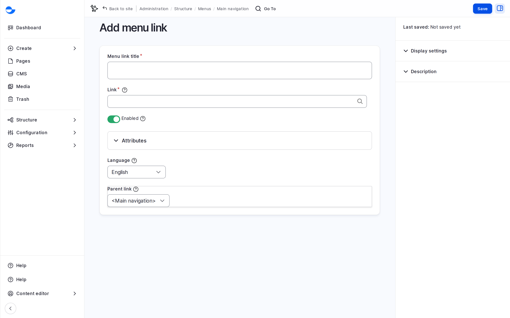
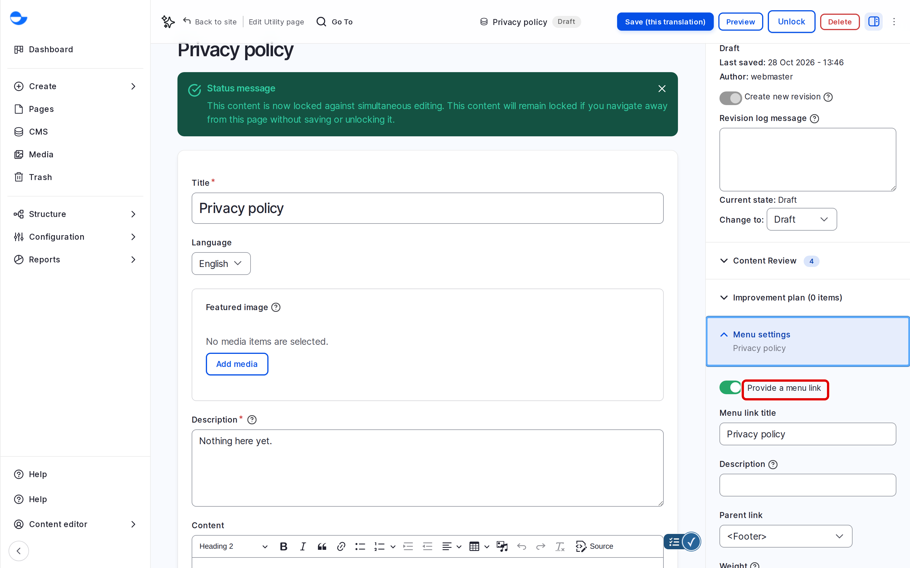

# Add Menu Items

This page shows how to add a link to a menu, either from the menu itself or from a utility page's form.

## Adding a Link From the Menu

1. Go to **Structure** \ **Menus** and click **Edit menu** next to the menu, for example **Main navigation**.
2. Click **Add link**.
3. Fill in the form:
   - **Menu link title**: the text visitors see.
   - **Link**: start typing the title of a page on your site and pick it, or enter a full address such as `https://example.com`. Use `<front>` for the home page, or `<nolink>` for a heading that only opens a drop-down.
   - **Enabled**: leave ticked to show the link.
   - **Description**: optional text shown when visitors hover over the link.
   - **Show as expanded**: tick to always show this link's sub-items.
   - **Parent link**: choose where the link sits; keep the menu name for a top-level link.
   - **Weight**: optional; you can drag to reorder later.
4. Click **Save**.

<figure><figcaption>
The Add Menu Link Form
</figcaption></figure>


Under **Attributes**, you can also set the **Link target** (for example, to open the link in a new tab) and other options. Leave them empty unless you need them.


## Adding a Link From a Utility Page

1. Create or edit a **Utility page**.
2. In the sidebar, open **Menu settings** and tick **Provide a menu link**.
3. Enter the **Menu link title** and choose the **Parent link** in **Main navigation** or **Footer**.
4. Save the page.

<figure><figcaption>
Adding a Menu Link From a Utility Page
</figcaption></figure>

Blog posts and Drupal Canvas pages do not have **Menu settings**; add their links from the menu.

## Tips

- Keep link titles short; the main menu has limited room, especially on phones.
- Use at most two levels: a link and its sub-items.
- Check the menu on the site after saving, including on a phone.
