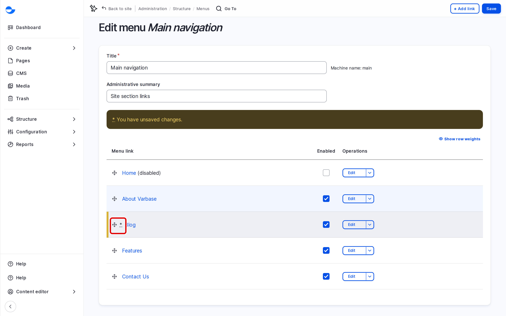

# Update Menu Items

This page shows how to reorder, edit, hide and delete the links in a menu.

## Reordering Links

1. Go to **Structure** \ **Menus** and click **Edit menu** next to the menu.
2. Drag a link by its handle:
   - up or down to change the order,
   - to the right to place it under the link above,
   - to the left to move it up a level.
3. Click **Save**.

<!-- <figure><figcaption>
Reordering Menu Links
</figcaption></figure> -->

The new order is not kept until you click **Save**. You can also click **Show row weights** to type the order as numbers.

## Editing a Link

1. On the menu form, click **Edit** next to the link.
2. Change the **Menu link title**, **Link**, **Parent link** or other fields.
3. Click **Save**.

## Hiding a Link

Untick **Enabled** next to the link on the menu form and click **Save**. The link stays in the menu for later, but visitors do not see it.

## Deleting a Link

1. On the menu form, open the list next to **Edit** and choose **Delete**.
2. Click **Delete** to confirm.

Deleting a link does not delete the page it points to.

## Tips

- Hide rather than delete a link you will need again, such as a seasonal campaign.
- Moving or deleting a parent link also affects its sub-items.
- If a change does not show on the site, reload the page. If it still does not show, ask your site administrator to clear the cache. See [Clearing Cache](../../site-configuration/system/clearing-cache.md).
