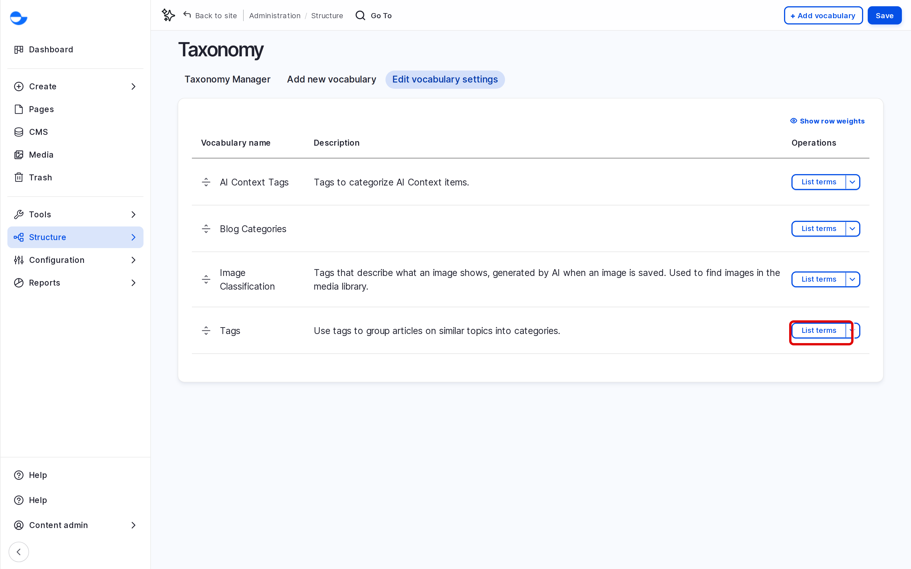

# Taxonomies

Taxonomies group content so visitors can find related items: a blog post can have a category and several tags, and each one links to a list of everything else that shares it. This page explains vocabularies and terms on a Varbase site.

## Vocabularies and Terms

- A **vocabulary** is a set of labels for one purpose, such as **Tags**.
- A **term** is one label in it, such as **Security** or **Multilingual**.

A Varbase site has these vocabularies:

| Vocabulary | Used for |
| --- | --- |
| **Blog Categories** | The single category of a blog post, chosen from a list. |
| **Tags** | Free keywords on blog posts and utility pages. |
| **Image Classification** | Labels for images in the media library. |
| **AI Context Tags** | Labels used by the AI tools. Managed by your site administrator. |

Each term has its own page on the site listing the content that uses it.

## Opening a Vocabulary

1. Go to **Structure** \ **Taxonomy** (`/admin/structure/taxonomy`).
2. Click **List terms** next to the vocabulary.

<!-- <figure><figcaption>
The Vocabularies
</figcaption></figure> -->

## Using Terms in Content

- **Categories**: choose one from the list in the blog post form.
- **Tags**: type a tag and pick it from the suggestions, or type a new one and press **Enter** to add it. New tags are created when you save the content.

## Who Can Do What

| Task | Content editor | Content Admin | Site Admin |
| --- | --- | --- | --- |
| Add terms | Yes | Yes | Yes |
| Edit tags | Yes | Yes | Yes |
| Edit categories | No | Yes | Yes |
| Reorder categories | Yes | Yes | Yes |
| Delete terms | No | Yes | Yes |

An **SEO Admin** can add terms and edit tags.

## In This Section

- [Add Terms](add-terms.md)
- [Reorder and Edit Terms](reorder-and-edit-terms.md)
