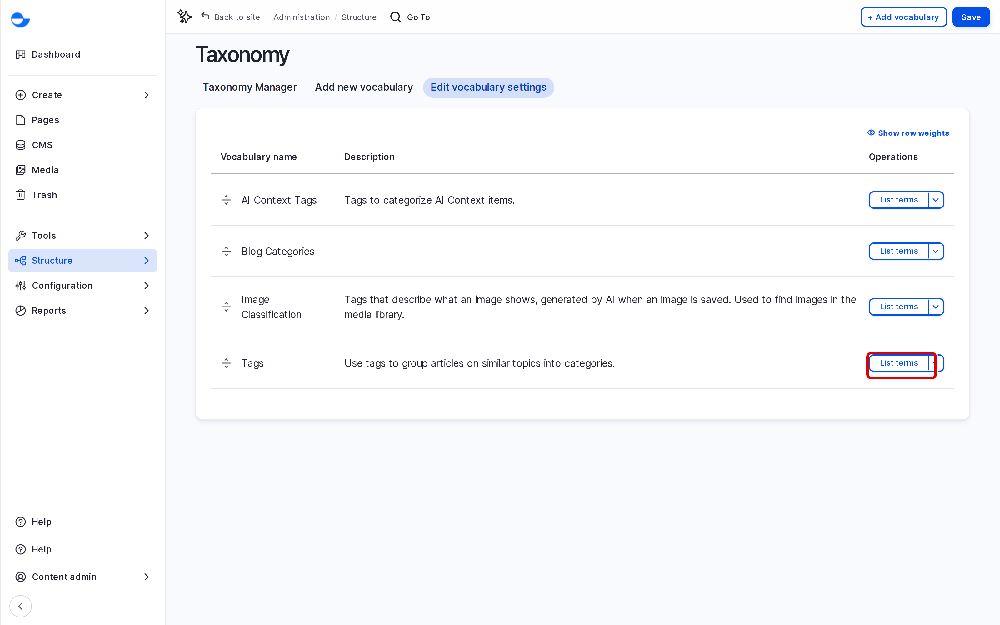
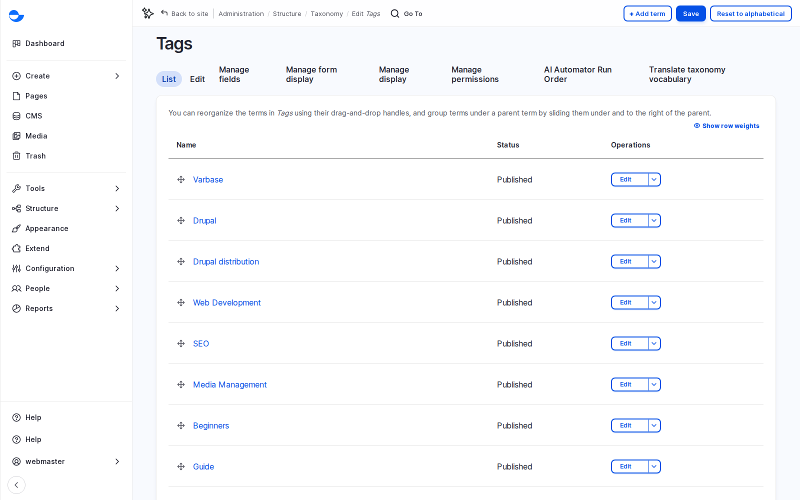

# Taxonomies

Taxonomies group content so visitors can find related items: a blog post can have a category and several tags, and each one links to a list of everything else that shares it. This page explains vocabularies and terms on a Varbase site.

## Vocabularies and Terms

- A **vocabulary** is a set of labels for one purpose, such as **Tags**.
- A **term** is one label in it, such as **Security** or **Multilingual**.

A Varbase site has these vocabularies:

| Vocabulary | Used for |
| --- | --- |
| **Blog Categories** | The single category of a blog post, chosen from a list. |
| **Tags** | Free keywords on blog posts and utility pages. |
| **Image Classification** | Labels for images in the media library. |
| **AI Context Tags** | Labels used by the AI tools. Managed by your site administrator. |

Each term has its own page on the site listing the content that uses it.

## Opening a Vocabulary

1. Go to **Structure** \ **Taxonomy** (`/admin/structure/taxonomy`).
2. Click **List terms** next to the vocabulary.

<figure><figcaption>
The Vocabularies
</figcaption></figure>

## Using Terms in Content

- **Categories**: choose one from the list in the blog post form.
- **Tags**: type a tag and pick it from the suggestions, or type a new one and press **Enter** to add it. New tags are created when you save the content.

## Tags or Categories

- **Tags** are open: editors add a new tag while writing, and the list grows. Use them for the long tail of details that help search and related content.
- **Categories** are controlled: a short, stable list managed by a few people, for the main ways visitors browse, such as topics or departments.

Many sites use both. Each term has its own page listing the content tagged with it, and terms power filters such as the tags filter on the search page. Whatever the choice, someone must own each vocabulary.

<figure><figcaption>
Terms in the Tags Vocabulary
</figcaption></figure>

### Managing Many Terms

For larger vocabularies, the **Taxonomy Manager** (the **Taxonomy Manager** tab on **Structure** \ _**Taxonomy**_) shows terms as a tree, and can add several terms at once, move them under a new parent, search them, delete unused ones and **Export CSV**. Exporting is a simple way to review a vocabulary with the client's content lead before deciding what to merge. Keep hierarchies shallow.

With the AI recipes, **Suggest tags** on the content form proposes tags from the existing list, which keeps tagging consistent. See [AI Tools in the Editor](../../ai-in-varbase/ai-tools-in-the-editor.md).

## Who Can Do What

| Task | Content editor | Content Admin | Site Admin |
| --- | --- | --- | --- |
| Add terms | Yes | Yes | Yes |
| Edit tags | Yes | Yes | Yes |
| Edit categories | No | Yes | Yes |
| Reorder categories | Yes | Yes | Yes |
| Delete terms | No | Yes | Yes |

An **SEO Admin** can add terms and edit tags.

## In This Section

- [Add Terms](add-terms.md)
- [Reorder and Edit Terms](reorder-and-edit-terms.md)
