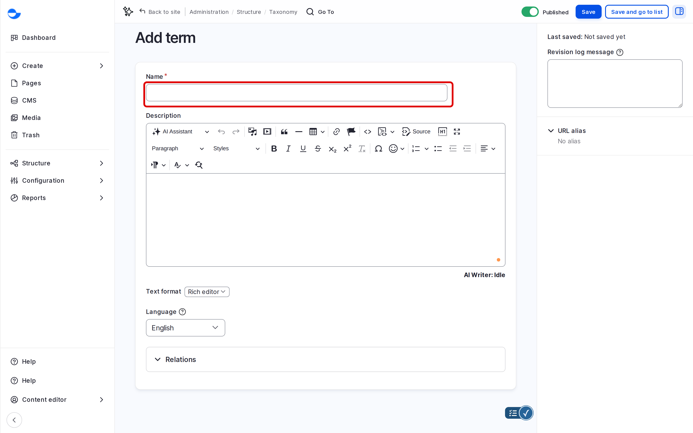
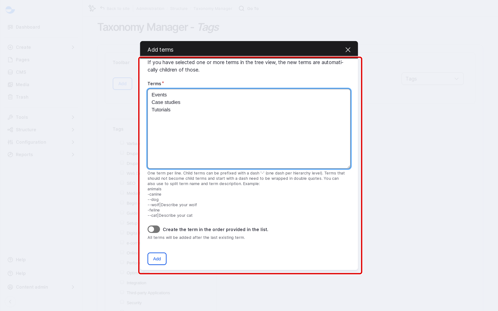

# Add Terms

This page shows how to add terms to a vocabulary: one at a time, several at once, or while writing content.

## Adding One Term

1. Go to **Structure** \ **Taxonomy** and click **List terms** next to the vocabulary, for example **Tags**.
2. Click **Add term**.
3. Fill in the form:
   - **Name** (required): the label, as visitors will see it.
   - **Description**: optional; may show on the term's page.
   - **Relations**: optional; choose a parent term to place it under.
   - **URL alias**: optional; a readable address for the term's page, such as `/tags/security`. Leave it empty to use the default address.
   - **Published**: leave ticked to show the term on the site.
4. Click **Save**.

<!-- <figure><figcaption>
Adding a Term
</figcaption></figure> -->

## Adding Several Terms With Taxonomy Manager

**Taxonomy Manager** shows a vocabulary as a tree and adds many terms at once.

1. Go to **Structure** \ **Taxonomy manager** (`/admin/structure/taxonomy_manager/voc`) and click the vocabulary.
2. Click **Add**.
3. Type one term per line, and choose a parent if needed.
4. Click **Add**.

<!-- <figure><figcaption>
Adding Terms With Taxonomy Manager
</figcaption></figure> -->

## Adding a Tag While Writing

In a blog post or utility page, type a new tag in **Tags** and press **Enter**. The tag is created when you save the content.

## Tips

- Search the vocabulary first, so you do not add a second "SEO" next to "Seo".
- Use one style: for example, capitalise each tag the same way.
- Prefer a few well-used tags to many tags used once.
