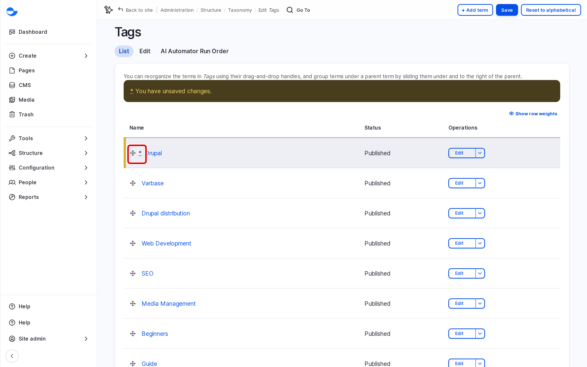

# Reorder and Edit Terms

This page shows how to change the order of terms, rename them and delete the ones you no longer need.

## Reordering Terms

1. Go to **Structure** \ **Taxonomy** and click **List terms** next to the vocabulary.
2. Drag a term by its handle: up or down to change the order, to the right to place it under the term above, to the left to move it up a level.
3. Click **Save**.

<!-- <figure><figcaption>
Reordering Terms
</figcaption></figure> -->

The order is used in lists, such as the **Categories** choice in the blog post form. Click **Reset to alphabetical** to sort the terms by name again.

## Editing a Term

1. In the term list, click **Edit** next to the term.
2. Change the **Name**, **Description**, parent or **URL alias**.
3. Click **Save**.

A new name shows everywhere the term is used; you do not need to edit the content.

## Deleting a Term

1. In the term list, open the list next to **Edit** and choose **Delete**.
2. Click **Delete** to confirm.

The term, and any terms under it, go to the **Trash**, where they can be restored. See [Trash](../../content-workflow/trash.md).

## Tips

- Merge duplicates by moving content to one term, then deleting the other.
- Review the tag list from time to time and remove tags used only once.
