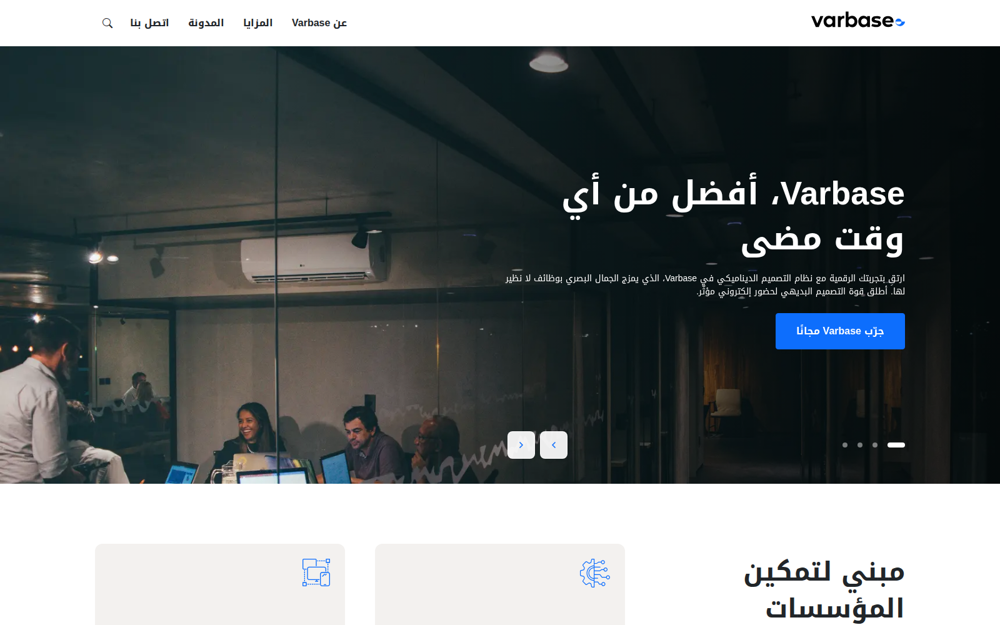
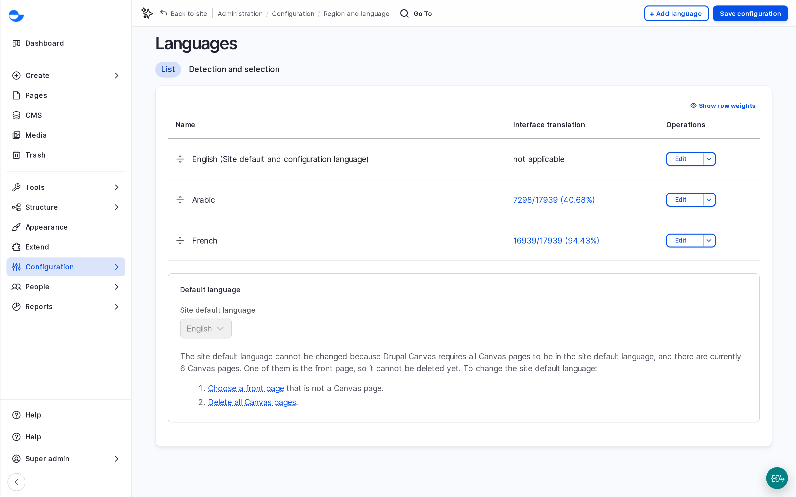
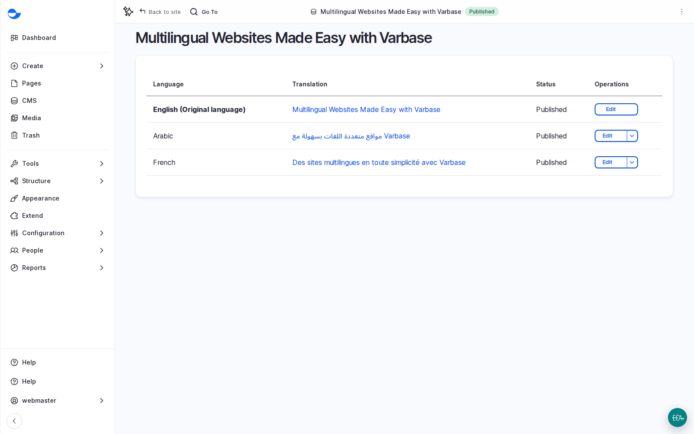
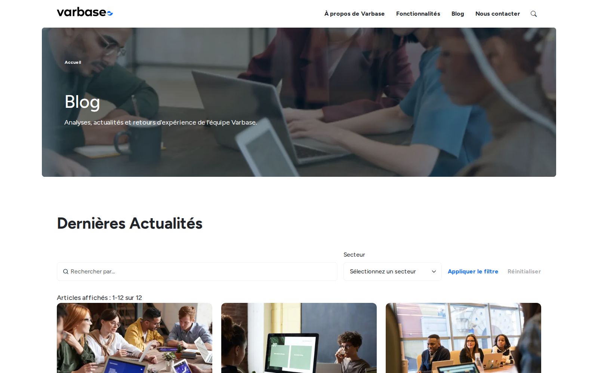

# Multilingual and Right to Left

A multilingual Varbase site shows each page, post, menu and image in the visitor's language, and mirrors the whole layout for right-to-left languages such as Arabic. You write the content once in its original language, then add a translation for each other language. This section explains how translation works, how visitors switch languages, and how to plan a multilingual project. Full right-to-left support is one of Varbase's strongest differentiators, especially for Gulf and MENA clients.

<!-- TODO(lesson-13-video): when the unlisted upload exists, replace the hint block below with an embed block for its https://youtu.be/ link, captioned "Lesson 13: Multilingual and Right to Left (Video)". -->

**Lesson 13 video: coming soon.** It will appear here and in the [Varbase: Content Designers playlist](https://www.youtube.com/playlist?list=PLRf-g9-Bc-LI).


<figure><figcaption>
The Arabic Home Page, Mirrored Right to Left
</figcaption></figure>

## Why It Matters

- One site, one team, several audiences: no separate sites to keep in sync.
- Right to left that works out of the box saves weeks of front-end fixes.
- Each translation is published on its own, so languages can launch in stages.

## Three Kinds of Translation

| Kind | Covers | Where |
| --- | --- | --- |
| **Content** | Posts, pages, media, terms: the words editors write | The **Translate** tab, or **Translate** in the Canvas editor |
| **Interface** | Words the software shows: buttons, labels, messages | Downloaded from the Drupal community; the rest under **Configuration** \ **Region and language** \ _**User interface translation**_ |
| **Configuration** | Words in settings: site name and slogan, menu link titles, form labels and messages, email templates | The **Translate** operation on each item |

Configuration translation is the one most often forgotten: a contact form or an account email that greets an Arabic visitor in English undermines trust.

## What Can Be Translated

| What | How |
| --- | --- |
| **Blog posts and utility pages** | The **Translate** tab of the item. See [Translating Content](translating-content.md). |
| **Drupal Canvas pages** | **Translate** in the Canvas editor. See [Translating a Page](../building-pages-with-drupal-canvas/translating-a-page.md). |
| **Media, taxonomy terms and menu links** | The **Translate** tab of each item, the same way as blog posts. |

## Languages and Addresses

The site's main language has no prefix in the address. Each other language adds its code, for example:

- English: `https://example.com/about-varbase`
- Arabic: `https://example.com/ar/about-varbase`
- French: `https://example.com/fr/about-varbase`

<figure><figcaption>
The Site Languages
</figcaption></figure>

The list of languages is at **Configuration** \ **Region and language** \ _**Languages**_ (`/admin/config/regional/language`). Adding a language is a **Super Admin** task. Multilingual support comes from the **Varbase Internationalization Base** recipe; see [Varbase Internationalization Base](../../developers/understanding-varbase/varbase-recipes/varbase-i18n-base.md).

## Scenario: Translate a Blog Post

1. Open the post and click its **Translate** tab. Each language is listed with its status.
2. Click **Add** for the target language. The form opens filled with the original; replace the text field by field. Shared fields, such as a non-translatable image, stay the same.
3. On Arabic, the form and the editor switch to right to left. Use the direction buttons to mark an English product name inside an Arabic sentence.
4. Save it as a draft. Each translation has its own workflow state: the English original can be published while the French version is still a draft.
5. Publish when a native speaker has reviewed it. See [Translating Content](translating-content.md).

<figure><figcaption>
The Translate Tab: Three Published Versions
</figcaption></figure>

Content does not have to start in the default language: set **Language** on the form, and an Arabic team can publish in Arabic first.

Drupal Canvas pages have their own translation workspace, with every page in every language, its status (not translated, draft, up to date, outdated) and how complete it is. See [Translating a Page](../building-pages-with-drupal-canvas/translating-a-page.md).

<figure><figcaption>
The French Blog Listing
</figcaption></figure>

## Right to Left Is More Than Translation

Varbase mirrors menus, cards, directional icons and forms for Arabic. Check fonts that support Arabic script, numbers, dates and mixed-direction text, and test every new component in right to left, not only pages.

## AI and Translation

The editor's AI translate action is off by default and can be switched on. An editor can also ask the assistant to rewrite a passage in another language as a first draft. Agree a rule: AI drafts are saved as drafts with a revision note saying so, and a native speaker publishes them.

## Who Can Translate

The **Content editor**, **Content Admin**, **SEO Admin** and **Site Admin** roles can add and update translations. Only a **Site Admin** or **Super Admin** can delete a translation.

## Questions Clients Ask

- **Can we change the default language later?** Plan it up front. While Drupal Canvas pages exist in the default language, the **Languages** screen does not let you change it.
- **Can visitors switch language?** Yes, with the **Language switcher** component, placed in the header in Drupal Canvas. Decide where it goes and whether it shows languages without a translation. See [Language Switcher](language-switcher.md).

## Planning Notes

- Ask in discovery: which languages at launch and later; all content or some sections; who translates and reviews (in-house or agency); how fast translations follow a change; how addresses are written per language.
- Decide what happens when a page has no translation: a fallback, a notice, or a link to the other language.
- Estimate by arithmetic: words of content, interface and configuration, times languages, plus review. AI drafts cut translation time, not review time. Remember the ongoing cost of every new post.
- Give every translator a glossary of the organisation's key terms in each language.
- Consider a translator role that can translate but not create or publish.
- Test each template and page in each language, moving between languages, search, forms and emails, with native speakers.

## In This Section

- [Translating Content](translating-content.md)
- [Language Switcher](language-switcher.md)


**Check Yourself**

1. What are the three kinds of translation, and which one is most often forgotten?
2. Can the English version of a post be published while its Arabic version is still a draft?
3. What does the Drupal Canvas translation workspace show for each page and language?

