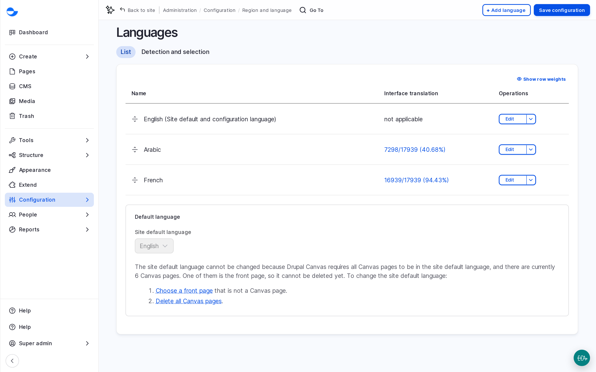

# Content Translation

A multilingual Varbase site shows each page, post, menu and image in the visitor's language. You write the content once in the main language, then add a translation for each other language. This section explains how translation works and how visitors switch languages.

## What Can Be Translated

| What | How |
| --- | --- |
| **Blog posts and utility pages** | The **Translate** tab of the item. See [Translating Content](translating-content.md). |
| **Drupal Canvas pages** | **Translate** in the Canvas editor. See [Translating a Page](../building-pages-with-drupal-canvas/translating-a-page.md). |
| **Media, taxonomy terms and menu links** | The **Translate** tab of each item, the same way as blog posts. |

## Languages and Addresses

The site's main language has no prefix in the address. Each other language adds its code, for example:

- English: `https://example.com/about-varbase`
- Arabic: `https://example.com/ar/about-varbase`
- French: `https://example.com/fr/about-varbase`

<!-- <figure><figcaption>
The Site Languages
</figcaption></figure> -->

The list of languages is at **Configuration** \ **Region and language** \ _**Languages**_ (`/admin/config/regional/language`). Adding a language is a **Super Admin** task. Multilingual support comes from the **Varbase Internationalization Base** recipe; see [Varbase Internationalization Base](../../developers/understanding-varbase/varbase-recipes/varbase-i18n-base.md).

## Who Can Translate

The **Content editor**, **Content Admin**, **SEO Admin** and **Site Admin** roles can add and update translations. Only a **Site Admin** or **Super Admin** can delete a translation.

## In This Section

- [Translating Content](translating-content.md)
- [Language Switcher](language-switcher.md)
