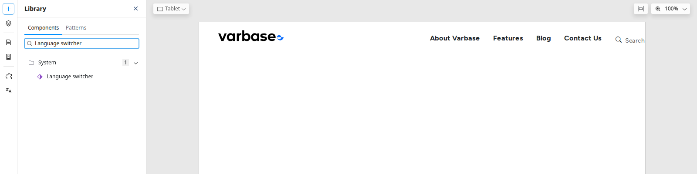

# Language Switcher

The language switcher lets visitors move between the translations of the page they are on. This page explains how it behaves and how it is added to the site.

## How It Works

The switcher lists the site's languages. Choosing one opens the same page in that language, for example from `/about-varbase` to `/ar/about-varbase`. If the page has no translation in that language, the visitor sees the original content with the interface in the chosen language.

## Adding the Switcher to the Header

On a Varbase site the switcher is a **Language switcher** component in the header of the page template. A **Site Admin** or **Super Admin** adds it:

1. Open any page in the Drupal Canvas editor.
2. Click **Templates**, then **Vartheme\_bs5 theme** under **Page templates**.
3. Click **Library** and search for `Language switcher`. It is in the **System** group. Drag it into the **Header**, for example next to the search.
4. Publish the page template.

<figure><figcaption>
Finding the Language Switcher in the Library
</figcaption></figure>

The switcher then shows on every page. See [Page Templates](../building-pages-with-drupal-canvas/page-templates.md).

## For Search Engines

Each page also tells search engines about its other language versions, so they show visitors the right one. This happens automatically.

## Tips

- Ask your site administrator to name each language in its own script, such as العربية and Français, so visitors recognise their language.
- Test the switcher on a page with translations and on one without.
