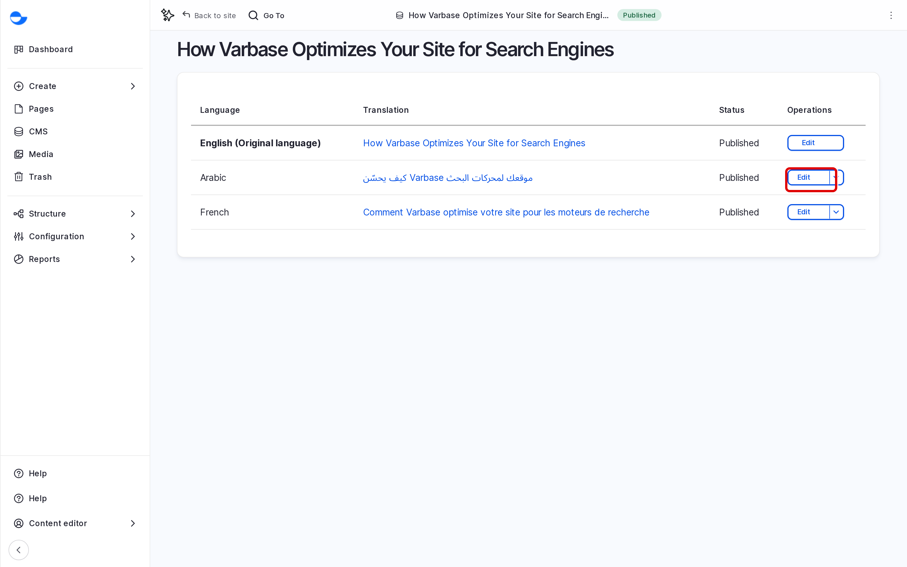
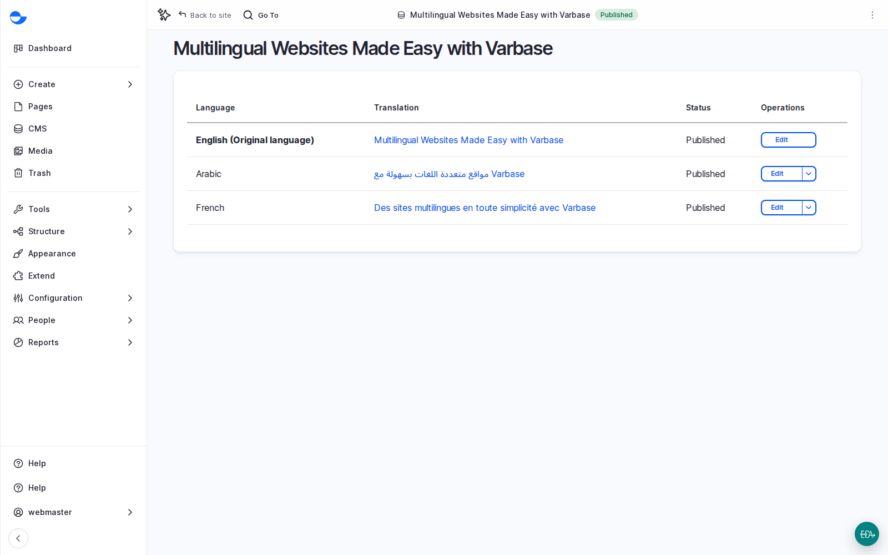

# Translating Content

This page shows how to translate a blog post or utility page. The same steps work for media, taxonomy terms and menu links. On some sites, **Remote audio** media have no **Language** field and cannot be translated. For Drupal Canvas pages, see [Translating a Page](../building-pages-with-drupal-canvas/translating-a-page.md).

## Adding a Translation

1. Open the item and click the **Translate** tab (for example `/node/6/translations`).

   The table lists each language in the **Language**, **Translation**, **Status** and **Operations** columns: the original language, **Not translated**, or the existing translation.

   <figure><figcaption>
The Translate Tab
</figcaption></figure>

2. Click **Add** next to the language.
3. The form opens with the original text. Replace it with the translation, field by field. Shared fields, such as a non-translatable image, stay the same:
   - **Title**, **Description** and **Content**.
   - The **SEO title** and **SEO description**, so search results show the right language.
   - The **URL alias**, if you want a translated address.
   - Images stay the same unless you choose another one for this language.
4. On Arabic, the form and the editor switch to right to left. Use the direction buttons in the editor to mark an English product name inside an Arabic sentence.
5. Choose the state in **Save as**. Save it as a **Draft** until a native speaker has reviewed it, then publish.
6. Click **Save**.


On some sites, saving the Arabic translation of a blog post as a **Content editor** fails with "Non-translatable fields can only be changed when updating the original language." The translation is not saved; ask a **Site Admin** to check the post.


Every edit form, including a translation, shows "This content is now locked against simultaneous editing…". It is a notice, not an error: it tells other editors you have the item open.
<!-- <figure><figcaption>
Translating a Blog Post Into Arabic
</figcaption></figure> -->

<figure><figcaption>
The Translate Tab: Three Published Versions
</figcaption></figure>

Content does not have to start in the default language: set **Language** on the form, and an Arabic team can publish in Arabic first.

## Editing a Translation

1. Open the item and click the **Translate** tab.
2. Click **Edit** next to the language.
3. Change the text and click **Save**.

## Translations and the Workflow

Each translation has its own state. You can publish the English post and keep the Arabic one as a **Draft** until it is checked. See [Content Workflow](../content-workflow/).

## Tips

- After changing the original, update every translation; the site does not do it for you.
- Keep a short list of how your key terms are translated, so all editors use the same words.
- Check right-to-left languages such as Arabic on the site, especially lists, tables and links.
