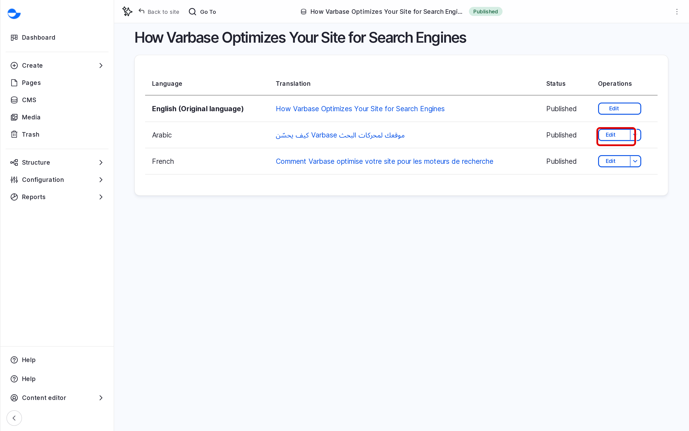

# Translating Content

This page shows how to translate a blog post or utility page. The same steps work for media, taxonomy terms and menu links. For Drupal Canvas pages, see [Translating a Page](../building-pages-with-drupal-canvas/translating-a-page.md).

## Adding a Translation

1. Open the item and click the **Translate** tab.

   The table lists each language with its status: the original language, **Not translated**, or the existing translation.

   <figure><figcaption>
The Translate Tab
</figcaption></figure>

2. Click **Add** next to the language.
3. The form opens with the original text. Replace it with the translation:
   - **Title**, **Description** and **Content**.
   - The **SEO title** and **SEO description**, so search results show the right language.
   - The **URL alias**, if you want a translated address.
   - Images stay the same unless you choose another one for this language.
4. Choose the state in **Save as**, for example **Draft** or **Published**.
5. Click **Save**.

<!-- <figure><figcaption>
Translating a Blog Post Into Arabic
</figcaption></figure> -->

## Editing a Translation

1. Open the item and click the **Translate** tab.
2. Click **Edit** next to the language.
3. Change the text and click **Save**.

## Translations and the Workflow

Each translation has its own state. You can publish the English post and keep the Arabic one as a **Draft** until it is checked. See [Content Workflow](../content-workflow/).

## Tips

- After changing the original, update every translation; the site does not do it for you.
- Keep a short list of how your key terms are translated, so all editors use the same words.
- Check right-to-left languages such as Arabic on the site, especially lists, tables and links.
