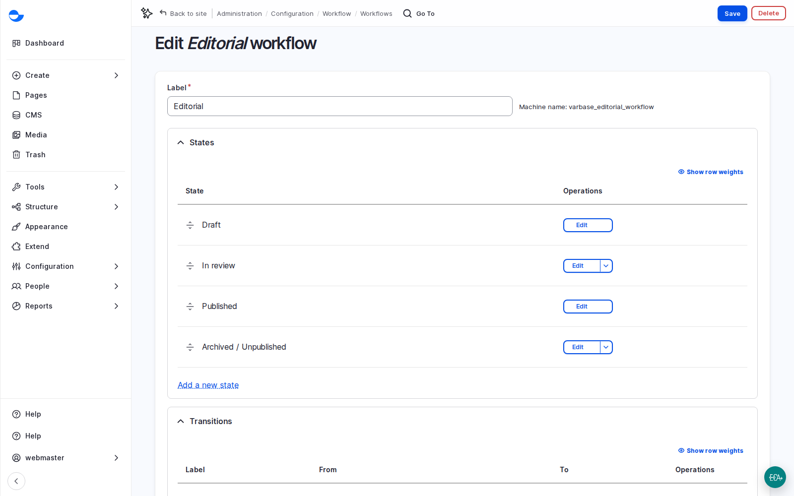
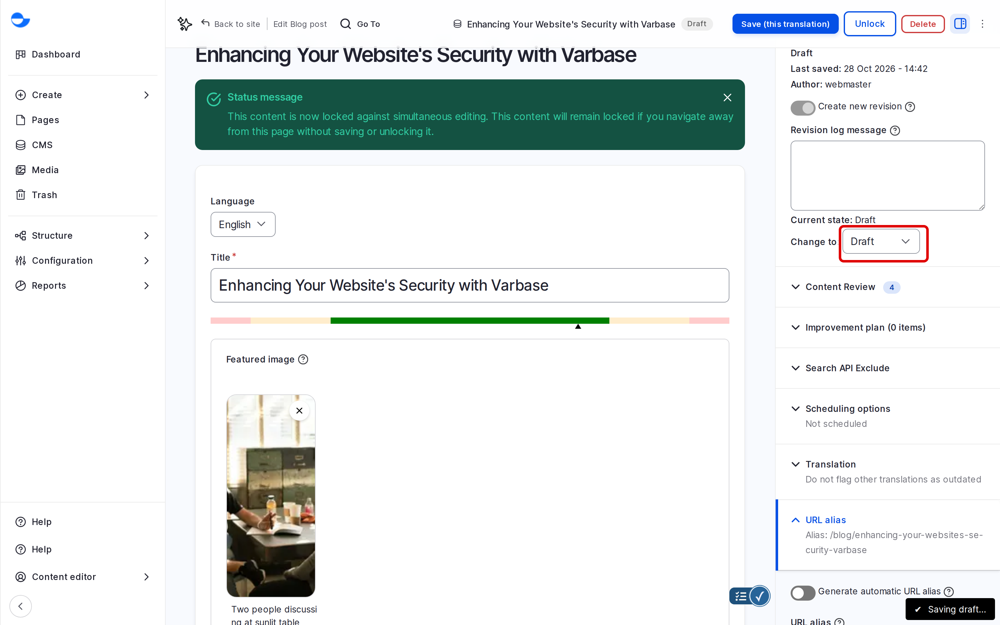
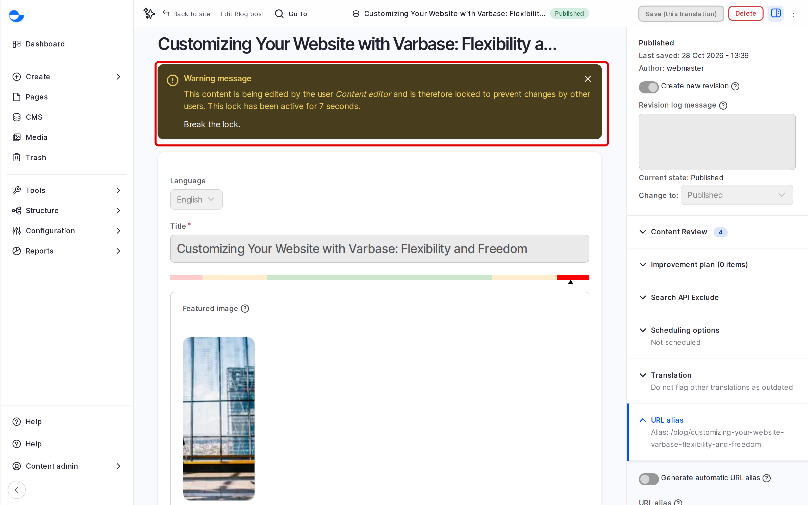
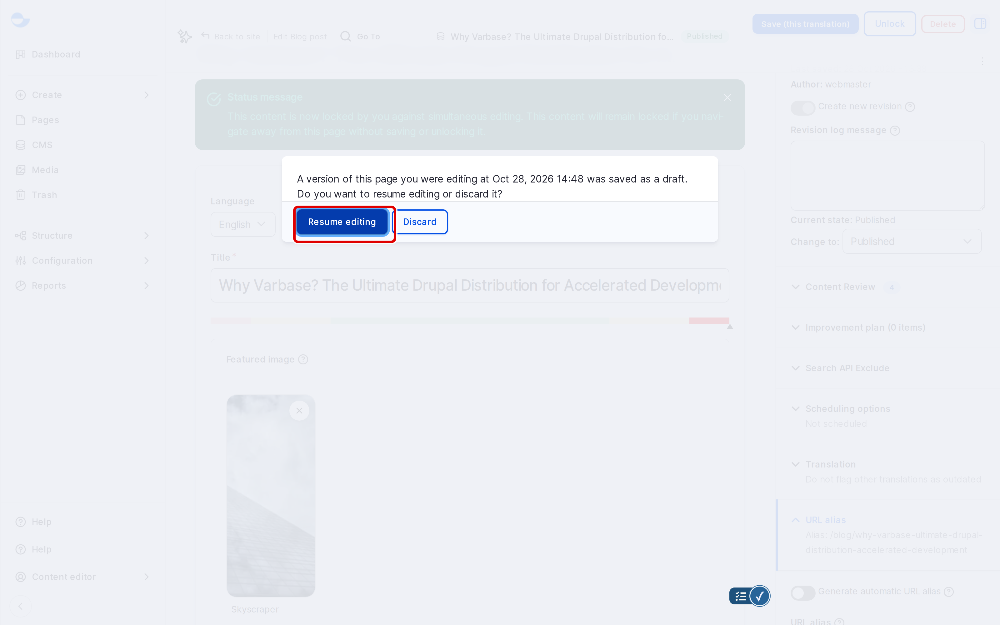
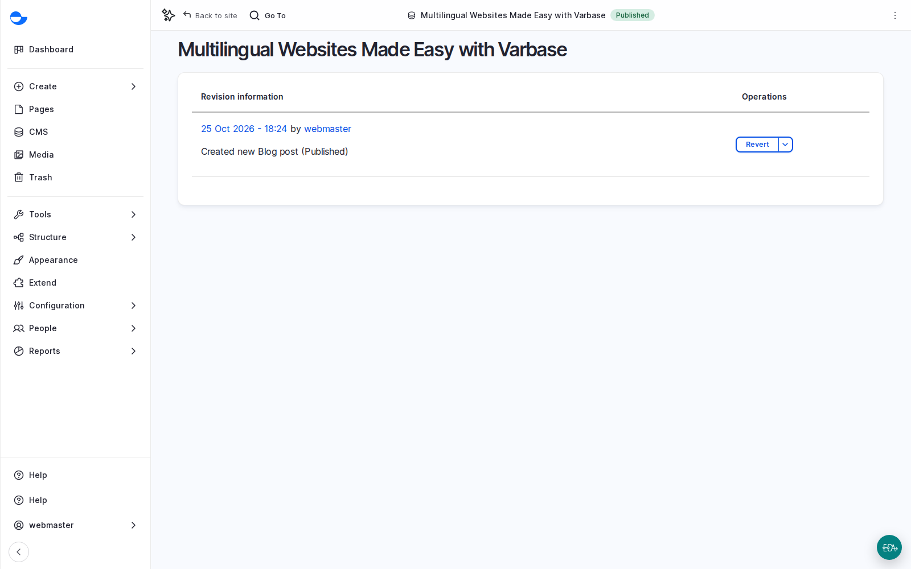
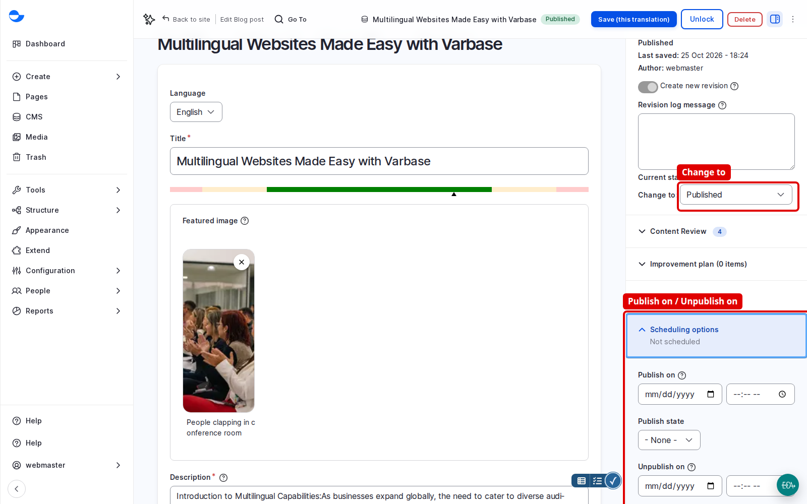

# Content Workflow

Varbase moves blog posts and utility pages through a publishing workflow, so nothing reaches visitors before it is ready. This page explains the states, who can change them, revisions, scheduling, the Trash, and the two safety features that protect your work while you edit: content locking and autosave. The workflow is where a website meets an organisation's way of working.

Watch the lesson: [Editorial Workflow](../varbase-content-designers-course/lesson-06-editorial-workflow.md) in the [Varbase: Content Designers Course](../varbase-content-designers-course/).

## Why It Matters

- **Separation of duties** when the client needs it: one permission decides whether editors publish themselves or send to a reviewer.
- **Campaign timing** without someone online at midnight: publish and unpublish on a date.
- **Recoverable mistakes**: revert a revision, restore from the Trash.
- **A record**: every save, note and state change is kept, which public-sector clients often require.

## Moderation States

**Blog post** and **Utility page** use the **Editorial** workflow, which has four states:

| State | Visible to visitors | Use it for |
| --- | --- | --- |
| **Draft** | No | Content you are still writing. |
| **In review** | No | Content waiting for someone to check it. |
| **Published** | Yes | Live content. |
| **Archived / Unpublished** | No | Content taken off the site but kept for reference. |

A published item can have a newer draft. Visitors keep seeing the published version until you publish the draft. New content starts as a **Draft**, so nothing goes live because someone clicked **Save** too early.

<figure><figcaption>
The Editorial Workflow and Its Four States
</figcaption></figure>

<figure><figcaption>
The Moderation Block in the Edit Form
</figcaption></figure>

## State Transitions

| Transition | From | To |
|---|---|---|
| **Create new draft** | Draft, In review, Published, Archived / Unpublished | Draft |
| **Send to review** | Draft, In review | In review |
| **Publish** | Draft, In review, Published | Published |
| **Archive / Unpublish** | Published | Archived / Unpublished |
| **Restore from archive** | Archived / Unpublished | Published |

The **Change to** list in the edit form shows only the states the item can move to. For the steps, see [Publish Content](publish-content.md).

To review or change the workflow, go to **Administration** \ **Configuration** \ **Workflow** \ _**Workflows**_ (`/admin/config/workflow/workflows`) and edit **Editorial**.

## Editorial Roles and Permissions

On a new Varbase site, the **Content editor**, **SEO Admin**, **Content Admin** and **Site Admin** roles can use every **Editorial** transition, including **Publish**. **Super Admin** has unrestricted access.

If your team needs a review step before content goes live, remove the **Editorial workflow: Use Publish transition** permission from the roles that should only send content to review. Set this at **Administration** \ **People** \ _**Permissions**_, in the **Content Moderation** group.

See [Default Roles and Site Personas](../user-management/default-roles-and-site-persons/) for details on each role.

## Content Locking and Autosave

### Content Locking

When you open a blog post or utility page for editing, Varbase locks it so no one else can edit it at the same time.

- Another editor who opens it sees a message naming you, and cannot save changes.
- The lock is released when you click **Save**, or **Unlock** at the top of the form.
- A lock left behind ends by itself after 30 minutes.
- A **Content Admin** or **Super Admin** can release someone else's lock with **Break the lock.** in that message, or **Break lock** in the item's **Operations** on the content list.

<figure><figcaption>
An Item Locked by Another Editor
</figcaption></figure>

### Autosave

While a content form is open, Varbase saves a copy of your changes every minute and shows **Saving draft...** for a moment. The copy is private to you; it is not a revision and nobody else sees it.

If you leave the form without saving, the next time you open the item Varbase asks whether to **Resume editing** with that copy or **Discard** it.

<figure><figcaption>
Resuming an Autosaved Draft
</figcaption></figure>

## Revisions

Every save creates a revision. The **Revisions** tab lists them, newest first, with who saved each one, when, and the note they left. Compare two revisions to read only what changed. **Revert** restores an older version as a new revision, so nothing is lost. See [Modify Content](../content-management/modify-content.md#revisions).

To start a new post from an old one, such as this year's event from last year's, use the **Duplicate** tab. See [Duplicate a Post](duplicate-a-post.md).

<figure><figcaption>
Revision History With Revert
</figcaption></figure>

## Scheduling, Archiving and the Trash

- **Schedule** a publish date and an unpublish date in **Scheduling options**. Scheduled times follow the site's time zone, so state it in every instruction to editors in other countries. See [Scheduling Content](scheduling-content.md).
- **Archive** takes content off the site but keeps it and its revisions, and **Restore from archive** brings it back. A visitor following an old link gets a page not found response. Archive rather than delete content that was real.
- **Delete** sends the item to the **Trash**, with tabs for content, files, media, taxonomy terms and pages. Restore it as it was, or delete it for good if your role allows. See [Trash](trash.md).
- **Bulk actions** on the content list apply one action to many items. See [Bulk Edit Content](bulk-edit-content.md).

<figure><figcaption>
Change To and the Scheduling Options in the Sidebar
</figcaption></figure>

## Drupal Canvas Pages Are Different

Drupal Canvas pages do not use the Editorial workflow. Every change in the Canvas editor is a private draft until someone opens **Review changes** and publishes it, and only **Content Admin**, **Site Admin** and **Super Admin** can publish pages. See [Preview and Publish](../building-pages-with-drupal-canvas/preview-and-publish.md).

## In This Section

- [Publish Content](publish-content.md)
- [Scheduling Content](scheduling-content.md)
- [Bulk Edit Content](bulk-edit-content.md)
- [Trash](trash.md)
- [Duplicate a Post](duplicate-a-post.md): start a new post from an old one.
- [Take a Post Through Review](take-a-post-through-review.md): the author sends a post to review, a reviewer publishes it or sends it back.
- [Design the Workflow With a Client](design-the-workflow-with-a-client.md): match the client's way of working to the lightest setup that meets their rules.

## Best Practices

1. **Start with Draft.** Use **Send to review** when someone else should approve the content.
2. **Write revision log messages** that say why the state changed, for example "Approved by editor".
3. **Archive rather than delete** content you may need again.
4. **Save or unlock when you finish**, so colleagues are not locked out.
5. **Review permissions regularly**, so each role has the access your process needs.
