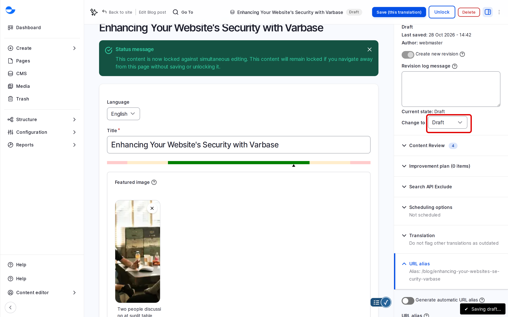
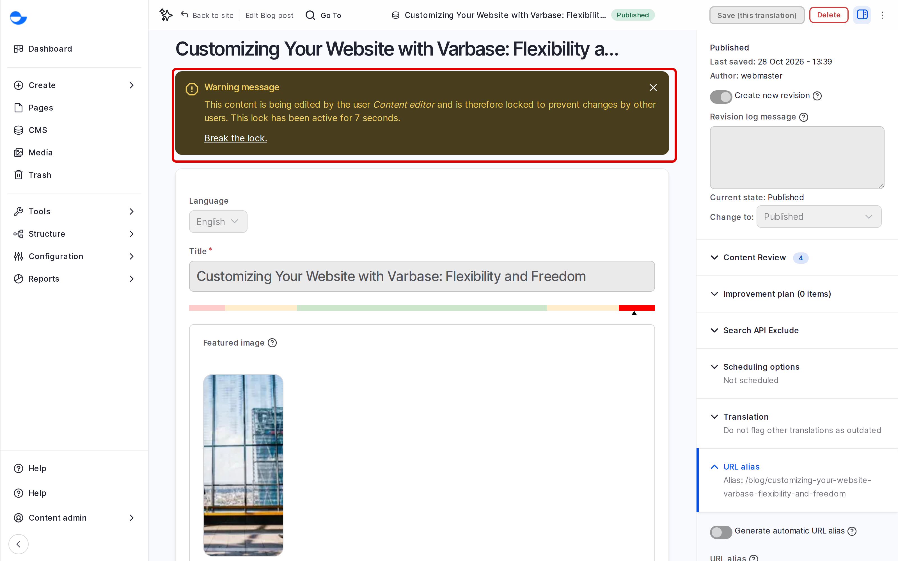
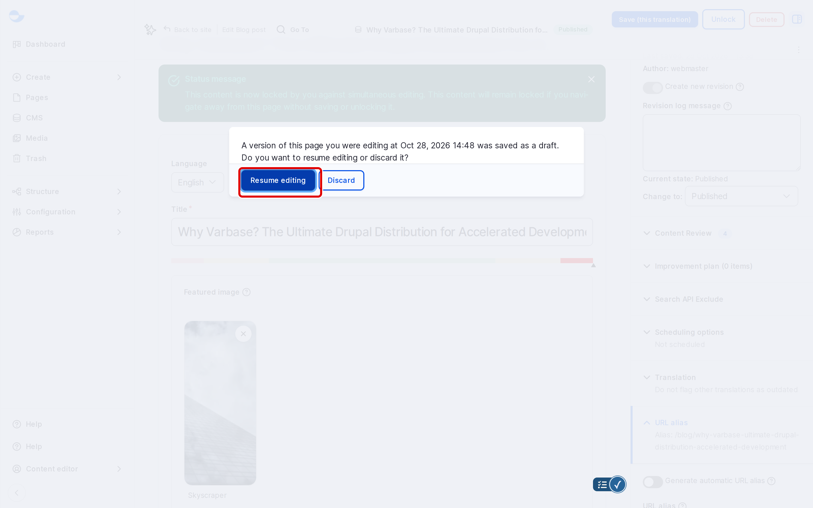

# Content Workflow

Varbase moves blog posts and utility pages through a publishing workflow, so nothing reaches visitors before it is ready. This page explains the states, who can change them, and the two safety features that protect your work while you edit: content locking and autosave.

## Moderation States

**Blog post** and **Utility page** use the **Editorial** workflow, which has four states:

| State | Visible to visitors | Use it for |
| --- | --- | --- |
| **Draft** | No | Content you are still writing. |
| **In review** | No | Content waiting for someone to check it. |
| **Published** | Yes | Live content. |
| **Archived / Unpublished** | No | Content taken off the site but kept for reference. |

A published item can have a newer draft. Visitors keep seeing the published version until you publish the draft.

<figure><figcaption>
The Moderation Block in the Edit Form
</figcaption></figure>

## State Transitions

| Transition | From | To |
|---|---|---|
| **Create new draft** | Draft, In review, Published, Archived / Unpublished | Draft |
| **Send to review** | Draft, In review | In review |
| **Publish** | Draft, In review, Published | Published |
| **Archive / Unpublish** | Published | Archived / Unpublished |
| **Restore from archive** | Archived / Unpublished | Published |

The **Change to** list in the edit form shows only the states the item can move to. For the steps, see [Publish Content](../content-management/publish-content.md).

To review or change the workflow, go to **Administration** \ **Configuration** \ **Workflow** \ _**Workflows**_ (`/admin/config/workflow/workflows`) and edit **Editorial**.


Pages built with **Drupal Canvas** do not use this workflow. Their changes stay unpublished until you click **Publish** in the editor. See [Building Pages With Drupal Canvas](../building-pages-with-drupal-canvas/).


## Editorial Roles and Permissions

On a new Varbase site, the **Content editor**, **SEO Admin**, **Content Admin** and **Site Admin** roles can use every **Editorial** transition, including **Publish**. **Super Admin** has unrestricted access.

If your team needs a review step before content goes live, remove the **Editorial workflow: Use Publish transition** permission from the roles that should only send content to review. Set this at **Administration** \ **People** \ _**Permissions**_, in the **Content Moderation** group.

See [Default Roles and Site Personas](../user-management/default-roles-and-site-persons/) for details on each role.

## Content Locking and Autosave

### Content Locking

When you open a blog post or utility page for editing, Varbase locks it so no one else can edit it at the same time.

- Another editor who opens it sees a message naming you, and cannot save changes.
- The lock is released when you click **Save**, or **Unlock** at the top of the form.
- A lock left behind ends by itself after 30 minutes.
- A **Content Admin** or **Super Admin** can release someone else's lock with **Break the lock.** in that message, or **Break lock** in the item's **Operations** on the content list.

<figure><figcaption>
An Item Locked by Another Editor
</figcaption></figure>

### Autosave

While a content form is open, Varbase saves a copy of your changes every minute and shows **Saving draft...** for a moment. The copy is private to you; it is not a revision and nobody else sees it.

If you leave the form without saving, the next time you open the item Varbase asks whether to **Resume editing** with that copy or **Discard** it.

<figure><figcaption>
Resuming an Autosaved Draft
</figcaption></figure>

## Scheduling and the Trash

- To publish or unpublish at a set time, see [Scheduling Content](scheduling-content.md).
- Deleted items go to the trash, where they can be restored. See [Trash](trash.md).

## Best Practices

1. **Start with Draft.** Use **Send to review** when someone else should approve the content.
2. **Write revision log messages** that say why the state changed, for example "Approved by editor".
3. **Archive rather than delete** content you may need again.
4. **Save or unlock when you finish**, so colleagues are not locked out.
5. **Review permissions regularly**, so each role has the access your process needs.
