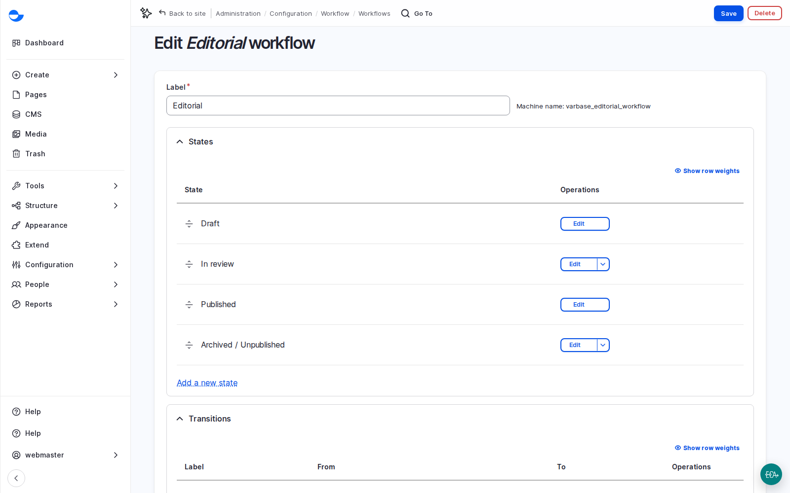

# Design the Workflow With a Client

The workflow is where a website meets an organisation's way of working. Start from how the team publishes today, match it to the lightest Varbase setup that meets their rules, and test it with real posts before launch.

## Steps

1. Ask the team to walk you through the last three things they published: who wrote, who checked, who said yes, and how long it took.
2. Match the pattern you hear:
   - **Everyone publishes**: give **Content editor** the publish transition (as on a new Varbase Starter site).
   - **One reviewer publishes**: keep **Publish** for **Content Admin**; editors use **Send to review**.
   - **Several approvals for some content** (legal, medical, financial): add a state such as legal review, or keep the standard workflow and limit who may publish that content type. Choose the lightest one that meets the rules.
3. Agree how reviewers learn something is waiting (a daily look at the list, or an email notification) and how fast reviews happen.
4. In the first week, have each editor take one real post from draft to published, with the reviewer doing their part. Fix permissions or wording before launch. See [Take a Post Through Review](take-a-post-through-review.md).
5. Hand over a one-page workflow guide: the states, who moves content between them, how reviewers are notified, and the review time.

<figure><figcaption>
The Editorial Workflow and Its Four States
</figcaption></figure>

## Questions Clients Ask

- **Can we have a two-step approval (legal, then brand)?** Yes. Workflows are configuration: add states and transitions and grant them per role. Assumption: one extra review step with notifications is about 1 to 2 days including tests.
- **Do translations follow the same workflow?** Yes, and each translation has its own state.

## Planning Notes

- Resist adding states nobody will use; each extra step slows every post.
- Email notifications for reviewers are a common small request; plan them with the site's automation tools.
- Decide who may empty the Trash and how long items stay.
- Scheduling relies on the site's scheduled tasks (cron) running on every server.
- Drupal Canvas pages do not use this workflow: only **Content Admin**, **Site Admin** and **Super Admin** publish them. Agree that split too. See [Preview and Publish](../building-pages-with-drupal-canvas/preview-and-publish.md).
