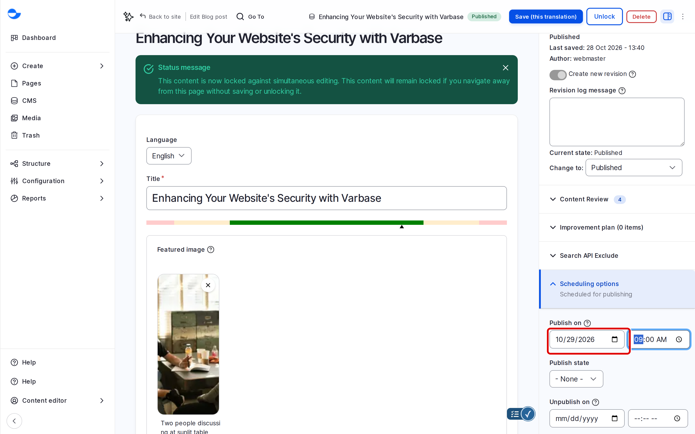
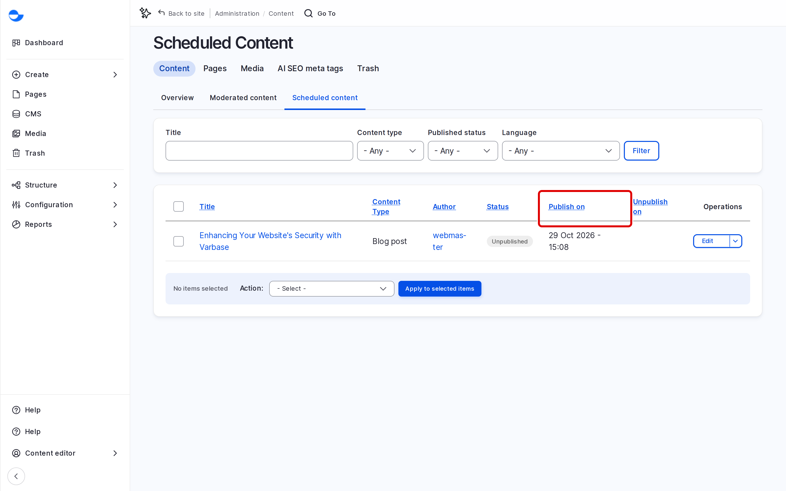

# Scheduling Content

Scheduling lets you prepare a blog post or utility page now and have Varbase publish it, or take it down, at a date and time you choose. Use it for announcements, campaigns and anything with a deadline.

## Scheduling a Publish Date

1. Create or edit the item, and save it as **Draft** or **In review** when you are ready.
2. In the sidebar, open **Scheduling options**.
3. In **Publish on**, enter the date and time.
4. In **Publish state**, keep **Published**.
5. Click **Save**.

<!-- <figure><figcaption>
Setting a Publish Date
</figcaption></figure> -->

The item stays unpublished until that time, then Varbase publishes it.

## Scheduling an Unpublish Date

1. In **Scheduling options**, enter a date and time in **Unpublish on**.
2. In **Unpublish state**, choose the state to move to, usually **Archived / Unpublished**.
3. Click **Save**.

You can set both dates on the same item, for example for a campaign that runs for one week.


The **Publish on** date must be in the future. Scheduled changes run when the site's scheduled tasks (cron) run, so an item can go live a few minutes after the exact time you set. Ask your site administrator how often cron runs on your site.


## Seeing What Is Scheduled

Go to **Administration** \ **Content** \ _**Scheduled Content**_ (`/admin/content/scheduled`) for the list of items with a publish or unpublish date. The **Scheduled** panel on the [Dashboard](../dashboard/) shows the same items.

<!-- <figure><figcaption>
The Scheduled Content List
</figcaption></figure> -->

## Changing or Cancelling a Schedule

1. Edit the item.
2. In **Scheduling options**, change the date, or clear it to cancel.
3. Click **Save**.

## Who Can Schedule

The **Content editor**, **Content Admin**, **SEO Admin** and **Site Admin** roles can schedule content and see the scheduled list.

## Tips

- Dates use the time zone in your account (**Edit profile**), or the site's default if you have not set one. Check it before scheduling.
- Check the item in preview before you schedule it; nobody needs to be online when it goes live.
- For a launch, schedule all related items for the same time.
