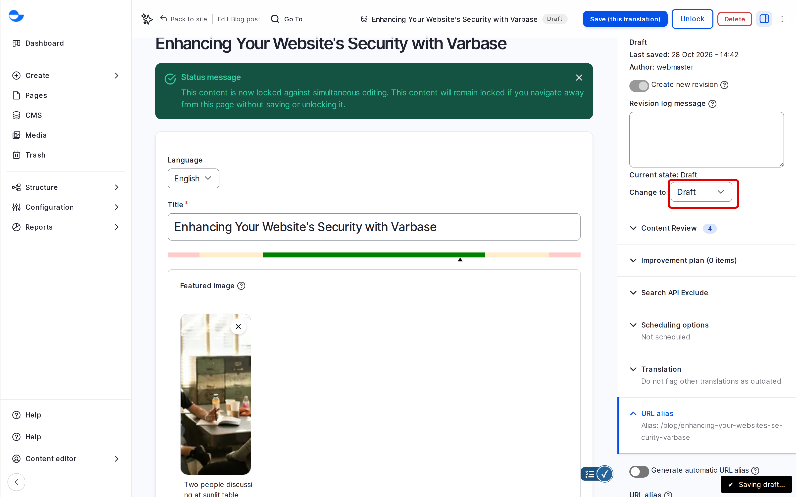

# Take a Post Through Review

When someone else should approve a post before visitors see it, the author sends it to review and a reviewer publishes it or sends it back. Every step is recorded in the post's history.

## Steps

1. **The author** writes the post, sets **Save as** to **In review**, writes a short note such as "Ready for review", and saves. Visitors still cannot see it.
2. **The reviewer** finds it in the content list: filter **Published status** by unpublished, or open **Moderated content**.
3. The reviewer opens the post, reads it, and may make small corrections.
4. If it is ready: **Change to** **Published**, a note such as "Approved", and **Save**. The history records who approved it and when.
5. If it is not ready: **Change to** **Draft** with a note on what to change. The note stays in the post's history, so the author knows why.

<figure><figcaption>
The Moderation Block in the Edit Form
</figcaption></figure>


On a Varbase 11.0 site the **Moderated content** list can stay empty even when drafts exist, because its filter points to a different workflow. Until your site is fixed, reviewers use the content list filter. Ask your development team to check it.


## Who Can Do It

On a new Varbase site, every editorial role can use **Publish**, so a review step is a habit rather than a rule. To make it a rule, remove the **Editorial workflow: Use Publish transition** permission from the roles that should only send to review. See [Editorial Roles and Permissions](README.md#editorial-roles-and-permissions).

## Questions Clients Ask

- **Do translations follow the same workflow?** Yes, and each translation has its own state.
- **Who can see what changed and when?** The **Revisions** tab per item, plus an audit trail of admin actions. Agree with the client how long those records are kept.

## Related

- [Publish Content](publish-content.md)
- [Design the Workflow With a Client](design-the-workflow-with-a-client.md)
