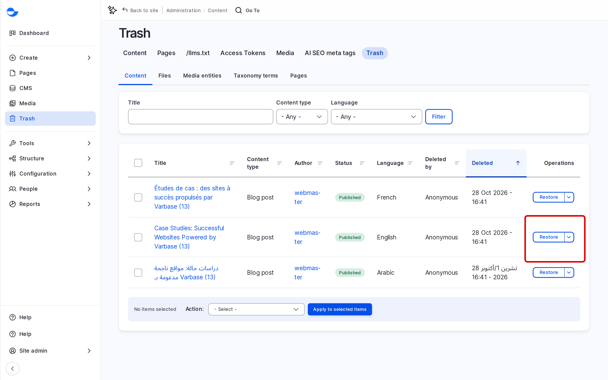
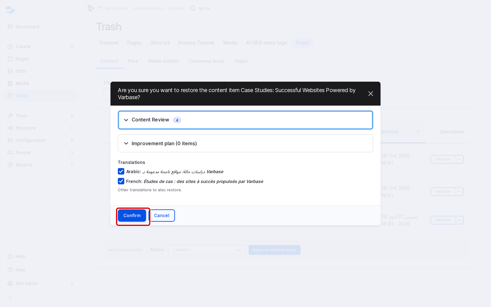

# Trash

When you delete something in Varbase, it goes to the **Trash** instead of being removed for good. You can restore it from there, or delete it permanently. This page explains how.

## What Goes to the Trash

Deleted **Content** (blog posts and utility pages), **Pages** built with **Drupal Canvas**, **Media entities**, **Taxonomy terms** and **Files** all go to the trash. A deleted taxonomy term takes its child terms with it.

Items in the trash are hidden from visitors and from the normal content lists.

## Opening the Trash

Click **Trash** in the **Navigation** sidebar, or go to `/admin/content/trash`. The tabs at the top split the trash by kind: **Content**, **Pages**, **Media entities**, **Taxonomy terms** and **Files**.

<figure><figcaption>
The Trash
</figcaption></figure>

## Restoring an Item

1. Open the tab for the kind of item, for example **Content**.
2. In the **Operations** column of the item, click **Restore**.
3. If the item has translations, tick the ones to restore too under **Translations**.
4. Click **Confirm**.

<figure><figcaption>
Restoring an Item From the Trash
</figcaption></figure>

The item returns to its list with the state it had before.

## Deleting an Item Permanently

1. In the **Operations** column of the item, choose **Purge**.
2. Click **Confirm**.


Purging cannot be undone. The item and all its revisions are removed.


Nothing is purged automatically: items stay in the trash until someone restores or purges them.

## Who Can Do What

| Role | Open the trash | Restore | Purge |
| --- | --- | --- | --- |
| **Content editor** | Yes | Content and taxonomy terms | No |
| **Content Admin** | Yes | Content, media, taxonomy terms and files | No |
| **SEO Admin** | Yes | No | No |
| **Site Admin** | Yes | Content, media, taxonomy terms and files | Content, media, taxonomy terms and files |
| **Super Admin** | Yes | Everything, including **Pages** | Everything, including **Pages** |

## Tips

- Restore first, decide later: restoring is safe, purging is final.
- Ask a **Super Admin** to restore a deleted **Drupal Canvas** page.
- Clear the trash from time to time with your **Site Admin**, so it stays easy to search.
