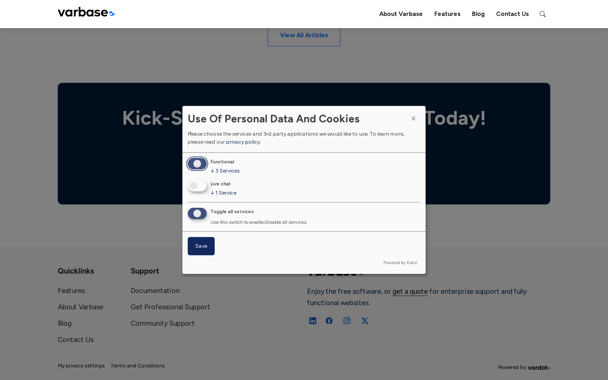

# Cookie Consent

Some services on a page, such as an embedded YouTube video, set cookies or send visitors' data to another company. Varbase asks visitors for consent before loading them, using **Klaro**. This page explains what visitors see and what it means for your content.

## What Visitors See

Varbase asks only when a page uses a service that needs consent:

- **Embedded content**, such as a YouTube or Vimeo video, shows a message in its place: **Load external content supplied by YouTube?** The visitor chooses **Yes (this time)** or **Always**.
- The **My privacy settings** link in the footer opens the consent settings, where visitors see each service and can turn it on or off at any time.

<!-- <figure><figcaption>
Asking for Consent Before a Video Loads
</figcaption></figure> -->

<figure><figcaption>
The Privacy Settings
</figcaption></figure>

## What It Means for Your Content

- When you add the first YouTube or Vimeo video, Varbase turns on consent for that service by itself. See [Remote Video](media-management/uploading-media-files/remote-video.md).
- Next to an important video, add a short text summary, so visitors who decline still get the message.
- Do not paste embed code from other services into your content: Varbase cannot ask for consent for it. Ask your site administrator to add the service first.

## Who Manages the Settings

The list of services and the texts visitors see are managed by a **Super Admin** at **Configuration** \ **User interface** \ _**Klaro! settings**_ (`/admin/config/user-interface/klaro`). The consent text links to your **privacy policy** page; keep that page up to date.

## Tips

- Test a page with a video in a private browser window, to see it as a new visitor does.
- Ask your legal or privacy contact before adding a new tracking or embedding service.
