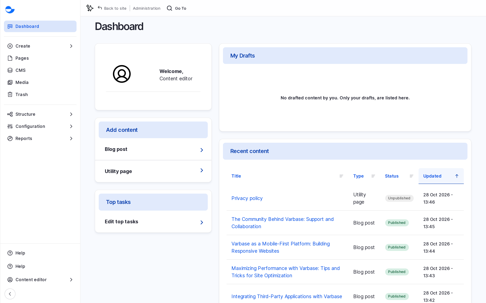
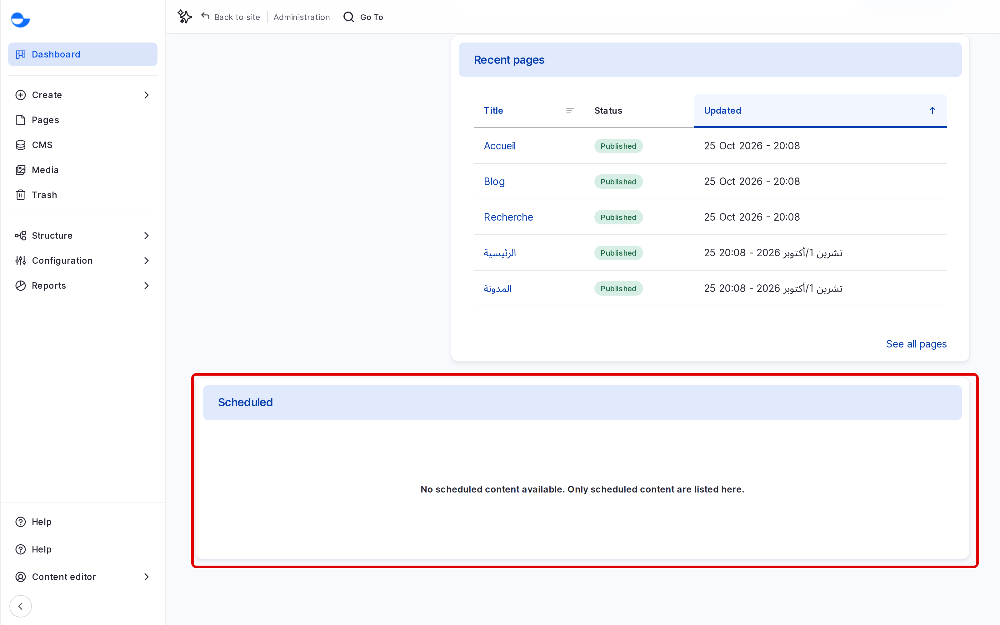

# Dashboard

The **Dashboard** is the first page you see after you log in. It shows what you can add, your own drafts, the latest content and pages, and what is scheduled to publish, so you can pick up your work in one place.

## Opening the Dashboard

- Log in: Varbase opens the dashboard for you.
- Or click **Dashboard** at the top of the **Navigation** sidebar.
- Or go to `/admin/dashboard`.

## The Welcome Dashboard

Varbase ships one dashboard for editors, **Welcome to your site**. Every editorial role (**Content editor**, **Content Admin**, **SEO Admin** and **Site Admin**) can see it.

<figure><figcaption>
The Welcome to Your Site Dashboard
</figcaption></figure>

### Left Column

| Panel | What it shows |
| --- | --- |
| **Welcome** | Your name and picture. |
| **Add content** | Links to **Create**, **Pages**, **CMS**, **Media** and **Trash**, the same as the top of the **Navigation** sidebar. |
| **Top tasks** | Setup shortcuts, such as **Change site appearance** and **Invite users to collaborate**. You see only the ones your role can use. |

### Right Column

| Panel | What it shows |
| --- | --- |
| **My Drafts** | Content you last worked on that is still in the **Draft** state. |
| **Recent content** | The five most recently changed items, with their type, status and date. |
| **Recent pages** | The most recently changed **Drupal Canvas** pages. |
| **Pages with accessibility alerts** | Pages where the accessibility checker found problems. Shown to a **Super Admin**, who manages accessibility results. See [Accessibility Checks](../accessibility-checks.md). |

### Scheduled Content

The bottom of the dashboard lists content that is set to publish or unpublish at a future date. See [Scheduling Content](../content-workflow/scheduling-content.md).

<figure><figcaption>
Scheduled Content on the Dashboard
</figcaption></figure>

Click any title in a panel to open that item.

## Other Dashboards

A **Super Admin** also sees the **AI Dashboard** (`/admin/dashboard/ai_dashboard`), which shows the AI provider setup, AI settings and status. Content designers do not need it to use the AI tools in the editor.

## Changing a Dashboard

A **Super Admin** can add, remove and arrange the panels at **Structure** \ **Dashboard** (`/admin/structure/dashboard`), and choose which roles see each dashboard. Each role gets the first dashboard in that list that it is allowed to see.

## Tips

- Use **My Drafts** each morning to see what you left unfinished.
- If a panel is empty, there is nothing to show yet, for example no scheduled content.
- Ask your site administrator if your team needs a panel that is not there, such as a list of content waiting for review.
