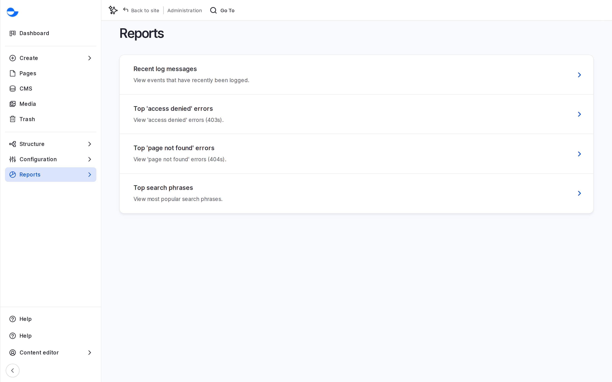
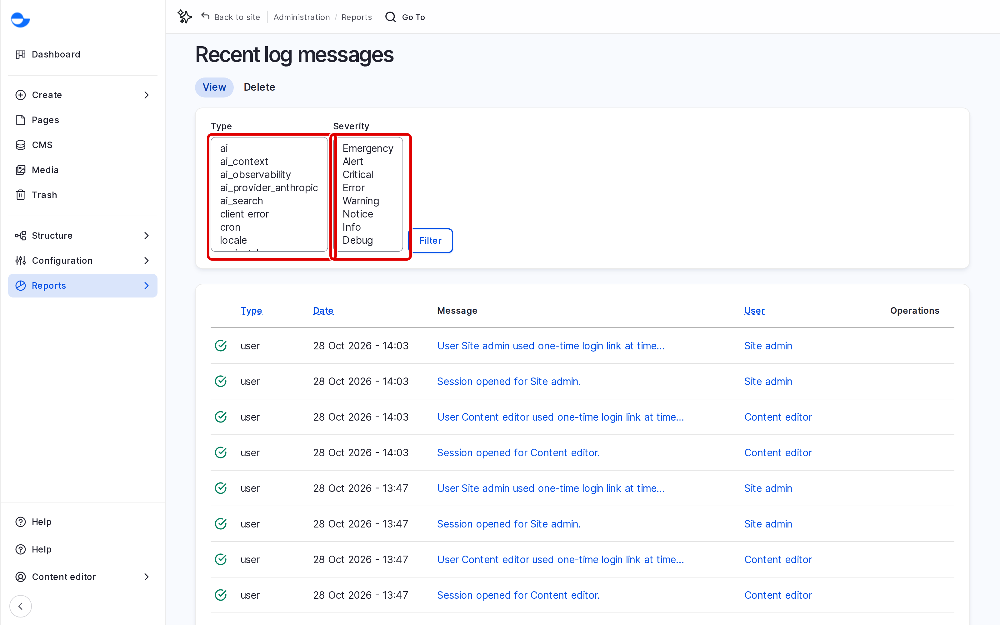

# Reports

Reports show what has happened on your site: errors, missing pages, failed access attempts and the site's health. They help you spot a broken link or a problem before visitors report it. This page lists the reports and who can open them.

## Opening Reports

1. In the **Navigation** sidebar, open **Administration** \ **Reports**.
2. Click the report you need.

You can also go to `/admin/reports`.

<figure><figcaption>
The Reports Page
</figcaption></figure>

## Reports for Editorial Roles

The **Content editor**, **Content Admin**, **SEO Admin** and **Site Admin** roles can open these reports.

### Recent Log Messages

`/admin/reports/dblog`

A list of recent events on the site, newest first: content saved or deleted, users logging in, errors and warnings.

1. Open **Recent log messages**.
2. Use **Type** and **Severity** to narrow the list, then click **Filter**.
3. Click a message to see its details.

<figure><figcaption>
Recent Log Messages
</figcaption></figure>

### Top "Page Not Found" Errors

`/admin/reports/page-not-found`

The addresses visitors asked for that do not exist, with how often each was requested. Use it to find old links that need a redirect. See [URL Redirects](../url-management/url-redirects.md).

### Top "Access Denied" Errors

`/admin/reports/access-denied`

The addresses visitors tried to open without permission. Many hits on one address can mean a link to a private page is published somewhere.

## Reports for the Super Admin

These reports need the **Super Admin** role:

| Report | Path | What it shows |
| --- | --- | --- |
| **Status report** | `/admin/reports/status` | The site's health: versions, warnings and errors to fix. |
| **Available updates** | `/admin/reports/updates` | Newer versions of the site's software, including security updates. |
| **Content Accessibility** | `/admin/reports/editoria11y` | Accessibility problems found on pages. See [Accessibility Checks](../accessibility-checks.md). |

An **SEO Admin** can also open **Metatag plugins** (`/admin/reports/metatag-plugins`), the list of meta tags the site supports.

## Tips

- Check **Top "page not found" errors** after you move or rename pages, and add redirects for the addresses that still get visits.
- If you see an error in **Recent log messages** that you do not understand, send its details to your development team rather than changing settings.
- Pass security updates listed in **Available updates** to your development team; updates are applied by developers, not from the editor screens.
