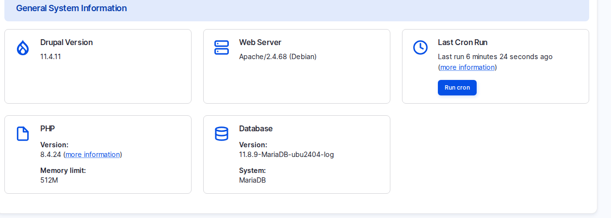

# From Client Needs to a Varbase Plan

This page brings the learning pack together into the skill that matters most for a project manager or product owner: turning a client's needs into a clear, honest Varbase plan. It follows seven steps: discover, map, choose a starting point, demo, estimate, plan the launch, and plan life after launch.

<!-- TODO(lesson-20-video): when the unlisted upload exists, replace the hint block below with an embed block for its https://youtu.be/ link, captioned "Lesson 20: From Client Needs to a Varbase Plan (Video)". -->

**Lesson 20 video: coming soon.** It will appear here and in the [Varbase: Content Designers playlist](https://www.youtube.com/playlist?list=PLRf-g9-Bc-LI).


## 1. Discover

Ask questions grouped by topic; each lesson gave you some:

| Topic | Ask |
| --- | --- |
| Content | What do you publish, how much, how often, and who writes it? |
| People | Who reviews and approves, in which roles? |
| Pages | Which pages do you want to build and change yourselves? |
| Languages | Which at launch, which later, who translates? |
| Integrations | Which other systems must the site talk to? |
| AI | This year, next year, or not at all? Which provider and budget? |

- **Listen for the real need.** Behind "a chatbot" may be "visitors must find answers faster"; behind "a new design" may be "pages editors can change". Ask why, twice, and write the need next to the request.
- **Collect constraints**: accessibility level, privacy laws, hosting rules such as data staying in one country, procurement and security questionnaires.
- **Map the people**: the sponsor, the day-to-day decision maker, weekly users, and which decisions need IT, legal or communications. Many delays come from decisions, not building.

## 2. Map Every Requirement

Place each requirement in one of three columns:

| Out of the box | Configure | Build |
| --- | --- | --- |
| Admin area and dashboard, editorial workflow, revisions, scheduling, Trash, media library and focal points, Drupal Canvas with patterns, the design system, readable addresses, redirects, meta tags, sitemap, accessibility checks, security defaults, consent | New content types and fields, vocabularies, roles and workflow rules, menus, forms, email handlers, languages and translation, AI features with context and guardrails | Integrations (CRM, single sign-on, payments), new components, special access rules such as editing by section, content migration |
| Work: content and training | Predictable work; most project hours | Most uncertainty: ranges and written assumptions |

| Client says | Varbase answer | Learn more |
| --- | --- | --- |
| "Marketing must build pages" | Drupal Canvas, patterns, the Canvas AI agent | [Building Pages With Drupal Canvas](../building-pages-with-drupal-canvas/) |
| "We need approvals" | Editorial workflow, roles, scheduling | [Editorial Workflow](../content-workflow/) |
| "Arabic and English" | Internationalization recipe, right to left | [Multilingual and Right to Left](../content-translation/) |
| "SEO matters" | Meta tags, sitemap, redirects, SEO checklist, AI SEO | [Search Engines and AI Readiness](../search-engine-optimization/) |
| "We must be accessible" | Editoria11y, accessible components | [Accessibility](../accessibility-checks.md) |
| "Security review is strict" | Security defaults, flood control, headers, consent | [Security and Privacy](../security-and-privacy/) |
| "Visitors cannot find things" | Site search, AI search, Ask AI | [Search, Forms and Email](../search-forms-and-email/) |
| "Forms and newsletters" | Webform, Easy Email | [Webforms](../search-forms-and-email/webforms/) |
| "We want AI, safely" | AI recipes with context, guardrails and logs | [AI in Varbase](../ai-in-varbase/) |

Before planning custom work, check the recipe list: news, events, podcasts, languages, APIs, outside sign-in and each AI feature have recipes, which turn a build item into a configuration item.

## 3. Choose the Starting Point

| Template | Best for | Owns |
| --- | --- | --- |
| **Varbase Starter** | Corporate, product and general sites | Home, about, features, blog, contact and search pages |
| **Educare** | Schools, universities, academies, e-learning | Program content type; admissions, research, student life pages |
| **Horizon Aid** | NGOs, charities, foundations, aid organisations | Country and Program content types; impact and donate pages |
| **The Rightup** | Newsrooms, publishers, magazines | News and podcasts, live ticker, filtered search, section pages |

If two templates partly fit, pick the one that matches most of the structure and add the missing parts with recipes; do not merge templates. See [Site Templates](../../developers/understanding-varbase/site-templates/) for demos and release lines.

### Worked Examples (Invented Clients)

- **A university**: programmes, admissions, news, events and research in English and Arabic. Start from **Educare**; English and Arabic are translation work, right to left comes with the platform; research papers are a new content type.
- **A humanitarian organisation**: work by country and programme, reports, stories, donations. Start from **Horizon Aid**; reports are documents in the media library; online donations usually mean a payment integration (build).
- **A publisher**: news, podcasts, sections, a live ticker, search, a newsletter. Start from **The Rightup**; the newsletter connection is configuration or integration depending on the service.
- **A professional services firm**: services, case studies, team profiles, insights, contact. Start from **Varbase Starter**; services and contact are Canvas pages from patterns, insights use the blog, case studies and team profiles are new content types.

## 4. Demo

A demo on a real site replaces promises with something the client can click, and surfaces misunderstandings early.

1. Reset the demo site to a saved snapshot before every demo.
2. Prepare a short story from the client's own day: an editor writes, a reviewer approves, a page is built, a visitor finds it.
3. Tailor lightly: their logo, a few real headlines, their language. Say clearly it is a demo, not the design.
4. Never show real personal data, secrets such as provider keys, or other clients' names or projects unless they are approved public case studies.
5. Send a short note afterwards: what you showed, what the client said, open questions, next steps. It becomes the first draft of the requirement map.

A 30-minute demo that works: front end and the Arabic version (2 minutes); log in, dashboard and Coffee (3); create a blog post with **Suggest tags** and save a draft (5); Drupal Canvas: patterns, Layers, preview widths (8); workflow, revisions and Trash (4); SEO, `/llms.txt` and the accessibility report (4); AI governance and the Canvas AI panel (4). Run it as the **Super Admin**, since some screens open for no other role.

<figure><figcaption>
The Status Report: a Quick Health Check Before Any Demo
</figcaption></figure>

## 5. Estimate Honestly

- Estimate from the requirement map, item by item. Label every number as an estimate and list its assumptions.
- **AI-assisted delivery**: configuration and much build work now take days rather than weeks. Discovery, client reviews, decisions, content writing, translation, outside dependencies and testing still take real time.
- **Phase the project**: phase one launches well (content model, key pages, workflow, roles, main language, launch essentials); later phases add languages, integrations, AI and improvements from real use.
- **Name the risks early**, each with an owner: content not ready (the most common), integrations that depend on other teams, slow decisions, messy migration data.
- **The proposal** follows the same structure: needs in the client's words, the requirement map, the starting point, phases, the estimate with assumptions, exclusions and risks.

With Varbase the site is often ready before the content. Plan content from week one: who writes, translates and approves, by when.

## 6. Plan the Launch

Every lesson added items. A combined checklist:

- [ ] Site template chosen; optional recipes listed (AI, multilingual, sign-in, API)
- [ ] Content model and taxonomy workshop held; vocabularies have owners
- [ ] Component inventory against Vartheme BS5 done
- [ ] Role matrix and approval chain agreed, including who publishes Canvas pages; **Role assign** set up for the Site Admin
- [ ] Policy pages published; every menu link leads to a published page
- [ ] Canvas page addresses planned (no automatic alias); route into search engines planned (not in the sitemap)
- [ ] Redirects from the old site imported and tested; **Fix 404 pages** cleared
- [ ] Sitemap in the robots file, submitted to search engine accounts the client owns
- [ ] Languages and translation owners named; forms and emails translated
- [ ] Accessibility alerts cleared; accessibility target and audit planned
- [ ] Every role tested with real tasks; email delivery confirmed in every language
- [ ] Security headers reviewed; security test done; incident plan agreed
- [ ] AI pilot scope, provider, budget and evaluation questions agreed
- [ ] Hosting, email delivery, backups and monitoring in the proposal

## 7. After Launch

- **Training and handover** by role, with each role's own test account. Hand over an editors' handbook: the one-page workflow guide, the role matrix, content standards and the launch checklist, plus these docs.
- **Updates**: Varbase releases about every two to three weeks; security releases follow the Drupal schedule. Agree who applies them, how fast, and how they are tested on staging. Budget regular small updates.
- **Support**: the community (the Varbase issue queue on drupal.org, the Varbase Slack, the public code) and professional support from Vardot or another capable Drupal team. See [How to Get Support](../../overview/how-to-get-support.md).
- **Measure success**, agreed before launch: can visitors find what they need and complete key tasks; how long editors take to publish and how often they need help; is the site secure, accessible and up to date.
- **A roadmap, not a finish line**: improve content and structure first, then add features in phases, such as a new language or AI help.
