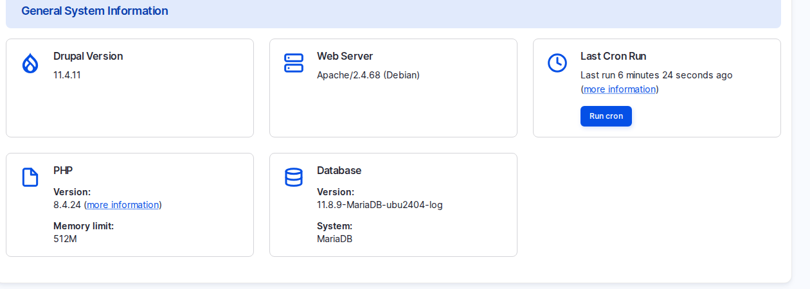

# Demo Varbase to a Client

A demo on a real site replaces promises with something the client can click, and surfaces misunderstandings early.

## Steps

1. Reset the demo site to a saved snapshot before every demo.
2. Prepare a short story from the client's own day: an editor writes, a reviewer approves, a page is built, a visitor finds it.
3. Test every live AI step beforehand, and have a recorded fallback, because AI answers can be slow on the day.
4. Show visitor pages logged out, for example in a private window, so the admin toolbar is not in the way.
5. Tailor lightly: their logo (**Logo image** in the theme settings, `/admin/appearance/settings/vartheme_bs5`), a few real headlines, their language. Say clearly it is a demo, not the design.
6. Never show real personal data, secrets such as provider keys, or other clients' names or projects unless they are approved public case studies.
7. Send a short note afterwards: what you showed, what the client said, open questions, next steps. It becomes the first draft of the requirement map.

## A 30-Minute Running Order

A 30-minute demo that works: front end and the Arabic version (2 minutes); log in, dashboard and Coffee (3); create a blog post with **Suggest tags** and save a draft (5); Drupal Canvas: patterns, Layers, preview widths (8); workflow, revisions and Trash (4); SEO, `/llms.txt` and the accessibility report (4); AI governance and the Canvas AI panel (4). Run it as the **Super Admin**, since some screens open for no other role.

<figure><figcaption>
The Status Report: a Quick Health Check Before Any Demo
</figcaption></figure>
