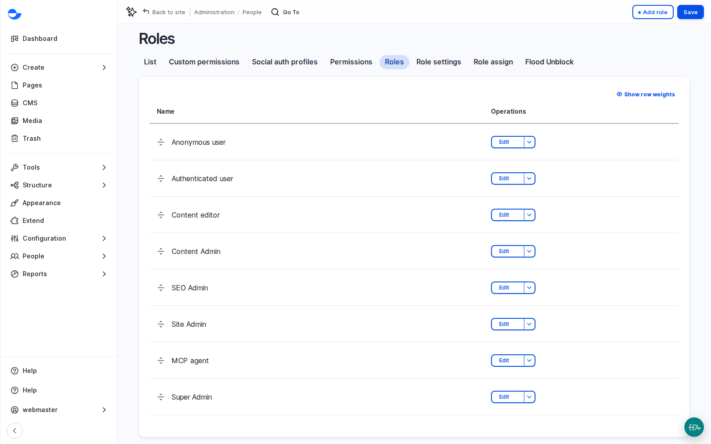
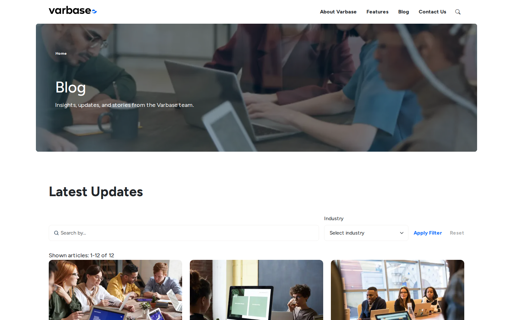

# How Varbase Is Built

Two ideas shape every Varbase project: **recipes** and **site templates**. This page explains both without code, so you can look at a client's needs and say which template and which recipes give the best starting point.


Lesson 2: How Varbase Is Built (Video)


## What It Is

### Recipes

A **recipe** is a tested feature kit. It has a name and a description, lists the recipes it depends on, switches on modules, and carries settings and permissions. Some recipes also carry content, such as demo pages, menus or images.

- **Applied once.** A recipe sets things up, and then the result belongs to the site. It does not keep running like a module. If the team later changes a setting, the recipe will not change it back, and a newer recipe version does not touch an existing site until the team decides to adopt it.
- **Layered.** A Varbase recipe often builds on a Drupal CMS recipe, which relies on Drupal core. **Varbase Starter** sits at the top: apply it, and every recipe below is applied in the right order.
- **Written down.** Recipes are downloaded with the rest of the code and each has its own version, so the team can always list which recipes a site has.

Varbase recipes come in five groups:

| Group | Examples | On every site? |
| --- | --- | --- |
| **Foundation** | Users and roles, admin, security, media, editor, content, **Drupal Canvas**, workflow, SEO, performance | Yes |
| **Content types** | Page (**Utility page**), Blog (**Blog post** and its listing); News, Events and Podcasts as add-ons | Page and Blog; the rest when needed |
| **Site features** | Search, **Webform**, **Easy Email** | Yes |
| **Optional** | Internationalization (languages), API, authentication (sign-in with outside accounts), AI recipes | Only when needed |
| **Demo content** | Sample pages, posts, images and menus | Removed or replaced before launch |

Not every recipe has Varbase in its name: the **Drupal CMS** recipes provide the admin interface, anti-spam, forms, media, privacy, search engine basics and accessibility tools, and Varbase adds its layer on top.

<figure><figcaption>
Editorial Roles Created by the Users Recipe
</figcaption></figure>

### Site Templates

A **site template** is a recipe that composes a whole site: the base recipes, a theme, pages, ready-made sections called **patterns**, and demo content. Some add a content type of their own. A site template is chosen during installation, in the installer's **Choose a site template** step, not added later.

| Template | Best for | What it adds |
| --- | --- | --- |
| **Varbase Starter** | Corporate, product and general sites (the default) | Home, about, features, blog, contact and search pages built with **Drupal Canvas**, demo posts, media and menus, patterns |
| **Educare** | Schools, universities, academies, e-learning | A **Program** content type (study level, program type); programs, admissions, research, student life pages |
| **Horizon Aid** | Nonprofits, charities, foundations, humanitarian organisations | **Country** and **Program** content types; impact, programs, resources, donate pages; listings that update themselves |
| **The Rightup** | Newsrooms, publishers, magazines | News and podcasts, a live feed ticker curated from a queue, search with filters, section landing pages |

All four share the same foundation, so the workflow, roles, security, media, SEO tools and accessibility checks work the same way. An editor trained on one template finds their way around another in minutes. See [Site Templates](../../developers/understanding-varbase/site-templates/) for demos and release lines.

<figure><figcaption>
The Blog Listing That Varbase Starter Ships, Filled With Demo Content
</figcaption></figure>

## Why It Matters

- **Faster start**: a sector template turns "a site for a university" into a starting point measured in days, not months.
- **Grow later**: a feature such as languages or AI is added by applying a recipe when the client is ready, not by rebuilding.
- **Reliable estimates**: each feature starts from a known, tested setup, and teams' skills carry over between sites.

## Scenario: Choose the Starting Point With a Client

1. Ask the four questions below in an early meeting.
2. If a template matches the client's sector, show its demo early. Ask what they like, what they would change, and what is missing.
3. Turn the answers into scope: what is kept, what is restyled, what is new.
4. If no template matches, start from **Varbase Starter** and build the sector-specific parts on top.
5. List the optional recipes in scope (languages, AI, sign-in, API). Each is a line item in the estimate.

Questions for the client:

- Which of these sites looks closest to what you have in mind: Varbase Starter, Educare, Horizon Aid or The Rightup?
- Which kinds of content do you publish today, and are any of them news, events or podcasts?
- Which languages do you need at launch, and which later?
- Are you planning to use AI on the site this year, next year, or not at all?

## Scenario: Find Out What an Existing Site Was Built From

1. As a **Super Admin**, open **Reports** \ _**Status report**_ for the Drupal version.
2. Open **Appearance**: the default theme usually tells you the site template (for example **Vartheme BS5** for Varbase Starter).
3. Look at **Structure** \ _**Content types**_: News, Events or Program types show which add-on or template recipes were applied.
4. Ask the development team for the list of applied recipes from the project files. It is the quickest way to know what the site can already do.

## What Recipes Do Not Do

Recipes start features; they do not finish projects. They do not write the client's content, choose their brand or decide their workflow, they do not replace testing by people, and they do not remove the need for custom work when a need is truly unique. Say this in the first meetings to keep expectations realistic.

## Questions Clients Ask

- **Can we switch site template later?** Not by re-applying a template. A template is applied at installation; features are added later with individual recipes.
- **If we remove a recipe, does the feature go away?** Recipes are not switched off. Removing a feature means a developer uninstalls the modules it brought. Plan it as a task, not a toggle.
- **We run many sites. Can they share our standards?** Yes. A team can write its own recipe (brand settings, roles, legal pages) so every new site starts the same way. Writing it is a developer task; deciding what goes in is a product decision. See [Creating Your Own Recipe](../../developers/extending-varbase/creating-your-own-recipe.md).

## Planning Notes

- Decide at kick-off which optional recipes are in scope. Each is a line item.
- Demo content helps in the early weeks; removing or replacing it before launch is a task with an owner.
- Custom features should become a project recipe, so they install the same way on every environment.


**Check Yourself**

1. What happens to a site's settings if a recipe is updated after it was applied?
2. Which site template would you show first to a university, and which content type does it add?
3. What is one thing a recipe will never do for a client?

