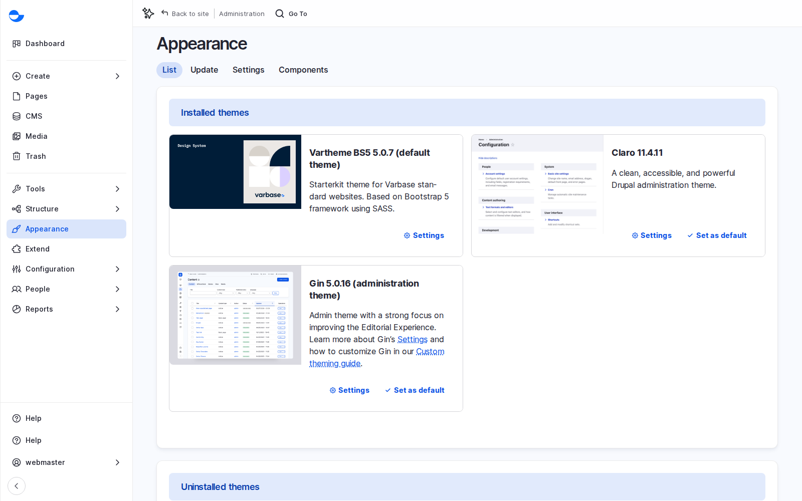

# Find Out What an Existing Site Was Built From

Before you plan changes to a site you did not build, find out which template and recipes it started from. It tells you what the site can already do.

## Steps

1. As a **Super Admin**, open **Reports** \ _**Status report**_ for the Drupal version. See [Check Which Version a Site Is On](../varbase-in-the-drupal-world/check-which-version-a-site-is-on.md).
2. Open **Appearance**: the default theme usually tells you the site template (for example **Vartheme BS5** for Varbase Starter).
3. Look at **Structure** \ _**Content types**_: News, Events or Program types show which add-on or template recipes were applied.
4. Ask the development team for the list of applied recipes from the project files. It is the quickest way to know what the site can already do.

<figure><figcaption>
The Default Theme on the Appearance Page
</figcaption></figure>

## Questions Clients Ask

- **If we remove a recipe, does the feature go away?** Recipes are not switched off. Removing a feature means a developer uninstalls the modules it brought. Plan it as a task, not a toggle.
