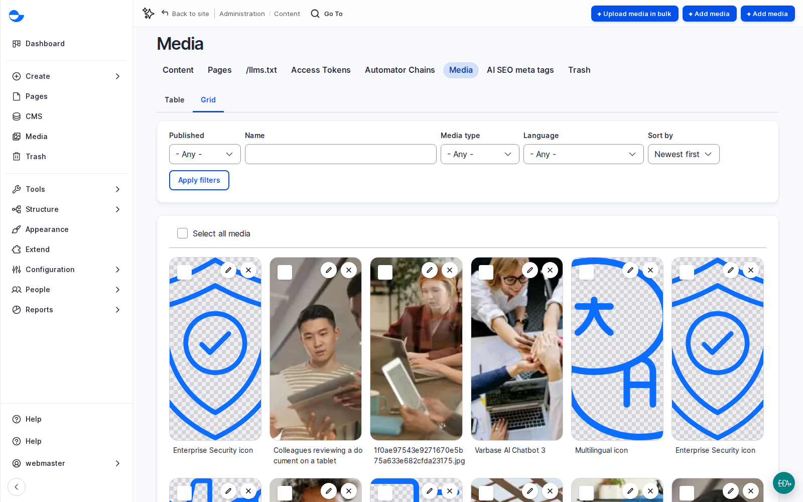

# Media Management

Images, videos, documents and audio on a Varbase site live in one shared **Media Library**. Each file or link is a media item: you add it once, then reuse it on any page. A change to the item, such as better alt text or a new file, shows everywhere it is used. This page also covers the habits that keep a library healthy for years.

Watch the lesson: [Media](../varbase-content-designers-course/lesson-07-media.md) in the [Varbase: Content Designers Course](../varbase-content-designers-course/).

## Why It Matters

- **Brand consistency**: the same approved image is reused, not re-uploaded in five sizes.
- **Speed**: editors upload one good original; image styles serve the right size to each device.
- **Accessibility by default**: images ask for alt text, and AI can suggest it.
- **One place to fix**: replace a report or improve a description once, and every page follows.

## The Media Library

The **Media Library** is two things:

- The **Media** page in the **Navigation** sidebar, where you find, add, edit and delete media.
- The **Add or select media** dialog, which opens from a media field or the editor so you can pick or upload media without leaving your page.

## Media Types

| Type | Use it for | Accepts |
| --- | --- | --- |
| **Image** | Photos and graphics, with a focal point for cropping | PNG, GIF, JPG, JPEG, WebP |
| **SVG Image** | Logos and icons that stay sharp at any size | SVG |
| **Document** | Files visitors download, such as a PDF report | PDF, Word, Excel, PowerPoint, OpenDocument, Apple iWork, TXT, RTF |
| **Video** | Short clips stored on your site, such as a looping background | MP4 |
| **Remote video** | Longer or public videos on YouTube or Vimeo | A link |
| **Audio** | Sound files stored on your site | MP3, WAV, AAC |
| **Remote audio** | Podcasts and tracks on SoundCloud, Spotify, Apple Podcasts and similar services | A link |

Prefer a remote type for long videos and podcasts: the service streams them, and your site stores only the link.

## Common Tasks

- **Upload**: on the **Media** page click **Add media** and choose the type, or upload from a media field or the editor. See [Uploading Media Files](uploading-media-files/).
- **Reuse**: on a media field or in the editor, open the dialog and pick an existing item instead of uploading the same file again. See [Accessing the Media Library](accessing-the-media-library.md).
- **Embed in text**: in the editor, click **Insert Media**, pick or upload the item, then click **Insert selected**.
- **Replace**: swap the file once and every page using the item shows the new one. See [Replace an Image Everywhere](replace-an-image-everywhere.md).
- **Delete**: check where the item is used first; deleted items go to the **Trash**. See [Delete a Media Item Safely](delete-a-media-item-safely.md).


Removing media from a page does not delete it from the library. Before deleting an item, check that no page still uses it.


## Where Things Live

| What | Where |
| --- | --- |
| **Media** page (table) | `/admin/content/media` |
| **Media** page (grid) | `/admin/content/media-grid` |
| Add a media item | `/media/add` |
| Upload media in bulk | `/media/bulk-upload` |
| Deleted media | **Trash**, **Media entities** tab, at `/admin/content/trash` |
| Uploaded files | A folder per year and month, such as `/sites/default/files/2026-11/` |

## Useful Features

- **Focal point**: mark the important part of an image so it stays in view when the image is cropped for cards and banners.
- **Alt text with AI**: click **Generate with AI** to get a suggested description of an image, then check and edit it.
- **Bulk upload**: upload up to 20 images, videos and audio files at once. See [Upload Many Files at Once](uploading-media-files/upload-many-files-at-once.md).
- **Bulk alt text**: generate alt text for many images in one run. See [Generate Alt Text for Many Images](generate-alt-text-for-many-images.md).

<figure><figcaption>
The Media Library in Grid View
</figcaption></figure>

## Good Images, Every Time

- **Name**: descriptive, so people find it by searching ("people clapping in conference room", never a camera file name).
- **Alternative text**: specific and brief, such as "four colleagues planning a project at a whiteboard". Do not start with "image of". Leave it empty only for purely decorative images.
- **Focal point**: click the part that must stay in view (a face, a product). Every crop on the site keeps it visible.
- **Format**: JPEG for photos, PNG for graphics with a transparent background, SVG for icons and logos, WebP for both with smaller files.
- **Size**: banners about 1600 to 2000 pixels wide, content images about 800 to 1200, files under about 200 KB (up to about 500 KB for large banners). See [Content Uploading Standards](../additional-tips/content-uploading-standards.md).
- **Text inside images**: avoid it. It cannot be read by screen readers and must be redone for every language.

With the AI recipes, saving an image fills an **Image description** and up to five **Image tags** when they are empty, and the image can be checked for safety on upload. See [AI Tools in the Editor](../ai-in-varbase/ai-tools-in-the-editor.md).

## Who Can Do What

The **Content editor**, **Content Admin**, **SEO Admin** and **Site Admin** roles can add media and use it in content. Editing and deleting depend on the type: for example, an **SEO Admin** can edit any image but not documents.

## Questions Clients Ask

- **Can we connect our DAM?** Not out of the box. It is an integration project; scope it in discovery against the DAM's API.
- **Where should large videos live?** On a video platform, as **Remote video**. The site stores the link and a cover image. Keep local videos under about 50 MB.
- **Can editors generate images with AI?** Yes, with the optional **Varbase AI Media Base** recipe, which adds **Generate with AI** to the **Media Library** for images and SVG graphics. It is not applied by default. Agree brand rules, rights and review first, because a generated image still represents the organisation. See [Varbase AI Media Base](../../developers/understanding-varbase/varbase-ai-recipes/varbase-ai-media-base.md).
- **Do embedded videos need consent?** Players from outside services can collect visitor data. Varbase asks for consent before loading them; switch it on for each service the client uses. See [Cookie Consent](../security-and-privacy/cookie-consent.md).

## Planning Notes

- Agree image ratios with design early; the focal point solves cropping, not wrong ratios.
- Migrating media is usually the slowest part of a content migration. Count files and total size, and plan who writes the missing alt text. See [Generate Alt Text for Many Images](generate-alt-text-for-many-images.md).
- Photos of people need permission for a purpose and a period. Name an owner for those rights and a way to remove photos quickly.

## In This Section

1. [Accessing the Media Library](accessing-the-media-library.md): finding, filtering and picking media.
2. [Uploading Media Files](uploading-media-files/): where to start and what each media type asks for.
3. [Replace an Image Everywhere](replace-an-image-everywhere.md): swap a file on every page at once.
4. [Delete a Media Item Safely](delete-a-media-item-safely.md): check where it is used before it goes.
5. [Generate Alt Text for Many Images](generate-alt-text-for-many-images.md): fill missing alt text after a migration.
