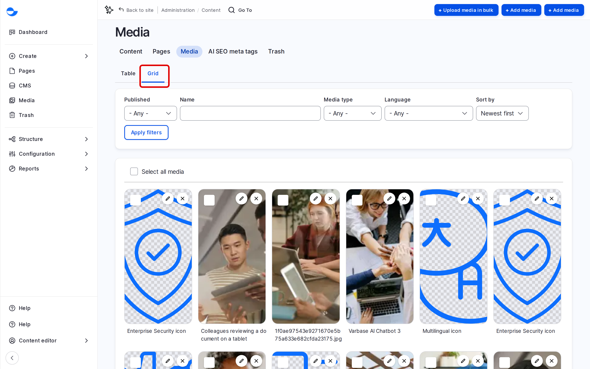
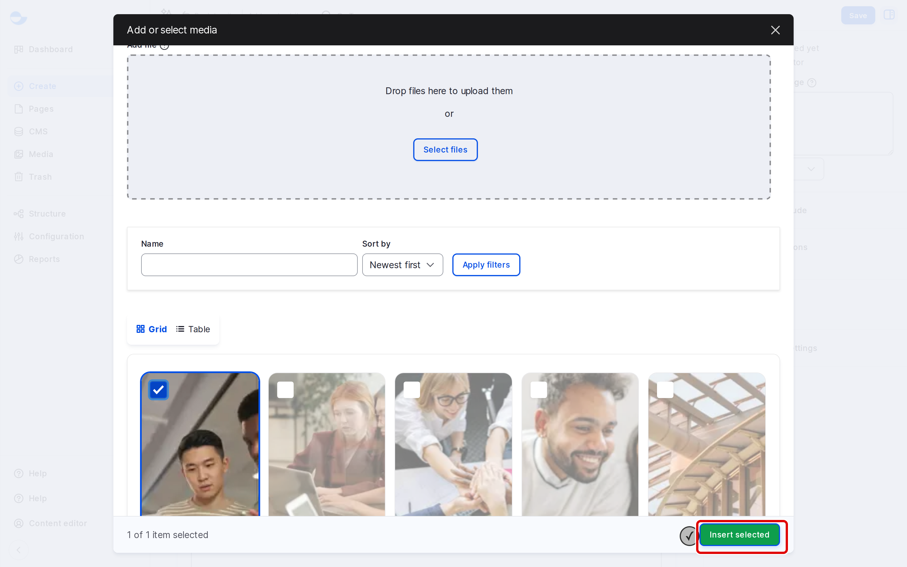

# Accessing the Media Library

The **Media Library** lists every image, video, document and audio file on your site. You can open it on its own to manage media, or from a content form to pick media for that item. This page shows both.

## Opening the Media Library

Click **Media** in the **Navigation** sidebar, or go to `/admin/content/media`.

The page has two views, as tabs:

- **Table**: a list with the name, type, author, status and date of each item.
- **Grid**: thumbnails, handy for finding an image by sight.

<!-- <figure><figcaption>
The Media Library Grid
</figcaption></figure> -->

## Finding Media

Use the filters at the top. On **Table** they are **Media name**, **Type**, **Published status** and **Language**; on **Grid** they are **Name**, **Media type**, **Publishing status** and **Language**. For example, choose **Image** as the type and type part of a name.

Click **Filter** to apply them.

## Managing an Item

- Click the name or thumbnail to open it.
- Click **Edit** to change its name, alt text or file.
- Choose **Delete** in its operations to move it to the **Trash**.

## Picking Media From a Content Form

1. On a media field, such as **Featured image**, click **Add media**.
2. The **Media Library** dialog opens. Choose the type tab, if there is more than one.
3. Pick an existing item, or upload a new file in the upload area at the top.
4. Click **Insert selected**.

<!-- <figure><figcaption>
Picking an Image for a Content Item
</figcaption></figure> -->

To change the picked item's alt text without leaving the form, click **Edit media item** on it in the field.

## Tips

- Search the library before uploading, to avoid two copies of the same file.
- Give each item a clear name, such as "Team photo, office 2026", so others can find it.
- Removing an image from a content item does not delete it from the library.
