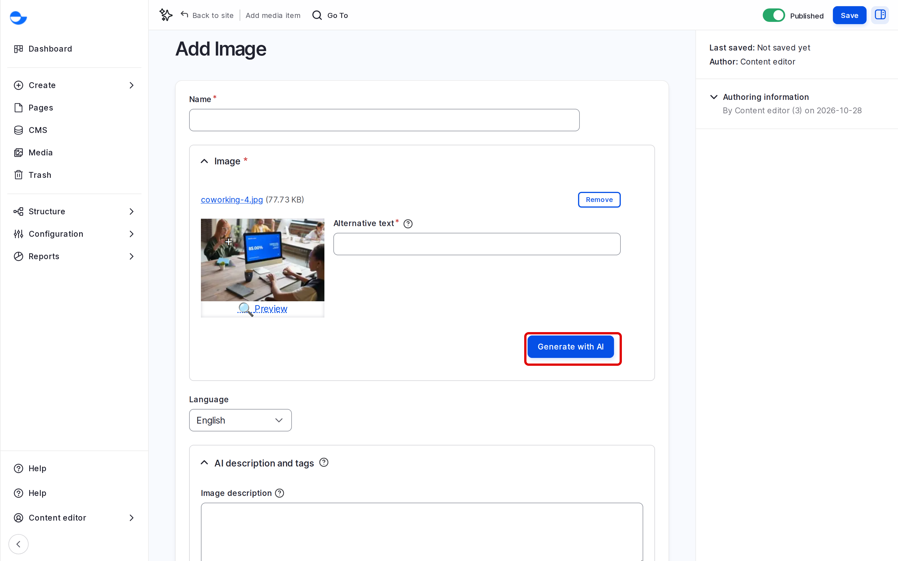

# Replace an Image Everywhere

A media item is used by reference, so replacing its file changes every page that shows it. Use this to swap an outdated photo, a new logo or a corrected report in one step.

## Steps

1. On the **Media** page, find the item and open it.
2. Check its **Usage** tab for the content that uses it. Images placed on Drupal Canvas pages are not listed there yet, so check those pages too.
3. On the **Edit** tab, click **Remove** on the file, then upload the new one. The form shows the warning "Modifications on this form will affect all existing usages of this entity": that is the point here, so carry on.
4. Check the **Alternative text** and the focal point: they must suit the new picture.
5. Click **Save**. Every page that uses the item shows the new file.

<figure><figcaption>
The Image Form, Where the File Is Replaced
</figcaption></figure>


To use a different image on one page only, do not replace the file. Pick or upload another item on that page instead.


## Tips

- Keep the new file the same shape as the old one, so cards and banners do not change size.
- Items with no usage at all are candidates for a clean-up.
