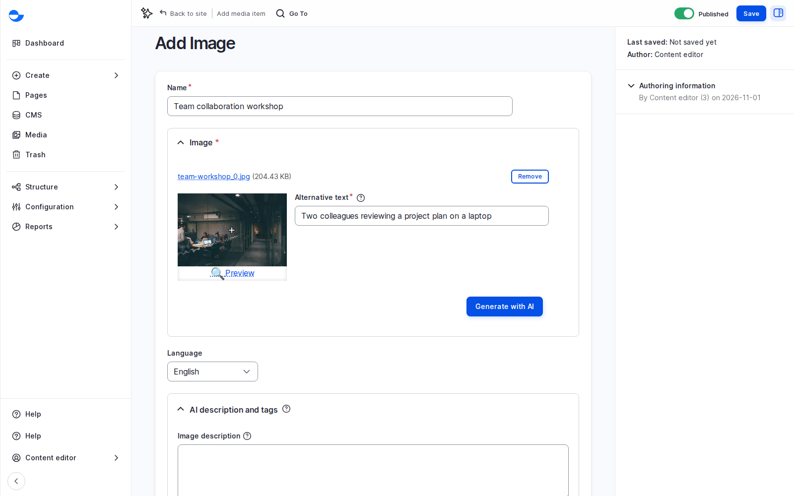
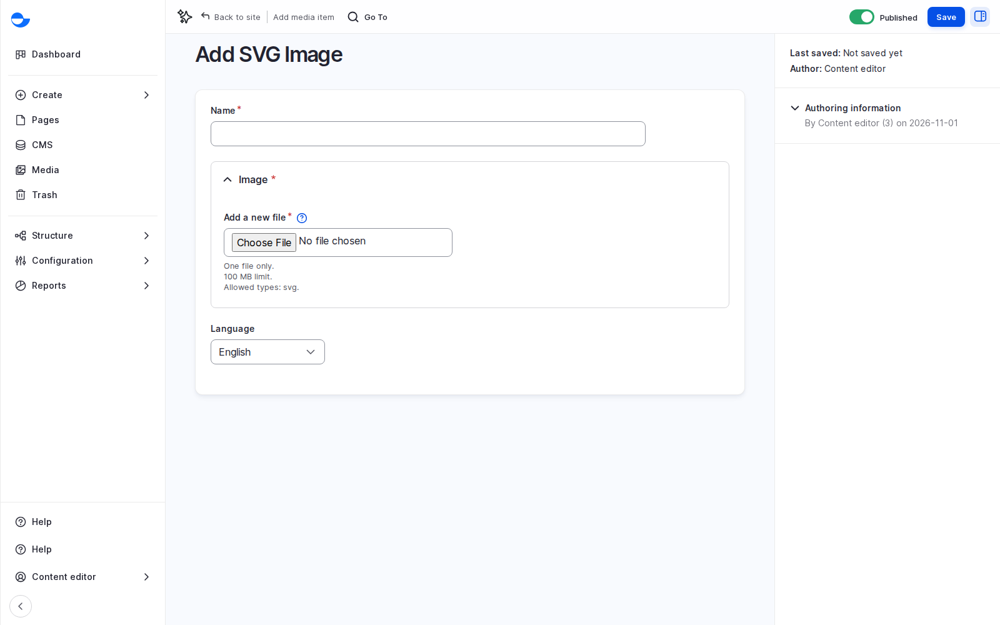
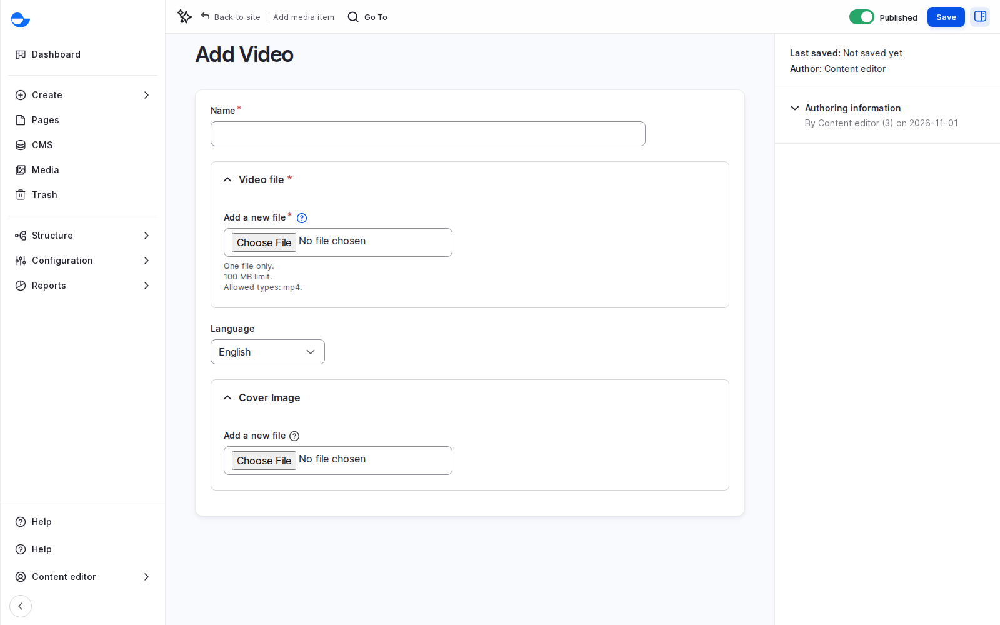
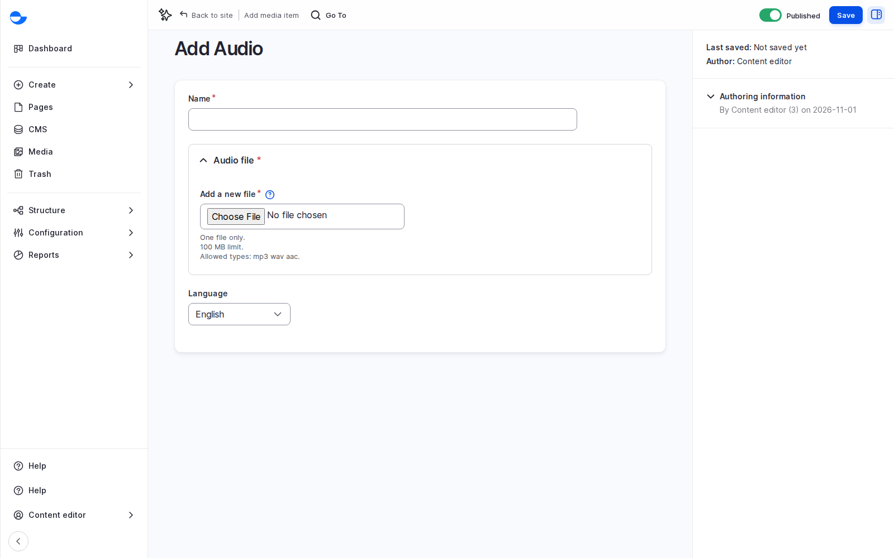
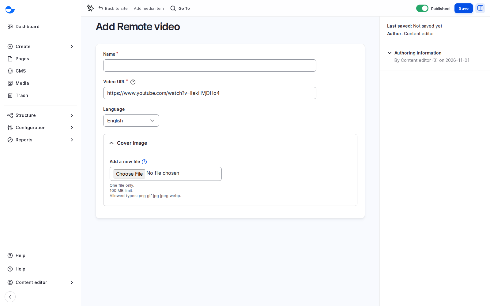
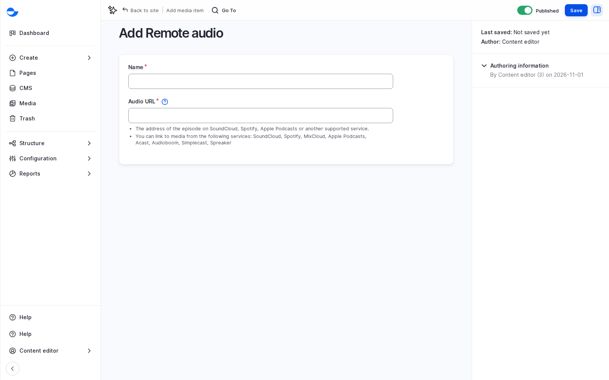
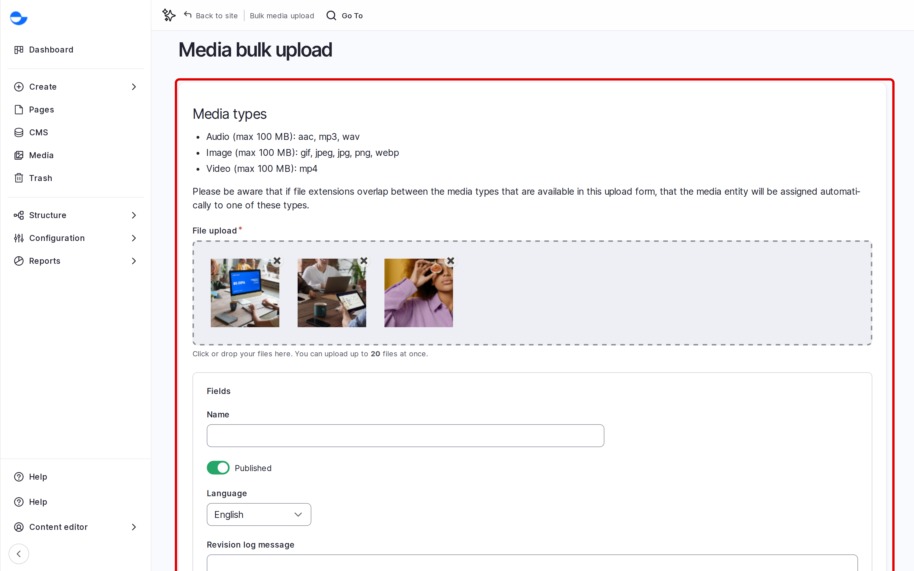
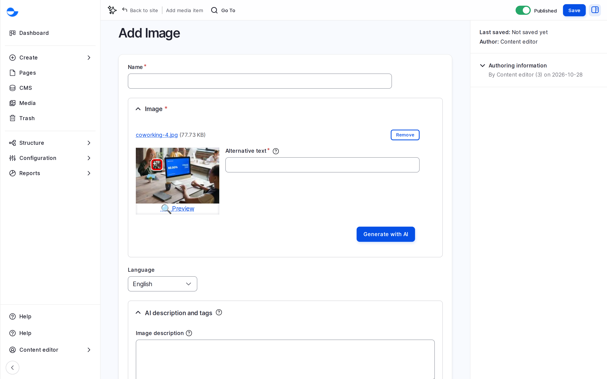

# Uploading Media Files

Every file or link you add becomes a media item in the **Media Library**, ready to reuse on any page. This page shows where to start an upload and, for each media type, what the form accepts and asks for.

## Where to Start

| Start from | How | Types offered |
| --- | --- | --- |
| The **Media** page | **Media** in the **Navigation** sidebar, then **Add media** | **Audio**, **Document**, **Image**, **Remote video**, **SVG Image** and **Video** |
| The full form | Go to `/media/add` and choose the type | All seven types, including **Remote audio** |
| A media field | **Add media** on the field, such as **Featured image** | Only the types the field accepts (**Featured image** takes **Image**) |
| The rich-text editor | **Insert Media** on the editor toolbar | Depends on the text format: **Content** offers all seven; **Rich editor** offers **Image**, **Audio**, **Remote video** and **Video** |
| Bulk upload | **Upload media in bulk** on the **Media** page (`/media/bulk-upload`) | **Audio**, **Image** and **Video** |

The **Media** page, the field and the editor show a short form: **Name**, the file or link, the alternative text for images, and **Language**. The full form at `/media/add` also has the optional fields, such as **Image description** and **Cover Image**. You can fill those later by editing the item.

### From the Media Page

1. Click **Media** in the **Navigation** sidebar, then **Add media**.
2. Choose the type.
3. Drop one or more files into the upload area, or click **Select files**. For **Remote video**, paste the link and click **Add**.
4. Fill in the required fields for each item, as described for each type below.
5. Click **Save**.

<figure><figcaption>
Choosing a Media Type From the Media Page
</figcaption></figure>

<figure><figcaption>
Uploading Images From the Media Page
</figcaption></figure>

### From the Full Form

1. Go to `/media/add` and choose the type.
2. Upload the file or paste the link, and fill in the fields.
3. Click **Save**.

### From a Media Field

1. Click **Add media** on the field. The **Add or select media** dialog opens, with a tab for each type the field accepts.
2. Drop a file into the upload area, or click **Select files**. For a remote type, paste the link and click **Add**.
3. The dialog says the item "has been created but has not yet been saved". Fill in the required fields and click **Save**.
4. The new item is selected. Click **Insert selected**.

<figure><figcaption>
The Media Library Dialog From a Field
</figcaption></figure>

<figure><figcaption>
Saving a New Image in the Dialog
</figcaption></figure>

### From the Rich-Text Editor

1. Place the cursor where the media should go and click **Insert Media** on the toolbar.
2. Pick an existing item, or upload a new one as in the field dialog.
3. Click **Insert selected**.
4. Click the inserted item to add a caption or change its alignment.

<figure><figcaption>
The Media Library Dialog From the Editor
</figcaption></figure>


The **Rich editor** toolbar also has **Media embed**, which embeds a pasted link without adding it to the **Media Library**. Use **Insert Media** for anything you may reuse.


## Media Types

The size limit and accepted file types are shown under the upload field; click the **?** next to **Add a new file** to see them. The size limit comes from your hosting; it is 100 MB in these screenshots.

### Image

Use for photos and graphics.

- **Accepts**: PNG, GIF, JPG, JPEG and WebP, one file.
- **Required**: **Name**, the **Image** file and **Alternative text**, which appears once the file is uploaded.
- **Focal point**: drag the cross on the preview to the most important part.
- **Generate with AI**: suggests the alternative text. If the form asks "Transfer image and meta data to chosen AI service?", click **Yes (this time)** to show the button.
- **AI description and tags**: **Image description** and **Image tags** are optional and on the full form. Left empty, AI writes them when you save.

There is no caption field on the item: add a caption where you place the image, for example in the editor.

<figure><figcaption>
Adding an Image
</figcaption></figure>


With **Varbase AI Safety** on, each uploaded image is checked for unsuitable content and flagged images are refused. If the form says "AI provider failed to evaluate the content", the file is likely too large for the check: resize it, for example to 2000 pixels wide, and upload it again.


See [Image](image.md) for alt text tips.

### SVG Image

Use for logos and icons that must stay sharp at any size.

- **Accepts**: SVG, one file.
- **Required**: **Name**, the **Image** file and **Alternative text**.
- There is no focal point: SVG images are not cropped.

<figure><figcaption>
Adding an SVG Image
</figcaption></figure>

### Document

Use for files visitors download, such as a PDF report or a price list.

- **Accepts**: TXT, RTF, DOC, DOCX, PPT, PPTX, XLS, XLSX, PDF, ODF, ODG, ODP, ODS, ODT, FODT, FODS, FODP, FODG, KEY, NUMBERS and PAGES, one file.
- **Required**: **Name** and the **Document** file.

<figure><figcaption>
Adding a Document
</figcaption></figure>

### Video

Use for short clips stored on your site, such as a looping background.

- **Accepts**: MP4, one file.
- **Required**: **Name** and the **Video file**.
- **Cover Image**: optional, shown before the video plays, with a focal point. It is on the full form, or edit the item after saving.

<figure><figcaption>
Adding a Video File
</figcaption></figure>

See [Video](video.md) for when to prefer a remote video.

### Audio

Use for sound files stored on your site, such as a recorded talk.

- **Accepts**: MP3, WAV and AAC, one file.
- **Required**: **Name** and the **Audio file**.

<figure><figcaption>
Adding an Audio File
</figcaption></figure>

### Remote Video

Use for videos on YouTube or Vimeo. Your site keeps only the link.

- **Accepts**: a **Video URL** from YouTube or Vimeo.
- **Required**: **Name** and **Video URL**.
- **Cover Image**: optional, with a focal point. It is on the full form, or edit the item after saving.

<figure><figcaption>
Adding a Remote Video
</figcaption></figure>

See [Remote Video](remote-video.md) for cookie consent and tips.

### Remote Audio

Use for podcasts and tracks hosted elsewhere. Your site keeps only the link.

- **Accepts**: an **Audio URL** from SoundCloud, Spotify, MixCloud, Apple Podcasts, Acast, Audioboom, Simplecast or Spreaker.
- **Required**: **Name** and **Audio URL**.
- **Where**: the full form (`/media/add/remote_audio`), or **Insert Media** in an editor that uses the **Content** text format. The **Media** page's **Add media** list does not offer it.

<figure><figcaption>
Adding Remote Audio
</figcaption></figure>

## After You Save

- **Published** is on by default, at the top of the form. Switch it off before saving to keep the item out of public view.
- Media has no draft or review step: the editorial workflow applies to content, not media.
- The item is listed on the **Media** page and in the **Media Library** dialog, ready to reuse.
- Editing the item later changes it everywhere it is used.

## Uploading Many Files at Once

1. On the **Media** page, click **Upload media in bulk** (`/media/bulk-upload`).
2. Drag your files into the upload area, or click it to choose them. Up to 20 images, videos and audio files can be mixed.
3. Wait for each file to finish, then fill in the shared fields.
4. Click **Save**.

<figure><figcaption>
Uploading Several Files at Once
</figcaption></figure>

Varbase creates one media item per file, named after the file. Open each image afterwards to add its alt text.

## Setting the Focal Point

Images, and the cover images of videos, have a focal point: a cross on the preview you drag to the most important part, such as a face. When the image is cropped for a card or a banner, that part stays in view.

<figure><figcaption>
Setting the Focal Point
</figcaption></figure>

## File Size

Compress large files before uploading. See [Content Uploading Standards](../../additional-tips/content-uploading-standards.md).

## In This Section

- [Image](image.md)
- [Remote Video](remote-video.md)
- [Video](video.md)
