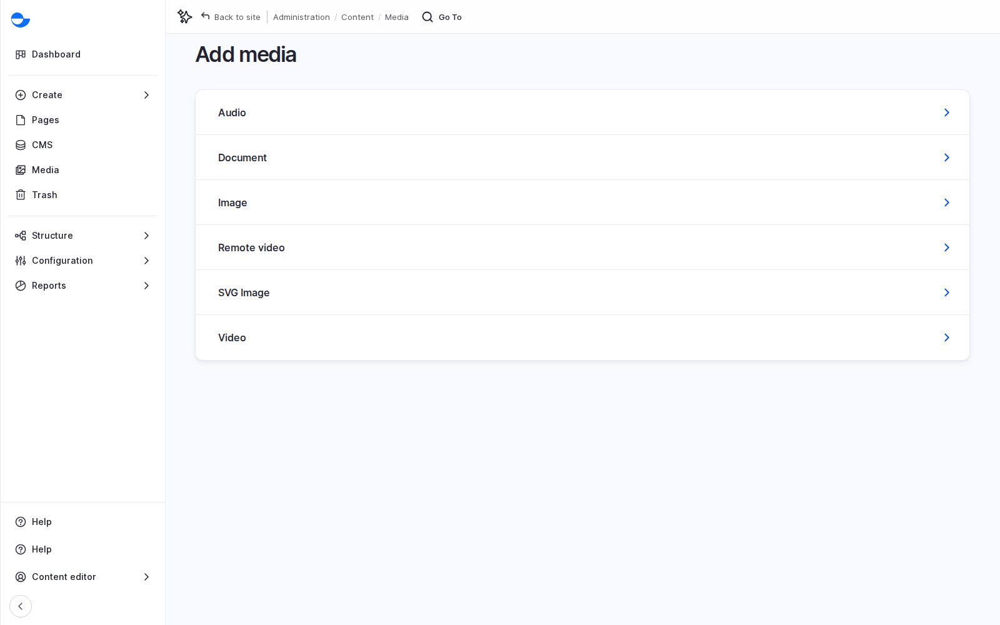
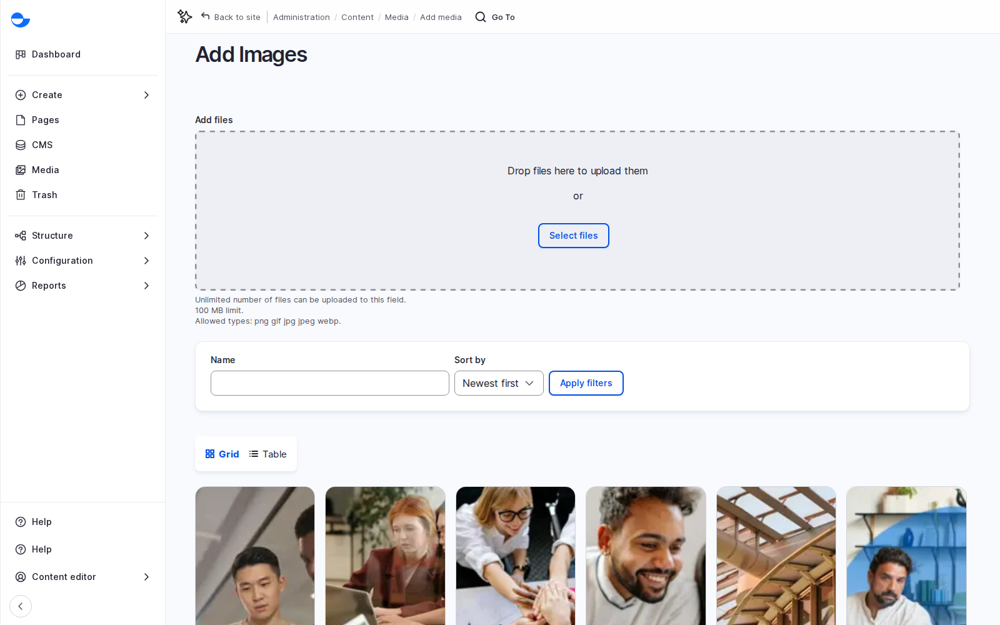
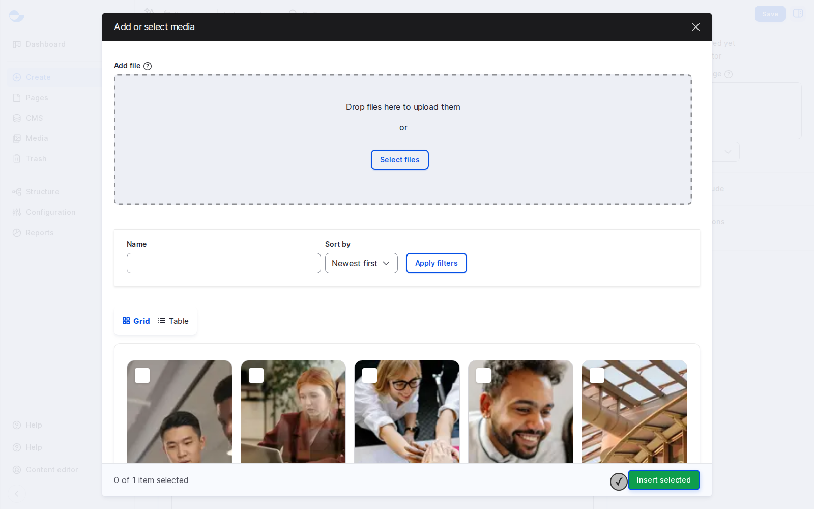
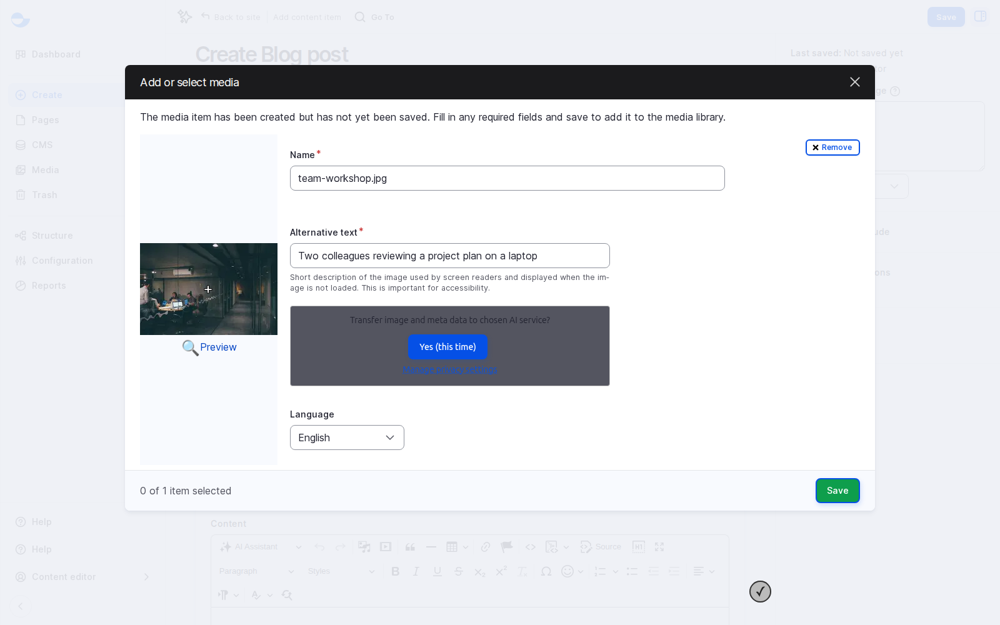
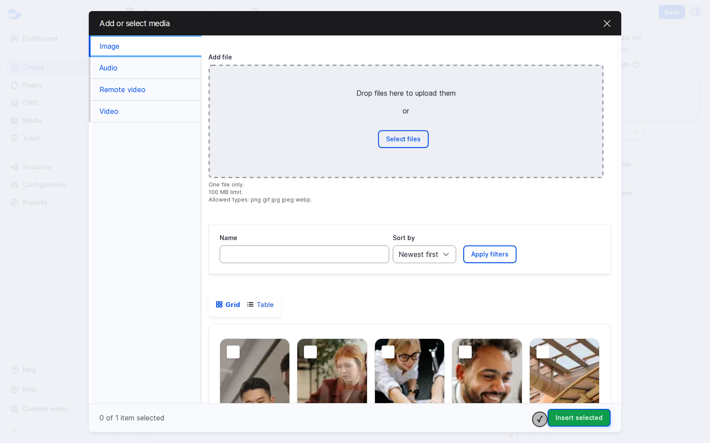

# Uploading Media Files

Every file or link you add becomes a media item in the **Media Library**, ready to reuse on any page. This page shows where to start an upload and, for each media type, what the form accepts and asks for.

## Where to Start

| Start from | How | Types offered |
| --- | --- | --- |
| The **Media** page | **Media** in the **Navigation** sidebar, then **Add media** (`/admin/content/media/bulk-upload`) | **Audio**, **Document**, **Image**, **Remote video**, **SVG Image** and **Video**, several files at a time |
| The full form | Go to `/media/add` (**Add media item**) and choose the type | All seven types, including **Remote audio** |
| A media field | **Add media** on the field, such as **Featured image** | Only the types the field accepts (**Featured image** takes **Image**) |
| The rich-text editor | **Insert Media** on the editor toolbar | Depends on the text format: **Content** offers all seven; **Rich editor** offers **Image**, **Audio**, **Remote video** and **Video** |
| Bulk upload | **Upload media in bulk** on the **Media** page (`/media/bulk-upload`) | **Audio**, **Image** and **Video** |

The **Media** page, the field and the editor show a short form: **Name**, the file or link, the alternative text for images, and **Language**. The full form at `/media/add` also has the optional fields, such as **Image description** and **Cover Image**. You can fill those later by editing the item.

### From the Media Page

1. Click **Media** in the **Navigation** sidebar, then **Add media**.
2. Choose the type.
3. Drop one or more files into the upload area, or click **Select files**. For **Remote video**, paste the link and click **Add**.
4. Fill in the required fields for each item, as described for each type below.
5. Click **Save**.

<figure><figcaption>
Choosing a Media Type From the Media Page
</figcaption></figure>

<figure><figcaption>
Uploading Images From the Media Page
</figcaption></figure>

### From the Full Form

1. Go to `/media/add` and choose the type.
2. Upload the file or paste the link, and fill in the fields.
3. Click **Save**.

### From a Media Field

1. Click **Add media** on the field. The **Add or select media** dialog opens, with a tab for each type the field accepts.
2. Drop a file into the upload area, or click **Select files**. For a remote type, paste the link and click **Add**.
3. The dialog says the item "has been created but has not yet been saved". Fill in the required fields and click **Save**.
4. The new item is selected. Click **Insert selected**.

<figure><figcaption>
The Media Library Dialog From a Field
</figcaption></figure>

<figure><figcaption>
Saving a New Image in the Dialog
</figcaption></figure>

### From the Rich-Text Editor

1. Place the cursor where the media should go and click **Insert Media** on the toolbar.
2. Pick an existing item, or upload a new one as in the field dialog.
3. Click **Insert selected**.
4. Click the inserted item to add a caption or change its alignment.

<figure><figcaption>
The Media Library Dialog From the Editor
</figcaption></figure>


The **Rich editor** toolbar also has **Media embed**, whose tooltip reads **Insert media** with a small m. It embeds a pasted link without adding it to the **Media Library**. Use **Insert Media** for anything you may reuse.


## Media Types

The size limit and accepted file types are shown under the upload field; click the **?** next to **Add a new file** to see them. The size limit comes from your hosting; it is 100 MB in these screenshots.

| Type | Use it for | Steps |
| --- | --- | --- |
| **Image** | Photos and graphics | [Image](image.md) |
| **SVG Image** | Logos and icons that stay sharp at any size | [SVG Image](svg-image.md) |
| **Document** | Files visitors download, such as a PDF report | [Document](document.md) |
| **Video** | Short clips stored on your site | [Video](video.md) |
| **Audio** | Sound files stored on your site | [Audio](audio.md) |
| **Remote video** | Videos on YouTube or Vimeo | [Remote Video](remote-video.md) |
| **Remote audio** | Podcasts and tracks on SoundCloud, Spotify and similar services | [Remote Audio](remote-audio.md) |

## After You Save

- **Published** is on by default, at the top of the form. Switch it off before saving to keep the item out of public view.
- Media has no draft or review step: the editorial workflow applies to content, not media.
- The item is listed on the **Media** page and in the **Media Library** dialog, ready to reuse.
- Editing the item later changes it everywhere it is used.

## File Size

Compress large files before uploading. See [Content Uploading Standards](../../additional-tips/content-uploading-standards.md).

## Uploading Many Files

To upload up to 20 images, videos and audio files together, see [Upload Many Files at Once](upload-many-files-at-once.md). To keep the important part of an image in view when it is cropped, see [Set the Focal Point](set-the-focal-point.md).

## In This Section

- [Image](image.md)
- [SVG Image](svg-image.md)
- [Document](document.md)
- [Video](video.md)
- [Audio](audio.md)
- [Remote Video](remote-video.md)
- [Remote Audio](remote-audio.md)
- [Upload Many Files at Once](upload-many-files-at-once.md)
- [Set the Focal Point](set-the-focal-point.md)
