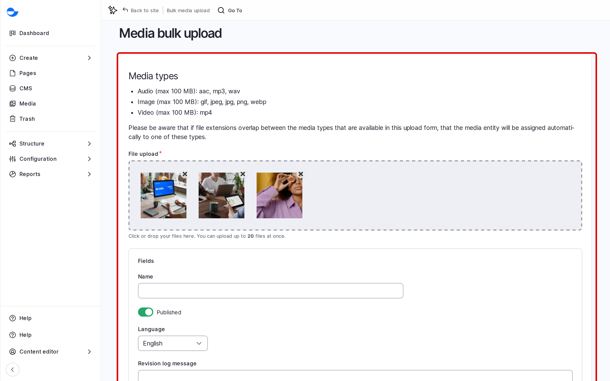
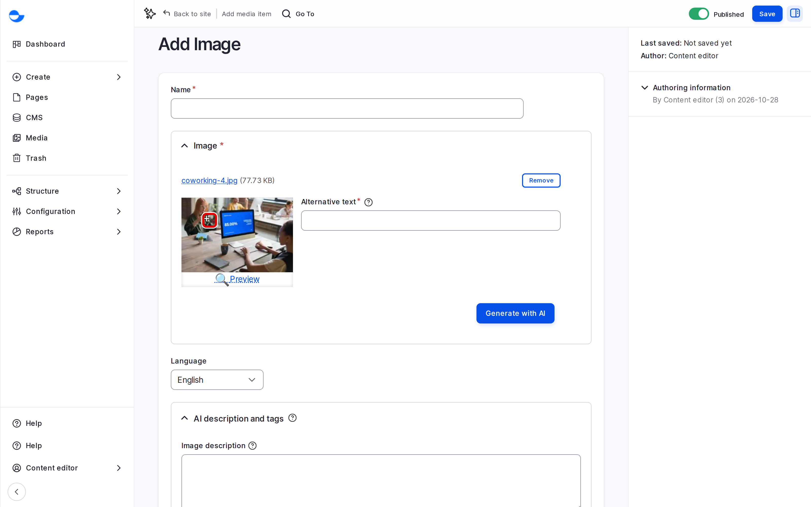

# Uploading Media Files

You can add media from the **Media** page, from a content form while you work, or many files at once with bulk upload. This page shows each way; the pages for each media type cover the details.

## Adding One Item From the Media Page

1. Click **Media** in the **Navigation** sidebar.
2. Click **Add media**, then choose the type, for example **Image**.
3. Upload the file or paste the link, and fill in the fields.
4. Click **Save**.

## Adding Media While Editing Content

1. On a media field, such as **Featured image**, click **Add media**.
2. Drop a file into the upload area at the top of the dialog, or click it to browse.
3. Fill in the fields for the new item, such as the alt text.
4. Click **Save**, then **Insert selected**.

## Uploading Many Files at Once

1. On the **Media** page, click **Upload media in bulk** (`/media/bulk-upload`).
2. Drag your files into the upload area, or click it to choose them. Images, videos and audio files can be mixed.
3. Wait for each file to finish, then fill in the shared fields.
4. Click **Save**.

<!-- <figure><figcaption>
Uploading Several Files at Once
</figcaption></figure> -->

Varbase creates one media item per file, named after the file. Open each image afterwards to add its alt text.

## Setting the Focal Point

Images, and the cover images of videos, have a focal point: a cross on the preview you drag to the most important part, such as a face. When the image is cropped for a card or a banner, that part stays in view.

<!-- <figure><figcaption>
Setting the Focal Point
</figcaption></figure> -->

## File Size

The largest file you can upload is set by your hosting; the upload field shows the limit. Compress large files first. See [Content Uploading Standards](../../additional-tips/content-uploading-standards.md).

## In This Section

- [Image](image.md)
- [Remote Video](remote-video.md)
- [Video](video.md)
