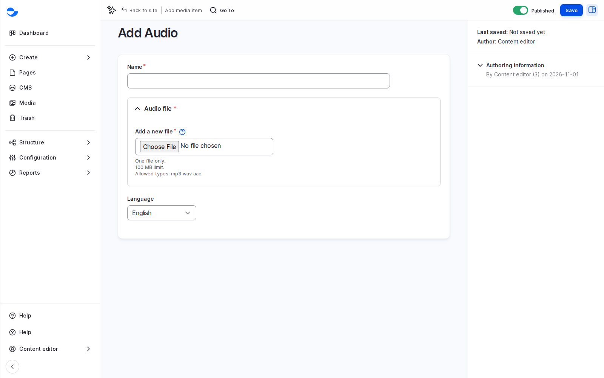

# Audio

Use **Audio** for sound files stored on your site, such as a recorded talk.

## Steps

1. Click **Media** in the **Navigation** sidebar, then **Add media** and **Audio**.
2. Upload one MP3, WAV or AAC file in **Audio file**.
3. Fill in the **Name**.
4. Click **Save**.

<figure><figcaption>
Adding an Audio File
</figcaption></figure>

## Audio File or Remote Audio?

For podcasts and long recordings, prefer [Remote Audio](remote-audio.md): the service streams them, and your site stores only the link.

## Tips

- Offer a transcript next to the player, so people who cannot hear it, or prefer to read, can follow.
