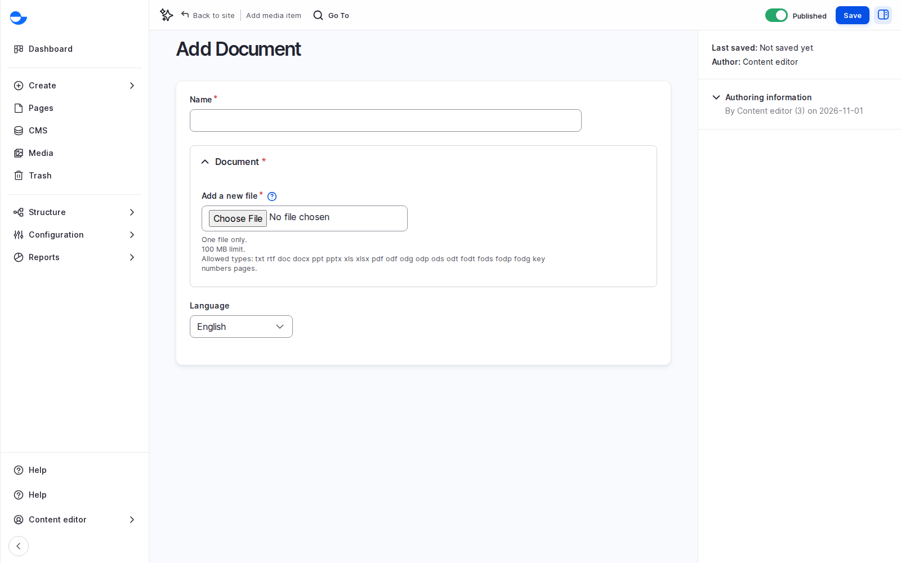

# Document

Use **Document** for files visitors download, such as a PDF report or a price list.

## Steps

1. Click **Media** in the **Navigation** sidebar, then **Add media** and **Document**.
2. Upload one file in **Document**.
3. Fill in the **Name**: say what the file is, such as "Annual report 2026", so editors find it later.
4. Click **Save**.

<figure><figcaption>
Adding a Document
</figcaption></figure>

## Accepted Files

TXT, RTF, DOC, DOCX, PPT, PPTX, XLS, XLSX, PDF, ODF, ODG, ODP, ODS, ODT, FODT, FODS, FODP, FODG, KEY, NUMBERS and PAGES, one file per item.

## Replacing a Document

To publish a new version of a report, edit the item, click **Remove** on the file, upload the new one and **Save**. Every page that links to it gets the new file. See [Replace an Image Everywhere](../replace-an-image-everywhere.md); the same steps work for documents.

## Tips

- Publish the content as a page where possible, and offer the document as an extra. A scanned PDF on its own cannot be read by screen readers.
- Insert documents through a field or an editor that uses the **Content** text format: the **Rich editor** format does not offer **Document** in **Insert Media**.
