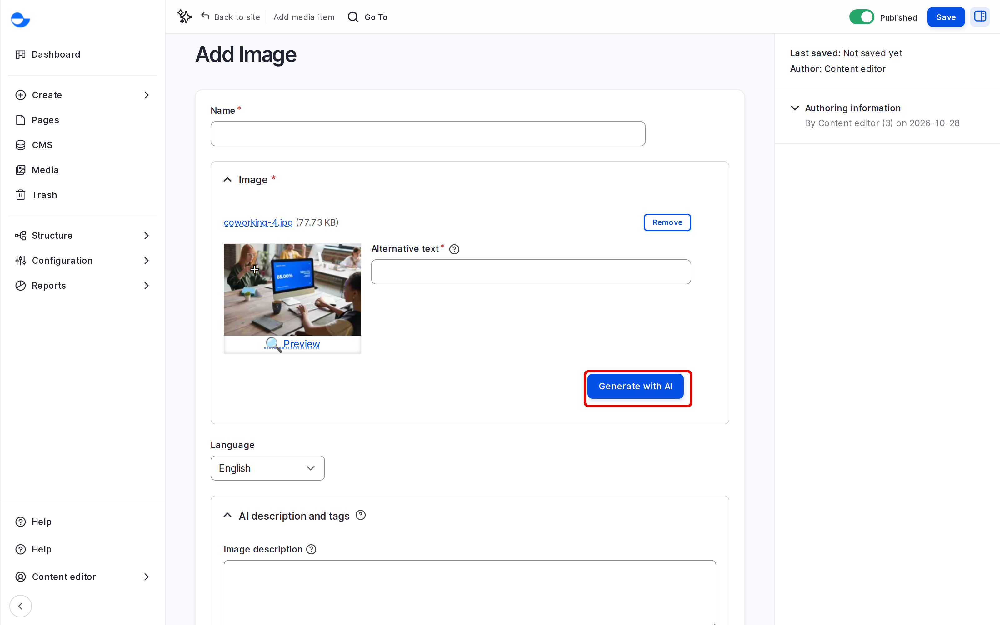

# Image

This page shows how to add an image to the **Media Library**, write its alt text and set its focal point.

## Formats

**Image** accepts PNG, GIF, JPG, JPEG and WebP. Use **SVG Image** for SVG logos and icons.

## Steps

1. Click **Media** in the **Navigation** sidebar, then **Add media** and **Image**. You can also add one from a content form. See [Uploading Media Files](./).
2. In **Image**, click to choose the file, or drag it in.
3. Fill in the fields:
   - **Name** (required): a clear name for finding the image later, such as "Team photo, office 2026".
   - **Alternative text** (required): what the image shows, for people who cannot see it. Click **Generate with AI** for a suggestion, then check and edit it.
   - **Image description**: optional caption or credit.
   - **Image tags**: optional labels from **Image Classification**, to find the image later.
4. Drag the focal point cross onto the most important part of the image.
5. Click **Save**.

<!-- <figure><figcaption>
Adding an Image
</figcaption></figure> -->

## Writing Good Alt Text

- Say what the image shows and why it is there, in one short sentence.
- Do not start with "Image of" or "Photo of"; screen readers already say it is an image.
- For a linked image, describe where the link goes.
- Always check AI suggestions: the AI does not know why you chose the image.

## Editing an Image

1. On the **Media** page, find the image and click **Edit**.
2. Change the fields, replace the file, or move the focal point.
3. Click **Save**.

The change shows everywhere the image is used.

## Tips

- Resize photos before uploading: 2000 pixels wide is enough for a full-width banner.
- Use the same shape (for example, landscape) for images shown side by side in cards.
- Choose WebP or JPG for photos, PNG for graphics with transparency.
