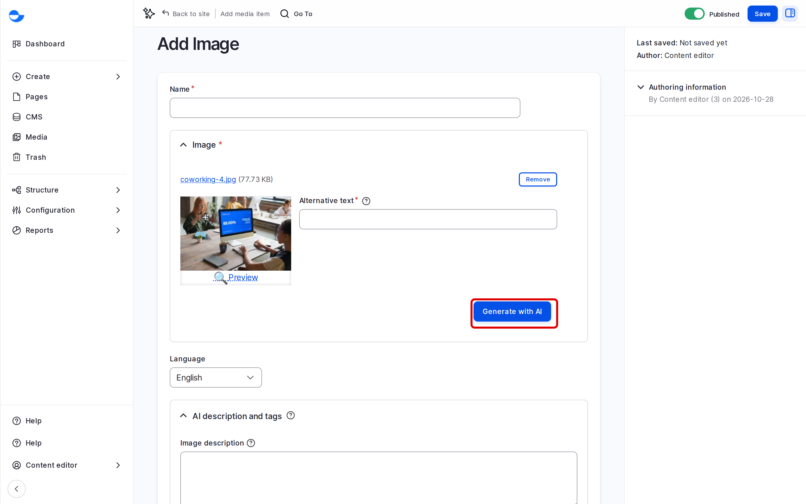

# Image

This page shows how to add an image to the **Media Library**, write its alt text and set its focal point.


Uploading an Image With a Focal Point (Video)


## Formats

**Image** accepts PNG, GIF, JPG, JPEG and WebP. Use **SVG Image** for SVG logos and icons.

## Steps

1. Click **Media** in the **Navigation** sidebar, then **Add media** and **Image**. You can also add one from a content form. See [Uploading Media Files](./).
2. In **Image**, click to choose the file, or drag it in.
3. Fill in the fields:
   - **Name** (required): a clear name for finding the image later, such as "Team photo, office 2026".
   - **Alternative text** (required): what the image shows, for people who cannot see it. Click **Generate with AI** for a suggestion, then check and edit it.
   - **Image description**: optional. Left empty, AI writes a description when you save.
   - **Image tags**: optional labels to find the image later. Left empty, AI picks up to 5 tags when you save.
4. Drag the focal point cross onto the most important part of the image. See [Set the Focal Point](set-the-focal-point.md).
5. Click **Save**.

<figure><figcaption>
Adding an Image
</figcaption></figure>

If the form asks "Transfer image and meta data to chosen AI service?", click **Yes (this time)** to show **Generate with AI**. **Image description** and **Image tags** are on the full form at `/media/add/image`; you can also fill them later by editing the image.

There is no caption field on the item: add a caption where you place the image, for example in the editor.


With **Varbase AI Safety** on, each uploaded image is checked for unsuitable content and flagged images are refused. If the form says "AI provider failed to evaluate the content", the file is likely too large for the check: resize it, for example to 2000 pixels wide, and upload it again.


## Writing Good Alt Text

- Say what the image shows and why it is there, in one short sentence.
- Do not start with "Image of" or "Photo of"; screen readers already say it is an image.
- For a linked image, describe where the link goes.
- Always check AI suggestions: the AI does not know why you chose the image.

## Editing an Image

1. On the **Media** page, find the image and click **Edit**.
2. Change the fields, replace the file, or move the focal point.
3. Click **Save**.

The change shows everywhere the image is used.

## Tips

- Resize photos before uploading: 2000 pixels wide is enough for a full-width banner.
- Use the same shape (for example, landscape) for images shown side by side in cards.
- Choose WebP or JPG for photos, PNG for graphics with transparency.
