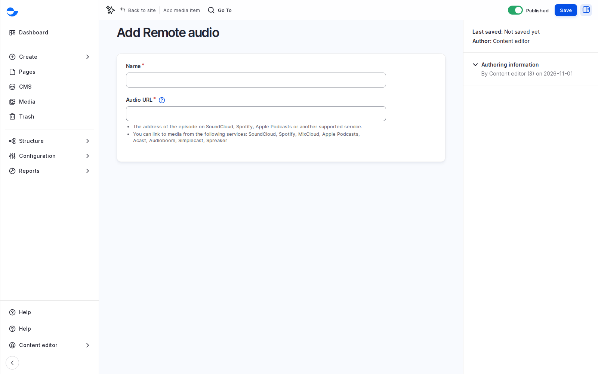

# Remote Audio

Use **Remote audio** for podcasts and tracks hosted on another service. Your site keeps only the link.

## Steps

1. Go to `/media/add/remote_audio`. The **Media** page's **Add media** list does not offer this type.
2. Paste the **Audio URL** from a supported service.
3. Fill in the **Name**.
4. Click **Save**.

<figure><figcaption>
Adding Remote Audio
</figcaption></figure>

## Supported Services

SoundCloud, Spotify, MixCloud, Apple Podcasts, Acast, Audioboom, Simplecast and Spreaker.

You can also add remote audio with **Insert Media** in an editor that uses the **Content** text format.

## Tips

- Use the address of the episode or track page, not the embed code.
- Players from outside services can collect visitor data. See [Cookie Consent](../../security-and-privacy/cookie-consent.md).
