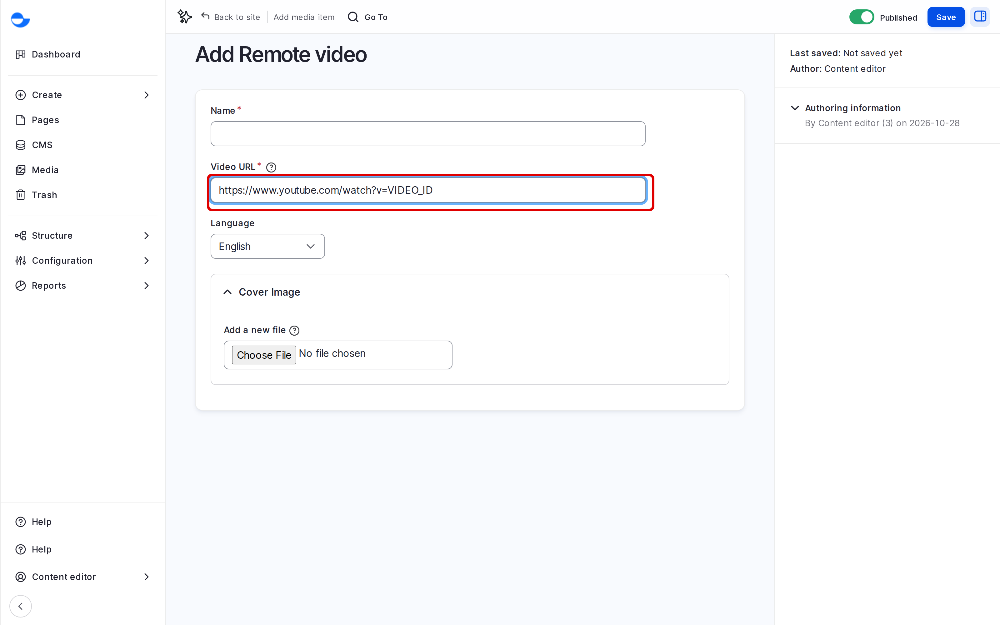

# Remote Video

A remote video plays from YouTube or Vimeo inside your page. The video stays on that service; your site keeps only the link and a cover image. This page shows how to add one.

## Steps

1. Click **Media** in the **Navigation** sidebar, then **Add media** and **Remote video**.
2. In **Video URL**, paste the address of the video, for example `https://www.youtube.com/watch?v=...` or `https://vimeo.com/...`.
3. Fill in the **Name**, or leave it to be filled from the video's title.
4. Optionally, upload a **Cover Image** to show before the video plays, and set its focal point.
5. Click **Save**.

<figure><figcaption>
Adding a Remote Video
</figcaption></figure>

## Using the Video

- In a content form, pick it with **Add media** on a media field.
- In the rich-text editor, click **Insert Media** and choose **Remote video**.


When you add the first YouTube or Vimeo video, Varbase turns on cookie consent for that service. Visitors then see a consent message before the video loads, and it plays after they accept. See [Cookie Consent](../../cookie-consent.md).


## Tips

- Copy the address from the browser's address bar on the video page, not the embed code.
- The video must be public or unlisted; private videos do not play.
- Turn on captions for the video on YouTube or Vimeo, so everyone can follow it.
