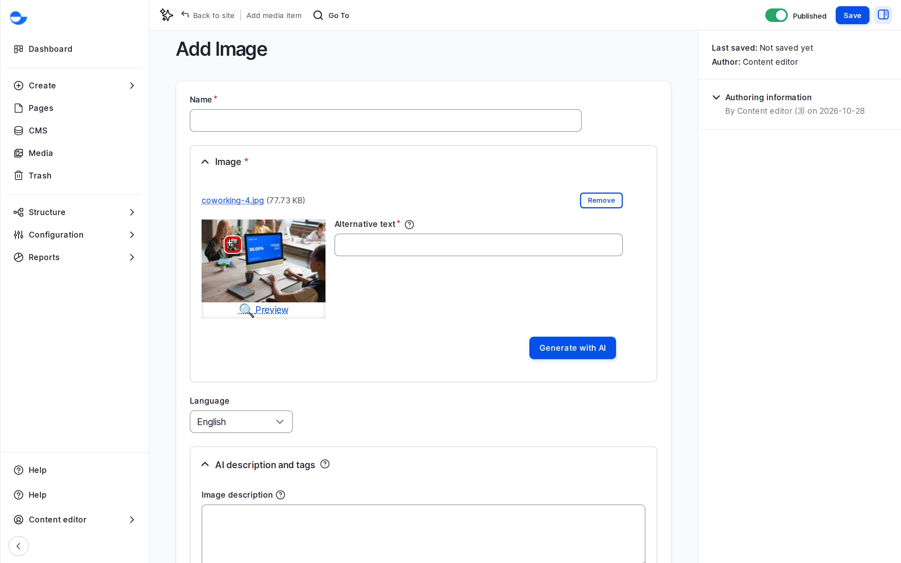

# Set the Focal Point

Images, and the cover images of videos, have a focal point: a cross on the preview that you drag to the most important part, such as a face. When the image is cropped for a card or a banner, that part stays in view.

## Steps

1. Open the image from the **Media** page and click **Edit**, or upload a new one.
2. On the preview, drag the cross onto the most important part of the image.
3. Click **Save**. Every crop of the image on the site keeps that part in view.

<figure><figcaption>
Setting the Focal Point
</figcaption></figure>

## Tips

- Check a card and a banner that use the image after saving: the crops change at once.
- The focal point solves cropping, not a wrong shape. Agree image ratios with the designer early.
- SVG images have no focal point, because they are never cropped.
