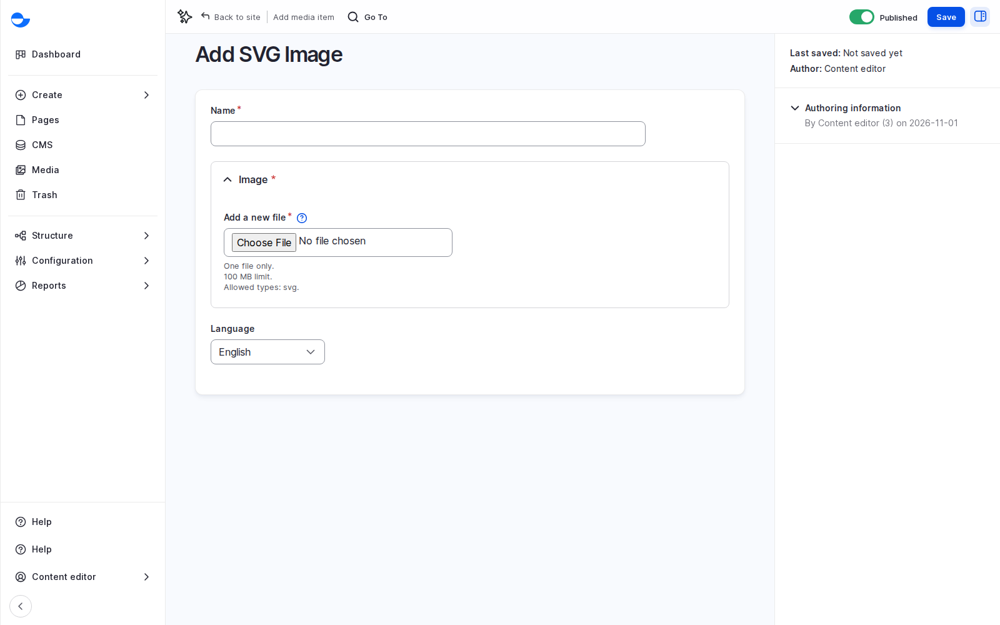

# SVG Image

Use **SVG Image** for logos and icons that must stay sharp at any size.

## Steps

1. Click **Media** in the **Navigation** sidebar, then **Add media** and **SVG Image**.
2. Upload one SVG file in **Image**.
3. Fill in the **Name** and the **Alternative text**. Both are required.
4. Click **Save**.

<figure><figcaption>
Adding an SVG Image
</figcaption></figure>

There is no focal point: SVG images are not cropped.

## Tips

- Use **Image** for photos; an SVG is for drawings made of shapes and lines.
- Write alt text that says what the logo or icon means, such as the organisation's name, not "logo".
