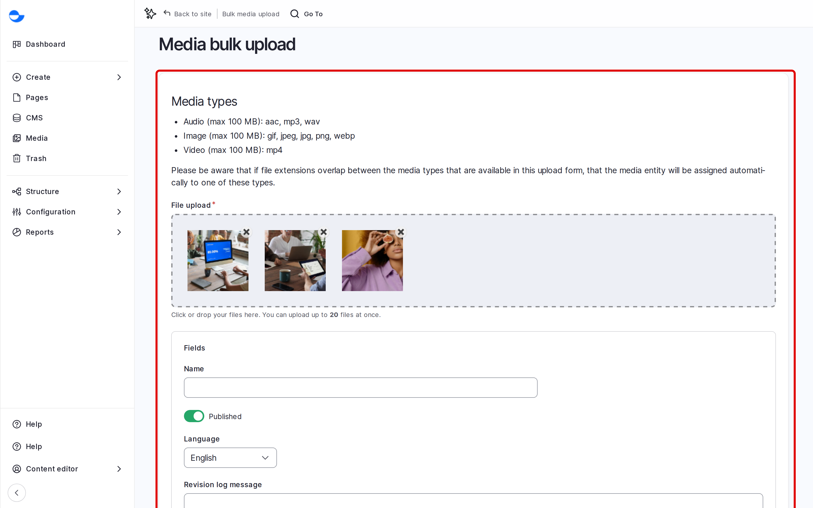

# Upload Many Files at Once

When you have a folder of photos or clips, upload them together instead of one by one. Varbase creates one media item per file.

## Steps

1. On the **Media** page, click **Upload media in bulk** (`/media/bulk-upload`).
2. Drag your files into the upload area, or click it to choose them. Up to 20 images, videos and audio files can be mixed.
3. Wait for each file to finish, then fill in the shared fields.
4. Click **Save**.

<figure><figcaption>
Uploading Several Files at Once
</figcaption></figure>

Each item is named after its file. Open each image afterwards to give it a descriptive name and its alt text, or generate the alt text for all of them. See [Generate Alt Text for Many Images](../generate-alt-text-for-many-images.md).

## Tips

- Rename files before uploading (`team-workshop-2026.jpg`, not `IMG_0042.jpg`); the name carries over.
- Bulk upload takes **Audio**, **Image** and **Video** only. Add documents and SVG images one at a time.
