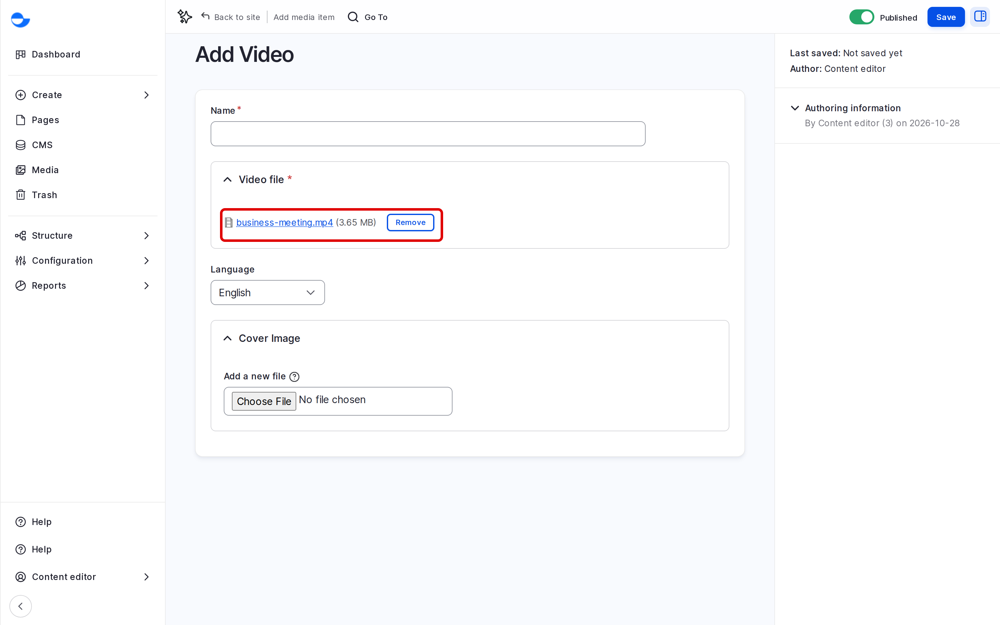

# Video

A video file is stored on your own site and played by the browser's video player. This page shows how to upload one and when to prefer a remote video instead.

## Format

**Video** accepts MP4 files.

## Steps

1. Click **Media** in the **Navigation** sidebar, then **Add media** and **Video**.
2. In **Video file**, choose the file and wait for the upload to finish.
3. Fill in the **Name**.
4. Optionally, upload a **Cover Image** to show before the video plays.
5. Click **Save**.

<figure><figcaption>
Adding a Video File
</figcaption></figure>

## Video File or Remote Video?

| | Video file | Remote video (YouTube, Vimeo) |
|---|---|---|
| **Stored** | On your site | On the video service |
| **Size limit** | Your site's upload limit | None on your site |
| **Player** | The browser's player | The service's player, with captions and quality options |
| **Cookies** | None from a video service | The service sets cookies, so visitors are asked for consent |

Use a remote video for long or popular videos. Use a video file for short clips, such as a looping background, or when the video cannot be on a public service.

## Tips

- Compress the video before uploading; most short web clips fit in a few megabytes.
- Add captions or a written summary next to the video for people who cannot hear it.
