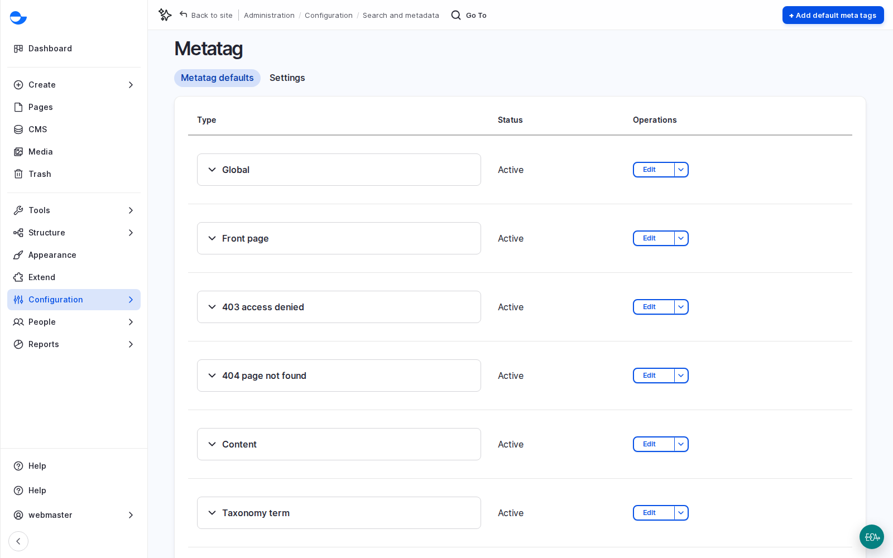
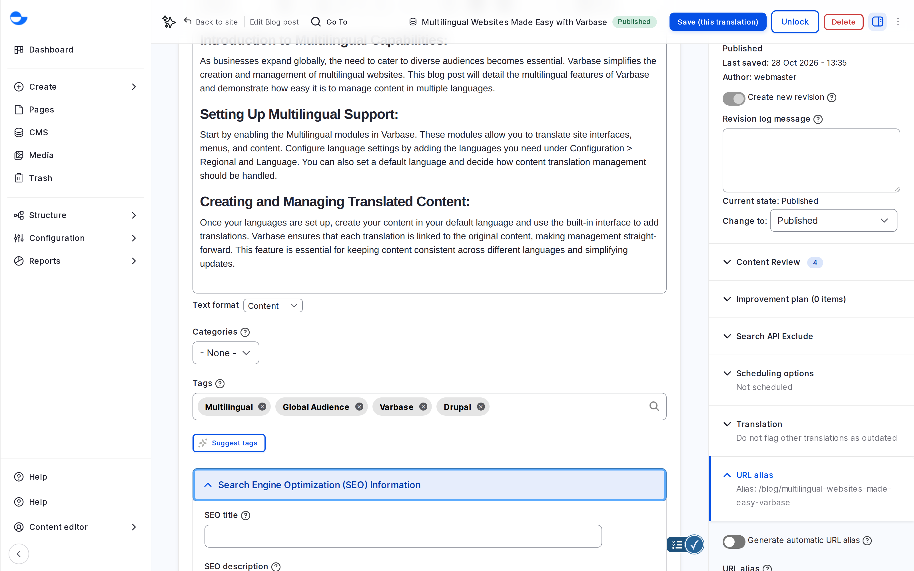
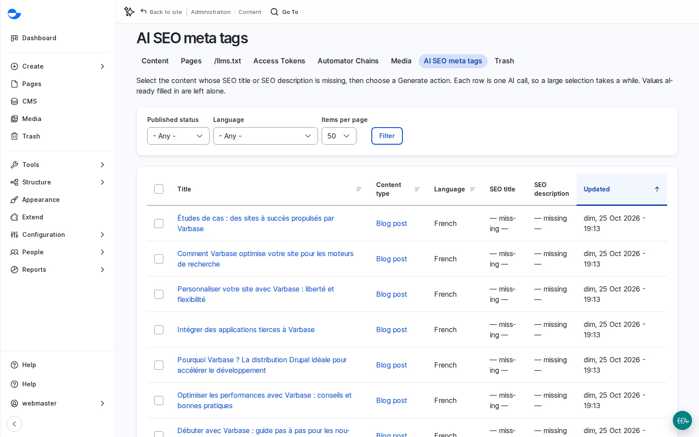
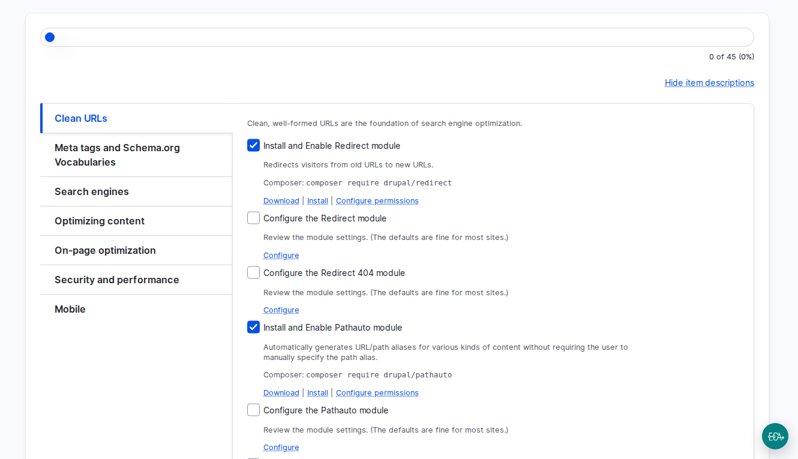

# Search Engines and AI Readiness

Search engine optimisation (SEO) helps people find your site in search results, and more people now also ask AI assistants, which read websites to answer questions. Varbase sets most SEO details for you, from page titles and descriptions to a sitemap and readable addresses, gives you fields and checks to improve each page, and adds the files AI tools look for. This section shows how.

<!-- TODO(lesson-12-video): when the unlisted upload exists, replace the hint block below with an embed block for its https://youtu.be/ link, captioned "Lesson 12: Search Engines and AI Readiness (Video)". -->

**Lesson 12 video: coming soon.** It will appear here and in the [Varbase: Content Designers playlist](https://www.youtube.com/playlist?list=PLRf-g9-Bc-LI).


## Why It Matters

- Clean titles, descriptions and structured data from launch day, without per-page effort.
- One set of fields serves search results and social media previews.
- AI assistants can read a clear summary of the site and the text of each post, so the site is more likely to be represented accurately.

## What Varbase Does for You

- **Page titles and descriptions** for search results and social sharing, built from your content. See [Meta Tags](meta-tags.md).
- **An XML sitemap** that lists your content for search engines. See [XML Sitemap](xml-sitemap.md).
- **Readable addresses** and redirects for moved pages. See [URL Management](../url-management/).
- **Language versions**: each page tells search engines about its translations.
- **Canonical addresses**, so a page reachable in two ways has one official address.
- **Social previews** (title, description and image when a link is shared).
- **Structured data** for articles, web pages and the website, which search engines use for richer results.
- **Site-wide defaults** for every page, the front page, error pages, content and taxonomy terms, using placeholders such as the title followed by the site name. Editors override them only when a page needs it.
- **An SEO checklist** that ticks off what Varbase already did and lists the launch tasks.
- **Files for AI tools**: `/llms.txt` and a Markdown version of each post. See [llms.txt and Markdown for AI Tools](llms-txt.md).

<figure><figcaption>
Meta Tag Defaults by Type
</figcaption></figure>

## What You Do on Each Blog Post

Open **Search Engine Optimization (SEO) Information** in the blog post form:

| Field | What it is for |
| --- | --- |
| **SEO title** | The title in search results, if it should differ from the post title. |
| **SEO description** | The summary under the title in search results. If empty, the **Description** is used. |
| **SEO image** | The picture shown when the post is shared on social media. If empty, the **Featured image** is used. |
| **SEO analysis** | A live check of the post against a focus keyword. See [SEO Analysis With Yoast SEO](seo-analysis-yoast.md). |

<figure><figcaption>
The SEO Fields of a Blog Post
</figcaption></figure>

Utility pages use their **Title** and **Description**. Drupal Canvas pages use the **Title**, **Meta description** and **Image** in **Page data**.

## Scenario: Write a Search Result That Gets the Right Clicks

1. Open a post and the **Search Engine Optimization (SEO) Information** group.
2. Enter a focus keyword in **SEO analysis**, the phrase people are likely to search for, and read the checks as you write.
3. Adjust **SEO title** and **SEO description** until the preview reads well. Treat the description as an advert for the page: "Three steps to prepare your website for launch, with a checklist you can use today" beats "Learn more about our services and solutions".
4. Save as usual.

## Scenario: Fill Missing Descriptions With AI

With the AI recipes, saving a post or utility page with empty SEO fields lets AI write a title and description from the content. An editor's own wording is never replaced. For older content:

1. Go to **Content** \ _**AI SEO meta tags**_. It lists content whose SEO title or description is missing.
2. Filter, select the items, choose the generate action and apply it. Each row is one AI call, so a large selection takes a while.
3. Review a sample in each language: accurate, on brand, promising nothing the page does not say.

<figure><figcaption>
Content Missing an SEO Title or Description
</figcaption></figure>

## Search Exclude Is Not Robots

**Search API Exclude** on the content form keeps an item out of the site's own search, such as a thank-you page. It does not hide it from outside search engines; that is a robots setting in the item's meta tags. Each item can also be left out of the sitemap from its form.

## The SEO Checklist

Go to **Configuration** \ **Search and metadata** \ _**SEO checklist**_. It lists 45 tasks, ticks those Varbase already did (clean addresses, meta tags, sitemap) and leaves the launch tasks: submitting the sitemap, analytics, the robots file. Save the form to record its progress.

<figure><figcaption>
The SEO Checklist
</figcaption></figure>

## Launch Checklist

1. Meta tag defaults reviewed, with the site name and slogan filled in.
2. SEO fields filled on key pages, by editors or by AI with a review.
3. Sitemap generated, its address added to the robots file (not there by default), and submitted to Google Search Console and Bing Webmaster Tools, in accounts the client owns. Verification codes go in the meta tag settings.
4. Redirects from the old site in place.
5. Analytics and consent agreed. Analytics is an optional recipe; the consent services for it exist but are off until switched on.
6. A decision on AI crawlers: welcome them, or ask some to stay away in the robots file.

## Who Manages SEO

Every editorial role can fill in the SEO fields of the content it edits. The **SEO Admin** role also manages the site-wide meta tag defaults, the sitemap, aliases and redirects.

## Questions Clients Ask

- **Does llms.txt improve rankings?** Do not promise that. It makes the site easier for AI tools to read; effects on AI search visibility are not measured.
- **Are Drupal Canvas pages in the sitemap?** Not on Varbase 11.0: the sitemap lists published blog posts and utility pages in every language. Plan how landing pages reach search engines.

## Planning Notes

- Agree title and description patterns per content type before content entry.
- After launch, a monthly routine for the **SEO Admin**: search engine accounts, **Fix 404 pages**, top search phrases, and a few key pages improved.
- Speed, phone use and accessibility count for search too; oversized images and missing alt text undo the platform's work.

## Tips

- Write the SEO description for people: one or two sentences, under about 160 characters, saying what they will find.
- Use headings in order and give every image alt text; both help search engines as much as people.
- Link related posts to each other.

## In This Section

- [XML Sitemap](xml-sitemap.md)
- [Meta Tags](meta-tags.md)
- [SEO Analysis With Yoast SEO](seo-analysis-yoast.md)
- [llms.txt and Markdown for AI Tools](llms-txt.md)


**Check Yourself**

1. What happens to a post's search result title if the editor leaves the SEO title empty?
2. What small launch task did the course find in the demo site's robots file?
3. What does adding `.md` to a post's address give an AI tool?

