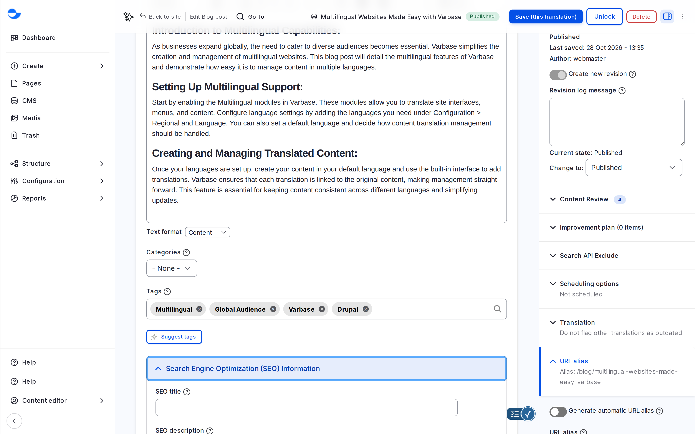

# SEO Management

Search engine optimisation (SEO) helps people find your site in search results. Varbase sets most SEO details for you, from page titles and descriptions to a sitemap and readable addresses, and gives you fields and checks to improve each page. This section shows how.

## What Varbase Does for You

- **Page titles and descriptions** for search results and social sharing, built from your content. See [Meta Tags](meta-tags.md).
- **An XML sitemap** that lists your content for search engines. See [XML Sitemap](xml-sitemap.md).
- **Readable addresses** and redirects for moved pages. See [URL Management](../url-management/).
- **Language versions**: each page tells search engines about its translations.

## What You Do on Each Blog Post

Open **Search Engine Optimization (SEO) Information** in the blog post form:

| Field | What it is for |
| --- | --- |
| **SEO title** | The title in search results, if it should differ from the post title. |
| **SEO description** | The summary under the title in search results. If empty, the **Description** is used. |
| **SEO image** | The picture shown when the post is shared on social media. If empty, the **Featured image** is used. |
| **SEO analysis** | A live check of the post against a focus keyword. See [SEO Analysis With Yoast SEO](seo-analysis-yoast.md). |

<!-- <figure><figcaption>
The SEO Fields of a Blog Post
</figcaption></figure> -->

Utility pages use their **Title** and **Description**. Drupal Canvas pages use the **Title**, **Meta description** and **Image** in **Page data**.

## Who Manages SEO

Every editorial role can fill in the SEO fields of the content it edits. The **SEO Admin** role also manages the site-wide meta tag defaults, the sitemap, aliases and redirects.

## Tips

- Write the SEO description for people: one or two sentences, under about 160 characters, saying what they will find.
- Use headings in order and give every image alt text; both help search engines as much as people.
- Link related posts to each other.

## In This Section

- [XML Sitemap](xml-sitemap.md)
- [Meta Tags](meta-tags.md)
- [SEO Analysis With Yoast SEO](seo-analysis-yoast.md)
