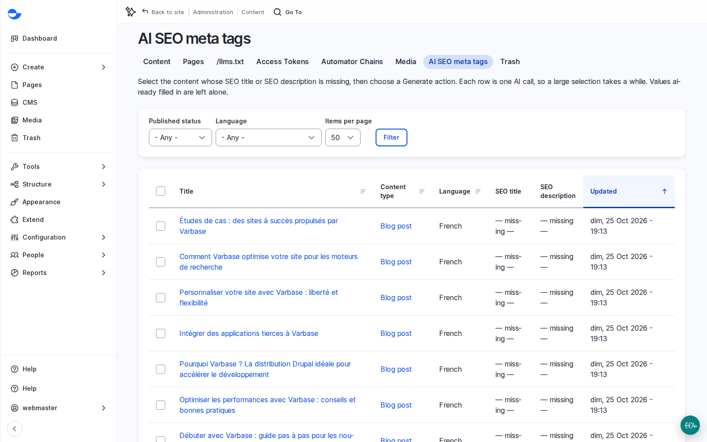

# Fill Missing Descriptions With AI

With the **Varbase AI SEO** recipe, saving a blog post or utility page with empty SEO fields lets AI write a title and description from the content (the **Generate SEO meta tags** automation). An editor's own wording is never replaced. For content that was saved before, run the AI over the gaps in bulk.

## Steps

1. Go to **Content** \ _**AI SEO meta tags**_ (`/admin/content/ai-seo-metatags`). It lists blog posts and utility pages in every language, with their **SEO title** and **SEO description** columns; the empty cells are the gaps.
2. Choose a **Language**, for example English, click **Filter**, and tick the items with empty fields.
3. In **Action**, choose **AI: SEO title and description (guarded)** and click **Apply to selected items**, then **Execute action** if it asks. Each row is one AI call, so a large selection takes a while. The two columns fill in when it is done.
4. Review a sample in each language: accurate, on brand, promising nothing the page does not say. Most corrections belong in the site's brand and editorial context, not in each post.

<figure><figcaption>
Content Missing an SEO Title or Description
</figcaption></figure>

## Planning Notes

- Bulk runs cost AI credits. Run a small batch first, and plan the review time with the client.
- Agree title and description patterns per content type before content entry, so the AI and editors follow the same rules.
