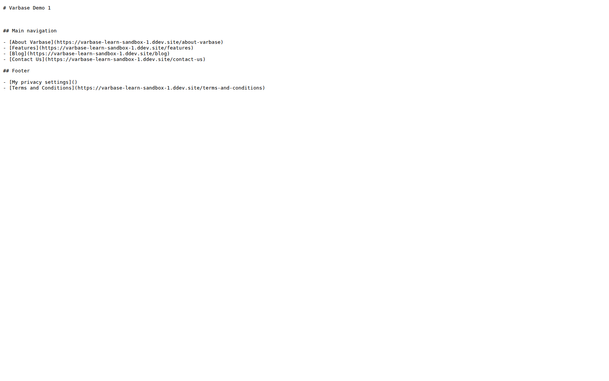
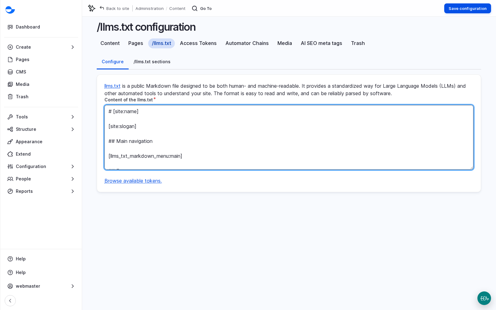

# llms.txt and Markdown for AI Tools

AI assistants read websites to answer questions, and they prefer clean, well-structured text over pages full of layout. With the **Varbase AI Readable Base** recipe, a Varbase site offers two things to them: a short map of the site at `/llms.txt`, and a plain-text version of each post.

## The llms.txt File

`/llms.txt` is a short Markdown file for AI tools: the site's name, a short description, and the main sections with their links. On a Varbase Starter site it is built from the **Main navigation** and **Footer** menus, so it stays up to date as menus change.

<figure><figcaption>
The llms.txt File Served by the Site
</figcaption></figure>

### Editing It

1. Go to **Content** \ _**/llms.txt**_.
2. Edit **Content of the llms.txt**. It uses placeholders, such as the site name and slogan and the menus. **Browse available tokens** lists them.
3. Add a short paragraph about the organisation or links to key documents if useful. Keep it short and factual: it is a signpost, not a brochure.
4. Click **Save configuration**.

<figure><figcaption>
Editing the llms.txt Content
</figcaption></figure>

If the site slogan is empty, the line it fills stays empty: fill **Slogan** in the site settings before launch. The **SEO Admin** and **Site Admin** roles can edit the file.

## Markdown Versions of Posts

Add `.md` to a post's address, such as `/blog/my-post.md`, to see its text without menus, scripts and layout. The normal page tells AI tools that this version exists. Taxonomy terms have one too.

Drupal Canvas pages and listing pages have no Markdown version yet. They appear in `/llms.txt` as links, so AI tools can still find them.

## Content That AI Reads Well

The tools help, but the content matters most: clear headings, short paragraphs, plain words, and key facts (dates, names, prices, places) written as text, not inside images. The habits from [Creating Content](../content-management/) serve search engines, AI tools and people equally.

## Tips

- Decide with the client whether they welcome AI tools reading their content. Most organisations that publish public information do; some publishers ask certain AI crawlers to stay away in the robots file.
- The AI Readable Base recipe is alpha. The `/llms.txt` address needs a small exception in the site settings on some servers; add it to the deployment checklist.
- See [Varbase AI Readable Base](../../developers/understanding-varbase/varbase-ai-recipes/varbase-ai-readable-base.md) for developers.
