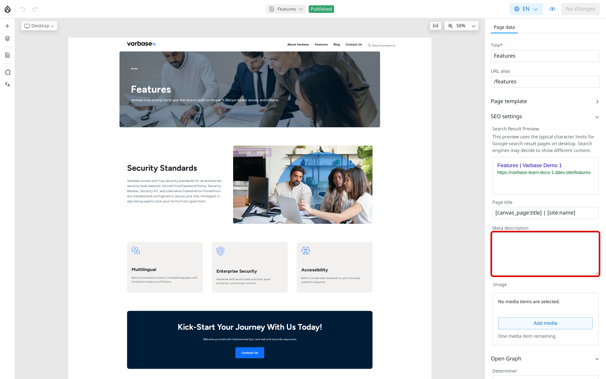
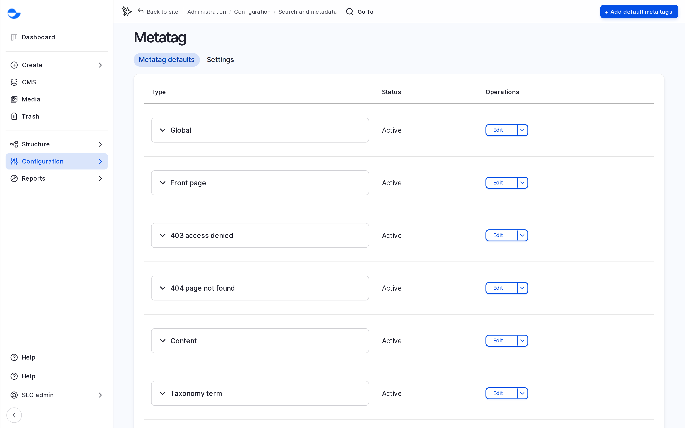

# Meta Tags

Meta tags are details in a page's code that search engines and social networks read: the title and description in search results, and the title, description and picture in a shared link. Varbase fills them in from your content. This page explains where they come from and how to change them.

## Where the Values Come From

For **Blog post** and **Utility page**:

| Meta tag | Value |
| --- | --- |
| Page title | The **SEO title**, or else the title, followed by the site name |
| Description | The **SEO description**, or else the **Description** |
| Social sharing title (Open Graph) | The **SEO title**, or else the title |
| Social sharing image (Open Graph) | The **SEO image**, or else the **Featured image** |

So the usual way to change a post's meta tags is to fill in its SEO fields. See [SEO Management](./).

For **Drupal Canvas pages**, the **Meta description** and **Image** in **Page data** are used, and the **Metatags** section there sets any other tag for that page.

<figure><figcaption>
Meta Tags of a Drupal Canvas Page
</figcaption></figure>

## Site-Wide Defaults

An **SEO Admin** sets the defaults at **Configuration** \ **Search and metadata** \ _**Metatag**_ (`/admin/config/search/metatag`). There is one set for each kind of page: **Global**, **Front page**, **Content**, **Taxonomy term**, **User**, and the error pages.

<figure><figcaption>
The Meta Tag Defaults
</figcaption></figure>

The values use tokens, placeholders such as `[node:title]` that are replaced by each page's own value. Change a default only if every page of that kind should change.

## Tips

- Check how a page looks when shared by pasting its address into the sharing preview of the social network you use most.
- Use an SEO image that reads well when cropped to a wide rectangle.
- Keep titles under about 60 characters, so they are not cut off in search results.
