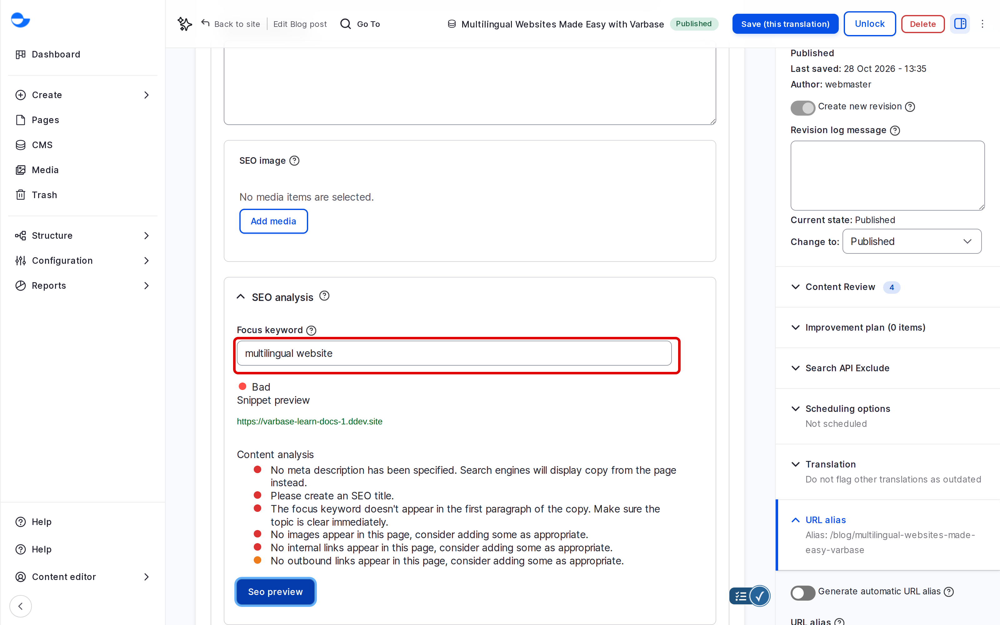

# SEO Analysis With Yoast SEO

The **SEO analysis** on a blog post checks your text against a focus keyword, the main phrase people would search for, and tells you what to improve. It also shows a preview of how the post looks in search results. This page shows how to use it.

## Using the Analysis

1. Edit a blog post and open **Search Engine Optimization (SEO) Information**.
2. In **Focus keyword**, type the phrase the post is about, for example `multilingual website`.
3. Click **Seo preview** to run the check with your latest text.
4. Read the results and the search preview, change the post, and click **Seo preview** again.

<!-- <figure><figcaption>
The SEO Analysis of a Blog Post
</figcaption></figure> -->

## Reading the Results

- **Real-time SEO status** gives an overall rating: **Good**, **Okay** or **Bad**.
- Each check is marked as good, needing improvement or a problem, with a short reason, for example that the keyword is missing from the first paragraph or the text is too short.
- The preview shows the title, address and description as a search engine may show them.

The SEO status is saved with the post, so you can come back to it.

## What to Act On

- Put the focus keyword in the **SEO title**, the first paragraph and one heading.
- Write an **SEO description** that includes the keyword and invites the click.
- Add internal links to related posts.
- Use a keyword once or twice naturally; a high keyword count reads badly and does not help.

## Where It Is Available

The analysis is on **Blog post** only. The **Content editor**, **Content Admin**, **SEO Admin** and **Site Admin** roles can use it.

## Tips

- Treat the ratings as advice, not rules: a clear post for people beats a perfect score.
- Choose a different focus keyword for each post, so your posts do not compete with each other in search.
