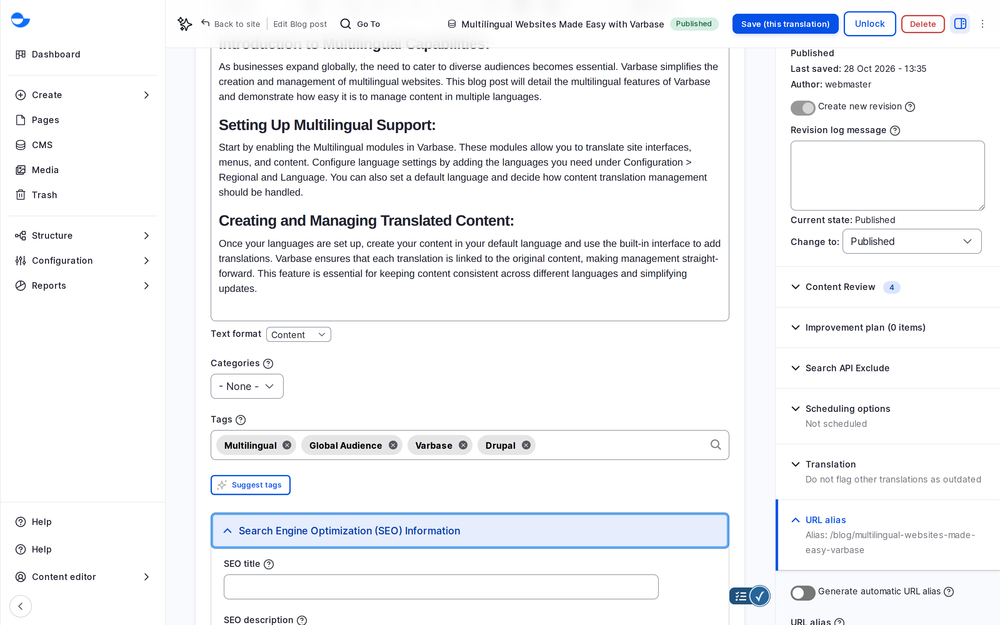

# Write a Search Result That Gets the Right Clicks

The title and description under it are all most people see of your page in a search result. Write them as a short advert for the page, and check them against the phrase people are likely to search for.

## Steps

1. Open a blog post and the **Search Engine Optimization (SEO) Information** group.
2. Enter a focus keyword in **SEO analysis**, the phrase people are likely to search for, and read the checks as you write.
3. Adjust **SEO title** and **SEO description** until the preview reads well. Treat the description as an advert for the page: "Three steps to prepare your website for launch, with a checklist you can use today" beats "Learn more about our services and solutions".
4. Save as usual.

<figure><figcaption>
The SEO Fields of a Blog Post
</figcaption></figure>

On a Drupal Canvas page, write the **Title** and **Meta description** in **Page data** instead.

## Tips

- Keep the description to one or two sentences, under about 160 characters, saying what people will find.
- Write for people first. A description stuffed with keywords gets fewer clicks.

See [SEO Analysis With Yoast SEO](seo-analysis-yoast.md) for each check.
