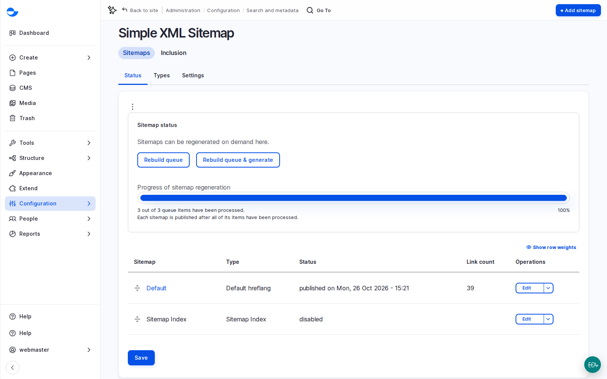
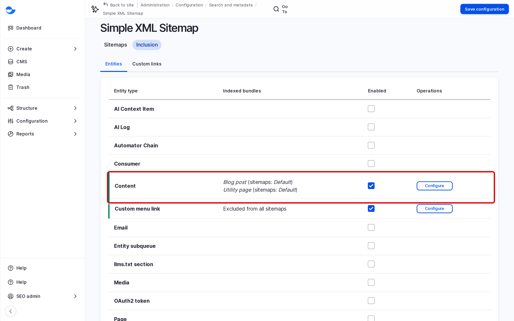

# XML Sitemap

An XML sitemap is a list of your site's pages written for search engines, at `/sitemap.xml`. It helps them find new and changed content quickly. Varbase builds and updates it for you; this page explains what is in it and how an SEO Admin manages it.

## What Is in the Sitemap

On a new Varbase site the sitemap includes:

- **Blog posts** and **Utility pages**, in every language.
- Taxonomy terms and menu links, when they are turned on for the sitemap.

It is rebuilt automatically when the site's scheduled tasks (cron) run, so a new post appears in it soon after you publish it. Open `/sitemap.xml` to see it.


Drupal Canvas pages are not in the sitemap on a new Varbase site. Ask your **SEO Admin** to add **Pages** under **Inclusion** if your landing pages should be listed.


## Leaving One Item Out

An **SEO Admin** can keep a single blog post or utility page out of the sitemap:

1. Edit the item and open **Simple XML Sitemap** in the sidebar.
2. Choose **Do not index this Blog post entity in sitemap** (the wording names the content type). **Priority** sets how important the item is compared with the rest of the site.
3. Save.

## Managing the Sitemap

An **SEO Admin** manages it at **Configuration** \ **Search and metadata** \ _**Simple XML Sitemap**_ (`/admin/config/search/simplesitemap`):

- **Inclusion**: which kinds of content are listed, with their priority and change frequency.
- **Custom links**: extra addresses to list.
- **Rebuild queue & generate**: rebuild the sitemap now instead of waiting for cron.

The page has the tabs **Sitemaps**, **Inclusion**, **Status**, **Types** and **Settings**.

The **Sitemaps** tab shows each sitemap with its status and **Link count**. Use the count as a quick check: with three languages, every blog post or utility page adds three links.

<figure><figcaption>
The Sitemap Status and Link Count
</figcaption></figure>

<figure><figcaption>
Choosing What the Sitemap Lists
</figcaption></figure>

## Submitting the Sitemap

Give the address `https://example.com/sitemap.xml` to Google Search Console and Bing Webmaster Tools once. They read it again by themselves after that. These accounts belong to the client, not to the agency; make sure the client's team has access before launch. Both ask you to prove you own the site; the verification codes go in the meta tag settings. See [Meta Tags](meta-tags.md).


On a new Varbase site, `/robots.txt` does not mention the sitemap: there is no `Sitemap:` line. Ask your development team to add `Sitemap: https://example.com/sitemap.xml` (with your own domain) before launch. The **SEO checklist** lists it as **Verify your XML Sitemap is in your robots.txt file**.


## Tips

- Leave out pages that are not useful from search, such as thank-you pages after a form.
- After a large content change, use **Rebuild queue & generate** so search engines see it sooner.
